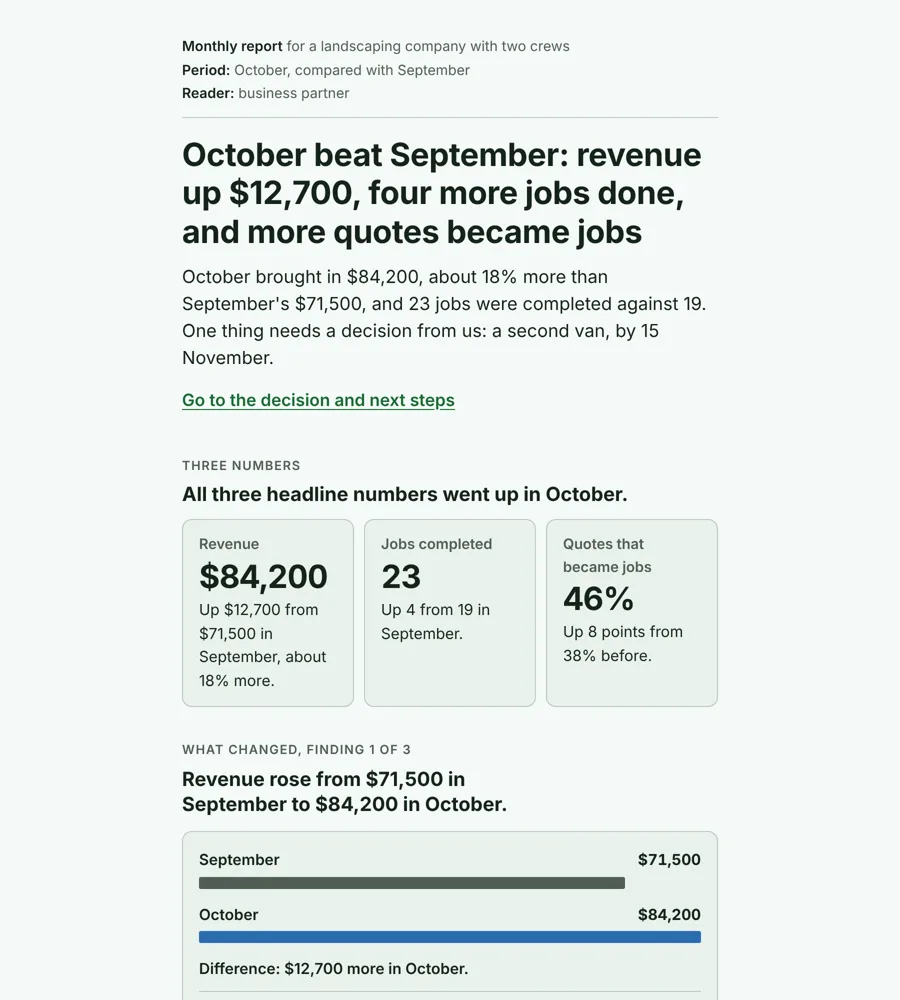

# Practical AI: AI tools for the work you repeat

  

**Practical AI is a free set of tools that save time on work you already do, without lowering the
quality.** Each tool does one job. It is one file you paste into the chatbot you already use
(ChatGPT, Claude, Gemini, Microsoft Copilot and others), a short guide, and a worked example. The
AI drafts. You check the result and make the call.

  <a href="#make-your-first-report-artifact-studio"><b>Make your first report</b></a> &nbsp;·&nbsp;
  <a href="#build-a-tool-agentic-process"><b>Build a tool</b></a> &nbsp;·&nbsp;
  <a href="#the-jobs-you-repeat">The jobs it helps with</a> &nbsp;·&nbsp;
  <a href="#created-by-bradley-ross">Who made this</a>

## What you get

- **Time back.** A first draft of a report, a deck or a brief in minutes, not hours. The times on
  these pages are estimates.
- **Results you can check.** Tools quote their sources, label estimates and flag what is missing
  instead of guessing.
- **You stay in charge.** Nothing is sent, posted, paid or published without a person.
- **No lock-in.** The same file works in any chatbot, and installs as a skill where skills are
  supported.

Think of AI as a smart intern: it has read everything and has never met you. Each tool hands it
what it needs for one job.

## Choose a project

Two projects are ready. Pick the one that matches what you want to do today.

### Make your first report: Artifact Studio

**For someone with rough notes and something to share.** Paste one prompt into the chatbot you
already use and get a one-page report your reader can take in on a phone. Then the same notes as a
slide deck, a social post or a page that opens with your photo.

  

An AI chatbot made this page from eight lines of invented notes, in one try, unedited.

<a href="projects/artifact-studio/#try-it-make-your-first-report-in-5-minutes"><b>Make your first report in 5 minutes</b></a>

### Build a tool: Agentic Process

**For someone who builds tools or workflows with a coding agent** such as Claude Code or Codex.
Paste one build request with a job you repeat. You get back a small package another person can
start in five minutes: a README, one `SKILL.md` that works in any chatbot, and a worked example,
tested in a fresh session before you get it.

  

**In one blind pilot, a tool built with Agentic Process scored 93/100. The direct-build version
scored 73/100 on the same brief.** Both found all nine key items in an unseen supplier notice; the
Agentic Process version also put the missing date and form at the top, said who to ask, and needed
no corrections before acting. One build task, one notice, one blind reviewer:
[the evidence](projects/agentic-process/quality-results/README.md).

<a href="projects/agentic-process/#try-it-build-a-tool-in-about-10-minutes"><b>Build your first tool in about 10 minutes</b></a>

### Not sure?

| You are | Go to |
| --- | --- |
| **New to AI, on a phone or a laptop** | [Make your first report](projects/artifact-studio/#try-it-make-your-first-report-in-5-minutes) |
| **Using a chatbot every day** | Artifact Studio's [one-time setup](projects/artifact-studio/#advanced-setup-use-it-every-day) |
| **Building with a coding agent** | [Build a tool](projects/agentic-process/#try-it-build-a-tool-in-about-10-minutes) |
| **An AI agent** | [`AGENTS.md`](AGENTS.md) |

Some pages here are HTML files. GitHub shows an HTML file as code, so download it and open it in a
browser to see the page. The times are estimates.

## The jobs you repeat

  

| Job you repeat | The AI does | You do |
| --- | --- | --- |
| **A slide deck, report or mini website from your notes** Weekly. Ready now | The design, the layout, the first draft | Check the numbers, decide what to cut |
| **Sort the inbox and draft replies** Daily. Drafted | Reads, sorts, drafts | Approve and send |
| **Meeting notes to actions** Daily. Planned | Pulls decisions, owners and dates | Confirm names and dates |
| **Posts for the week from one piece** Weekly. Previews ready now | Drafts in your voice, shown as they will look in the feed | Choose, edit and post |
| **Research brief with checked sources** Weekly. Partly drafted | Finds, reads, links every claim | Open the links, judge the answer |
| **Receipts and invoices into a sheet** Monthly. Planned | Reads each receipt and fills the form | Check each line against the photo |

These are the jobs people most often use AI for, from usage studies and small-business surveys
read in November 2026. What gets built next is in [the priority list](docs/README.md#what-comes-next), and every project
idea is in [the plans](workshop/plans/README.md).

## How each tool is built

**Reuse first:** use what already does the job, add a thin layer for your rules, and build only
what is missing. **One file per tool:** a README, one `SKILL.md` in the open Agent Skills format,
and a worked example. [Agentic Process](projects/agentic-process/) builds them and tests each one
in a fresh session before handing it back.

## Three levels: how much is set up and automated

  

| Level | What you get |
| --- | --- |
| **Beginner** (Level 1, always) | Standalone in any chatbot: paste the file or share the link, add your context, get the result |
| **Advanced** (Level 2) | Saved as a skill or project, started whenever needed |
| **Expert** (Level 3) | Connected through MCP, endpoints or a trigger that supply inputs and take outputs. A person approves exceptions |

Not every tool has all three: a level is added only when it removes setup or recurring work. The
levels describe setup, not people. Start at Beginner. It is the whole tool.

## What comes next

[The priority list](docs/README.md#what-comes-next): the next tools in order, each with what it
will do for you. Every idea, sorted into everyday tasks, agent tools and hybrid projects, is in
[the plans](workshop/plans/README.md).

## Created by Bradley Ross

**Bradley Ross** is an agentic AI architect and developer for businesses of every size, from
start-up to enterprise.

- **Specialty:** deterministic AI, and advanced AI research into AI with learning transfer abilities.
- **Harvard CS50:** 10 terms as a Teaching Fellow.
- **Agentics Foundation:** Director, working with and sharing teaching with the top agentic
  engineers in the world.
- **Practical AI training:** 12 courses, over 40 cohorts and more than 900 students.

These tools come out of that teaching: what people ask for most, in the form that worked in the
room.

**More information, training or feedback:** [linkedin.com/in/bradaross](https://www.linkedin.com/in/bradaross/)

How the repository is organised, and the ground rules

| Folder | What it holds |
| --- | --- |
| [`projects/`](projects/) | The two projects: Artifact Studio and Agentic Process |
| [`docs/`](docs/) | A summary of both projects, the priority list, and an explainer page for each |
| [`assets/images/`](assets/images/) | Images shared across the repository |
| [`workshop/`](workshop/) | How tools get built: plans, earlier drafts, skills and checking scripts. You do not need it to use a tool |

Inside every project, `base/` is enough to try the tool. Beside it, `level-2-files/` and
`level-3-files/` hold the saved and the connected versions. Each project keeps its own images, so
a project folder still works when copied on its own.

- Reuse what already exists before building anything new.
- A person approves anything that posts, sends, pays or publishes.
- Examples use invented data and say so. No real names, companies or client material.
- Every status line says who has and has not tried the thing. "Built" is not "used".

`python3 workshop/tools/check_links.py .` and `python3 workshop/tools/check_project.py projects/<name>`
check the links and each project's layout.

Free to use, change and share under Apache-2.0.
