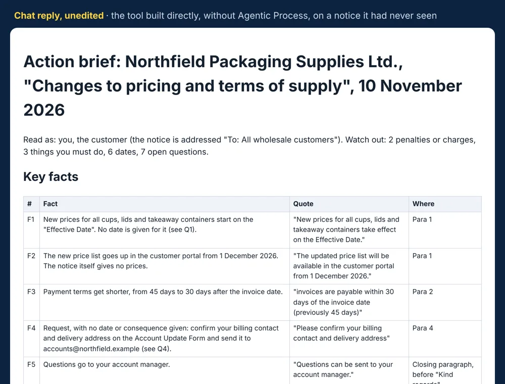
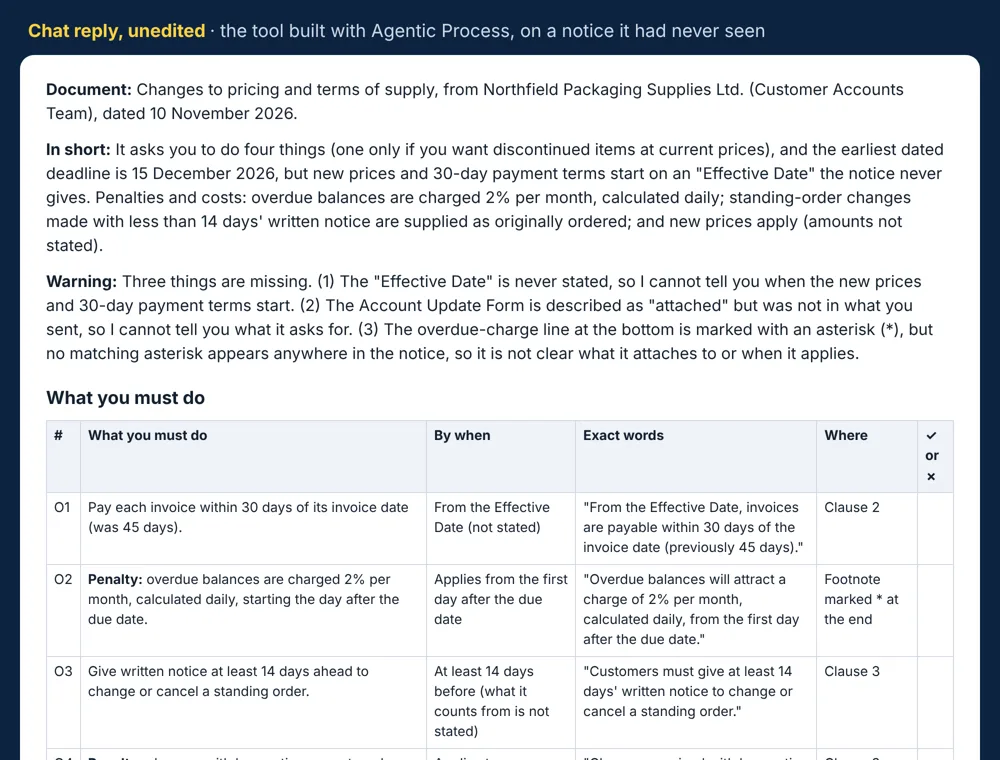

# Practical AI: better work from the AI you already use

  

<h3 align="center">Your AI is a smart intern. Practical AI gives it a proven way to do the work.</h3>

<b>Better results on the jobs you repeat, every time, and faster.</b> 
Practical use cases for the AI you already have. The AI drafts. You check and decide.

  <a href="#artifact-studio-professional-design-for-the-reports-your-ai-already-makes"><b>Artifact Studio</b></a> &nbsp;·&nbsp;
  <a href="#agentic-process-a-mini-harness-for-work-that-is-not-code"><b>Agentic Process</b></a> &nbsp;·&nbsp;
  <a href="#the-jobs-you-repeat">The jobs it helps with</a> &nbsp;·&nbsp;
  <a href="#created-by-bradley-ross">Who made this</a>

## What Practical AI is

Each project takes one specific, practical job and gives you a better way to do it with the AI you
already have. It does not replace Claude's or ChatGPT's own features, plugins or skills. It points
you to the right ones and adds what they are missing: the design, the structure and the checks.

- **Higher quality.** Professional design for your reports, and tools that catch what people miss.
- **The same standard every time.** A repeatable way of working with your AI, not a lucky prompt.
- **Faster, too.** A first draft in minutes instead of hours. Times are estimates.
- **You stay in charge.** Nothing is sent, posted, paid or published without you.

## Two tools, ready today

### Artifact Studio: professional design for the reports your AI already makes

**For anyone who shares reports, presentations or lessons.** Your AI can already make scrollytelling
pages, photo effects, animated diagrams, a visionary keynote or a lesson to teach from. Most people
never ask, because they do not know these exist. Artifact Studio puts them on a menu: name one in a
sentence, and your AI adds the design.

  

<a href="projects/artifact-studio/"><b>See what it makes</b></a>

### Agentic Process: a mini harness for work that is not code

**For anyone who repeats a job with AI.** Developers give coding agents a harness: a spec, steps and
tests. Agentic Process gives the same structure to everyday work, such as a supplier notice or a
decision: a clear result, written steps, and a test before you rely on it.

  
  

**In one blind pilot, a tool built with Agentic Process scored 93/100. The direct-build version
scored 73/100 on the same brief.** Left, the usual build buries the missing date. Right, Agentic
Process puts it first and says who to ask. One task, one notice, one blind reviewer.

<a href="projects/agentic-process/"><b>See how it works</b></a>

### Not sure?

| You are | Go to |
| --- | --- |
| **New to AI, on a phone or a laptop** | [Make your first report](projects/artifact-studio/#get-started-your-first-report) |
| **Using a chatbot every day** | Artifact Studio's [one-time setup](projects/artifact-studio/#make-it-your-standard) |
| **Building with a coding agent** | [Build a tool](projects/agentic-process/#get-started) |
| **An AI agent** | [`AGENTS.md`](AGENTS.md) |

Some pages here are HTML files. GitHub shows an HTML file as code, so download it and open it in a
browser to see the page. The times are estimates.

## The jobs you repeat

  

| Job you repeat | The AI does | You do |
| --- | --- | --- |
| **A slide deck, report or mini website from your notes** Weekly. Ready now | The design, the layout, the first draft | Check the numbers, decide what to cut |
| **Sort the inbox and draft replies** Daily. Drafted | Reads, sorts, drafts | Approve and send |
| **Meeting notes to actions** Daily. Planned | Pulls decisions, owners and dates | Confirm names and dates |
| **Posts for the week from one piece** Weekly. Previews ready now | Drafts in your voice, shown as they will look in the feed | Choose, edit and post |
| **Research brief with checked sources** Weekly. Partly drafted | Finds, reads, links every claim | Open the links, judge the answer |
| **Receipts and invoices into a sheet** Monthly. Planned | Reads each receipt and fills the form | Check each line against the photo |

These are the jobs people most often use AI for, from usage studies and small-business surveys
read in November 2026. What gets built next is in [the priority list](docs/README.md#what-comes-next), and every project
idea is in [the plans](workshop/plans/README.md).

## How each tool is built

Every tool starts from who will use the result and the one mistake it must catch. It uses the
leading tools that already do the job, adds only the steps and design they are missing, and is
tested in a fresh session before anyone relies on it. [Agentic Process](projects/agentic-process/)
is that method.

## Three levels: how much is set up and automated

  

| Level | What you get |
| --- | --- |
| **Beginner** (Level 1, always) | Standalone in any chatbot: paste the file or share the link, add your context, get the result |
| **Advanced** (Level 2) | Saved as a skill or project, started whenever needed |
| **Expert** (Level 3) | Connected through MCP, endpoints or a trigger that supply inputs and take outputs. A person approves exceptions |

Not every tool has all three: a level is added only when it removes setup or recurring work. The
levels describe setup, not people. Start at Beginner. It is the whole tool.

## What comes next

[The priority list](docs/README.md#what-comes-next): the next tools in order, each with what it
will do for you. Every idea, sorted into everyday tasks, agent tools and hybrid projects, is in
[the plans](workshop/plans/README.md).

## Created by Bradley Ross

**Bradley Ross** is an agentic AI architect and developer for businesses of every size, from
start-up to enterprise.

- **Specialty:** deterministic AI, and advanced AI research into AI with learning transfer abilities.
- **Harvard CS50:** 10 terms as a Teaching Fellow.
- **Agentics Foundation:** Director, working with and sharing teaching with the top agentic
  engineers in the world.
- **Practical AI training:** 12 courses, over 40 cohorts and more than 900 students.

These tools come out of that teaching: what people ask for most, in the form that worked in the
room.

**More information, training or feedback:** [linkedin.com/in/bradaross](https://www.linkedin.com/in/bradaross/)

How the repository is organised, and the ground rules

| Folder | What it holds |
| --- | --- |
| [`projects/`](projects/) | The two projects: Artifact Studio and Agentic Process |
| [`docs/`](docs/) | A summary of both projects, the priority list, and an explainer page for each |
| [`assets/images/`](assets/images/) | Images shared across the repository |
| [`workshop/`](workshop/) | How tools get built: plans, earlier drafts, skills and checking scripts. You do not need it to use a tool |

Inside every project, `base/` is enough to try the tool. Beside it, `level-2-files/` and
`level-3-files/` hold the saved and the connected versions. Each project keeps its own images, so
a project folder still works when copied on its own.

- Reuse what already exists before building anything new.
- A person approves anything that posts, sends, pays or publishes.
- Examples use invented data and say so. No real names, companies or client material.
- Every status line says who has and has not tried the thing. "Built" is not "used".

`python3 workshop/tools/check_links.py .` and `python3 workshop/tools/check_project.py projects/<name>`
check the links and each project's layout.

Free to use, change and share under Apache-2.0.
