<h1 align="center">Practical AI</h1>

<p align="center"><b>Expert work from the AI you already use.</b><br>
Free tools for the jobs you repeat, for business people and developers alike.</p>

<p align="center">
  <a href="#start-here"></a>
  &nbsp;
  <a href="#what-is-inside"></a>
</p>

<p align="center"><b>Free</b> &nbsp;·&nbsp; <b>Open source</b> &nbsp;·&nbsp; <b>16 projects</b><br><b>Eleven in use, by business owners to agentic developers; five new</b></p>

<p align="center"><sub>Each tool is a prompt you paste into your chatbot. Developers: the file formats, skills and connectors are at the bottom of this page.</sub></p>

<p align="center"><b>Prefer a website?</b> <a href="https://bar181.github.io/practical-ai/">Bradley Academy</a> explains every tool in plain words, with examples.</p>

<p align="center">
  <a href="projects/web-sections/">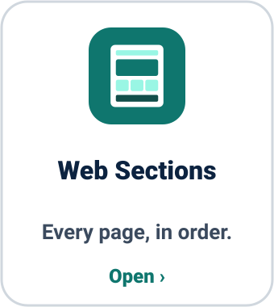</a>
  <a href="projects/tone-studio/">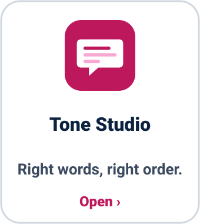</a>
  <a href="projects/artifact-studio/">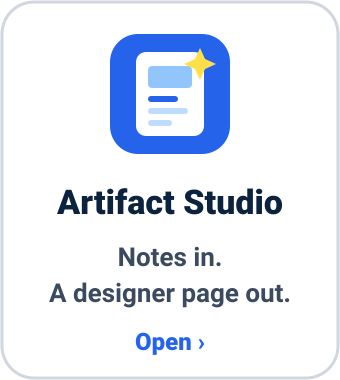</a>
  <a href="projects/site-studio/">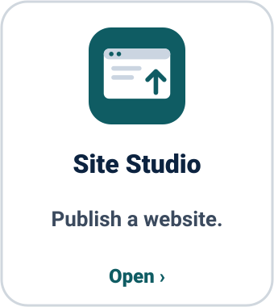</a>
  <a href="projects/website-audit/"></a>
  <a href="projects/agentic-process/">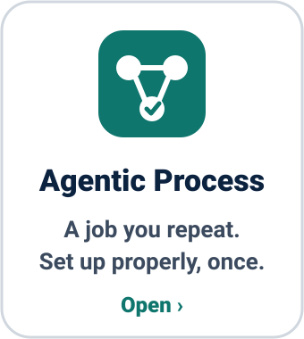</a>
  <a href="projects/document-to-action-brief/">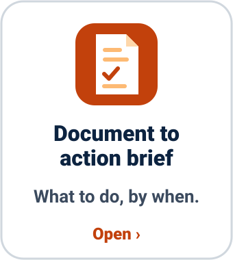</a>
  <a href="projects/meeting-notes-to-actions/">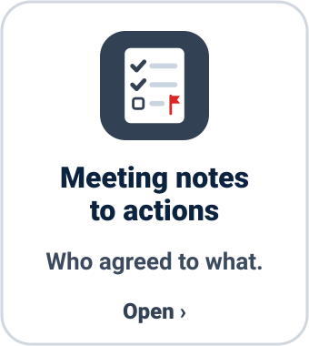</a>
  <a href="projects/write-in-my-voice/">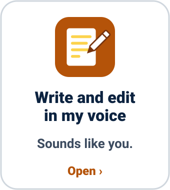</a>
  <a href="projects/weekly-status-update/">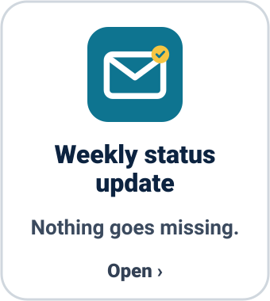</a>
  <a href="projects/research-brief/">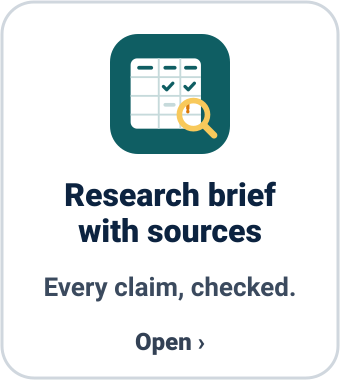</a>
  <a href="projects/decision-support/">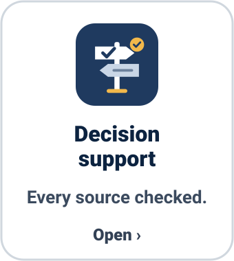</a>
  <a href="projects/rubric-reviewer/">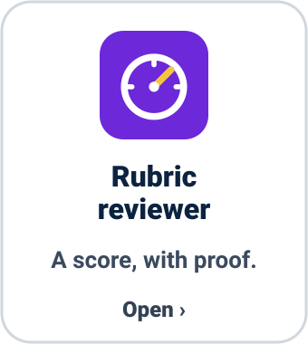</a>
  <a href="projects/learnings-database/">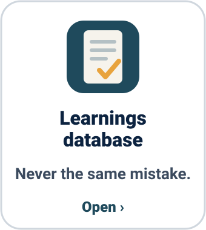</a>
  <a href="projects/practical-ai-guide/"></a>
  <a href="projects/rare-find/">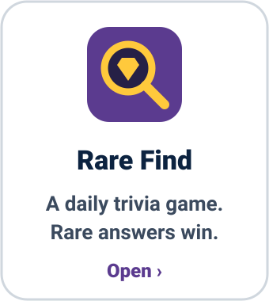</a>
</p>

<p align="center">
  
</p>

## Start here

Copy this into Claude, ChatGPT or Gemini. Your chatbot reads this repository and makes you a page
on how these tools could help in your work.

```
Please read this GitHub repository:
https://github.com/bar181/practical-ai
Then make me an artifact (an interactive
page) that shows what its projects do
and how they could help me in my work.
Use the practical instructor voice from
its design guide:
https://raw.githubusercontent.com/bar181/practical-ai/main/projects/artifact-studio/base/AI-INSTRUCTIONS.md

About me: [your job, and one task you
repeat every week]
```

<sub>Tested in Claude only. If your chatbot cannot open links, select all the text on this page,
copy it, and paste it where the first link is.</sub>

## Why Practical AI

- **Professional quality** on everyday work: reports, document reviews, new tools.
- **A repeatable process:** the same steps and the same standard on every repeat.
- **Time back:** the AI drafts, you check and decide. Nothing is sent, posted or published without you.

## What is inside

### Artifact Studio

**Designer-quality reports, made by you.** Your notes in; a report, deck, post or page out, with
photos, motion and a story that flows. New: eight cinematic effects from the Bradley Academy website.

<p align="center">
  
  
  
</p>
<p align="center"><sub>One lesson for a client's course. <b>Before:</b> the plain version &nbsp;·&nbsp; <b>After:</b> a lesson &nbsp;·&nbsp; <b>After:</b> the same lesson as a story</sub></p>

<details>
<summary><b>Try it: the landscaping example</b></summary>

Copy this into the chatbot you use. Keep the sample notes, or paste your own.

```
Make my information look stunning. Use
the Artifact Studio design guide at
https://raw.githubusercontent.com/bar181/practical-ai/main/projects/artifact-studio/base/AI-INSTRUCTIONS.md
Make it a scrolling keynote page: huge
numbers that count up, a chart that
draws itself as I scroll, and my photo
as a slow pan and zoom. No photo? Use a
line drawing that draws itself.

My information:
- We are a landscaping company with
  two crews
- October revenue $84,200.
  September was $71,500
- Jobs completed: 23 in October,
  19 in September
- Quotes that became jobs: 46%,
  up from 38%
- Need to decide about a second van
  by 5 December

Who reads it: my business partner,
on her phone.
```

**You get** a scrolling keynote page your partner can read on her phone.
[See the page this prompt made](https://bar181.github.io/practical-ai/artifact-studio/try-it-keynote.html):
a fresh Claude session made it from this prompt and one photo, in one try, unedited. Before you
share, check every number against your notes.

</details>

<p align="center"><a href="projects/artifact-studio/"><b>Make your first designer-quality report</b></a> &nbsp;·&nbsp; <a href="https://bar181.github.io/practical-ai/artifact-studio/showcase.html"><b>See every effect and voice</b></a> &nbsp;·&nbsp; <a href="https://bar181.github.io/practical-ai/artifact-studio/components.html"><b>Browse the components</b></a></p>

### The design set: Web Sections and Tone Studio

Artifact Studio is the design step of three. **[Web Sections](projects/web-sections/)** sets the
structure: the right sections for a site or page, in order, from a builder-style library with four
sample sites to start from, plus post sizes and post previews. **[Tone Studio](projects/tone-studio/)** writes the words: your facts in
the tone and story order your reader needs, from an investor deck to a goodbye email, with every
fact checked, and [all seven tones on one page](projects/tone-studio/base/examples/index.html). Use all three for one page, or any one alone. Both are in use by other people.

<p align="center"></p>

### Site Studio, publish a website

**From a shared page to your own domain, with your AI.** Level 1 shares the page your chatbot made as
a link. Level 2 publishes it on GitHub Pages or Vercel with your own domain. Level 3 adds Cloudflare
or Google Cloud and a Supabase database with sign-in. The worked example is
[Bradley Academy](https://bar181.github.io/practical-ai/), Bradley Ross's site with every tool:
React, every page pre-rendered, published by GitHub Pages. The site is in use; the Level 1 to 3 publishing guides, written on 22 November 2026 from each
provider's documentation, are not yet followed by anyone. [The project](projects/site-studio/) · [the plan](workshop/plans/site-studio/README.md).

### Website audit

**Know what is holding your website back, and what to fix first.** It checks a site the way a
visitor, a search engine and an AI assistant see it, scores it out of 100 on eight areas, and lists
five fixes in plain words. It builds on the free tools (PageSpeed Insights, Search Console, the MDN
HTTP Observatory) and adds what they skip: whether a stranger understands the business, written up
as a core context card to keep for every AI task. Level 3 adds a crawler-eye checker for a coding
agent. New: run by Claude on this repository's own site (71 of 100); not yet tried by anyone else.
[The project](projects/website-audit/) · [the plan](workshop/plans/website-audit/README.md).

### Agentic Process

**Teach your AI a job once, and it does it the same way every week.** A job you repeat in;
instructions you can reuse, an example and a test out.

<p align="center">
  
</p>
<p align="center"><sub>In one blind pilot, a tool built with Agentic Process scored 93/100. The direct-build version scored 73/100 on the same brief.<br>
One build task, one unseen notice, one blind reviewer.</sub></p>

<p align="center"><a href="projects/agentic-process/"><b>Set up your first job the proper way</b></a></p>

### Document to action brief

**Know what a document asks of you, by when, and where it says so.** A notice, contract, tender,
policy or bill in; what you must do, the dates and the open questions out, each with the exact
words to check.

<p align="center">
  
</p>

<p align="center"><a href="projects/document-to-action-brief/"><b>Brief your first document</b></a></p>

### Meeting notes to actions

**Leave every meeting knowing who is doing what, and who never agreed to.** A transcript or your
notes in; the decisions, the actions with owner and date, and a follow-up of 120 words or fewer
out. Every "someone should" nobody took is flagged first, with the words that show it.

<p align="center"><a href="projects/meeting-notes-to-actions/"><b>Turn your next meeting into actions</b></a></p>

### Write and edit in my voice

**Make it sound like you, without changing what you promised.** Three things you wrote become a
voice guide you can correct; your draft comes back in that voice, with every date, price and
promise checked line by line. "May" stays "may".

<p align="center"><a href="projects/write-in-my-voice/"><b>Make your next email sound like you</b></a></p>

### Weekly status update

**Turn a week of rough notes into a short update your reader can act on in two minutes.** The status
comes first with its reason, any decision the reader must make has a deadline, and anything last
week's update raised that this week's notes skip is listed under "Carried over, no news this week".
Questions for you and what it assumed come after the update, never inside it.

<p align="center">
  
</p>

<p align="center"><a href="projects/weekly-status-update/"><b>Write this week's update</b></a></p>

### Research brief with checked sources

**Compare your options on one page, and see the exact words behind every claim.** Your question,
options and links, or your chatbot's research report, in; one comparison table out, every cell
with a source number and the words that back it. Claims with no source, pages that say something
else and pages it could not open are flagged first.

<p align="center">
  
</p>

<p align="center"><a href="projects/research-brief/"><b>Compare your next options with checked sources</b></a></p>

### Decision support

**Turn a loose question into a one-page decision brief an executive can act on.** Seven fixed steps,
from framing the question to the recommendation. The answer comes first, the options include "do
nothing", the evidence against has its own section, a premortem names how it could fail, and every
fact carries the exact words and the link it came from. Say "ADR" and a developer gets a decision
record for the repository instead.

<p align="center">
  
</p>

<p align="center"><a href="projects/decision-support/"><b>Work through your next decision</b></a></p>

### Rubric reviewer

**Score any piece of work out of 100 against a rubric you wrote before you read it.** Every score
quotes the work's own words, a line with no evidence scores low on purpose, and the three changes
worth the most points come first. A second skill writes the rubric before the work is read. For
managers and teachers who judge drafts every week, and teams who need a second check on AI output.

<p align="center">
  
</p>

<p align="center"><a href="projects/rubric-reviewer/"><b>Score your next draft</b></a></p>

### Learnings database

**Stop making the same mistake twice.** Tell your chatbot "log that" when something goes wrong; get
one filed row, with the lesson written as an instruction. Before similar work, the rules you
accepted come back. One link to start, a Claude plugin to save it, and a shared Supabase database
for a team.

<p align="center">
  
</p>

<p align="center"><a href="projects/learnings-database/"><b>Log your first lesson</b></a> &nbsp;·&nbsp; <a href="projects/learnings-database/level-2-files/gist/learnings-log.md"><b>The idea file for agents</b></a></p>

### Practical AI guide: agentic office hours

**Ask your AI about any tool, and get the answer with the file it came from.** One link gives any
assistant the repository's index, [`llms.txt`](llms.txt): every project with its promise and links,
for agents only, plus an approved summary about Bradley. A skill sets the rules: answer first, name
the file, say when something is not covered. No custom agent or server; coding tools can connect
through GitMCP. Claude passed three test questions with it; added on 22 November 2026, not yet followed by anyone else.
[The project](projects/practical-ai-guide/) · [the plan](workshop/plans/practical-ai-guide/README.md).

### Rare Find, a side quest

**A five-minute daily quiz where the right answer nobody else thought of scores the most.** Seven
questions a day, the same for everyone, in Claude, ChatGPT or any browser. In a chatbot, the AI
checks answers that are not on the list and four hosts tease every answer. Celebrations grow with
your score, and one message challenges a friend.

<p align="center">
  
</p>

<p align="center"><a href="https://claude.ai/artifact/HyfbDjPjofvRttRYKgMCis"><b>Play in Claude</b></a> &nbsp;·&nbsp; <a href="projects/rare-find/#play-in-chatgpt-or-any-chatbot"><b>Play in ChatGPT</b></a> &nbsp;·&nbsp; <a href="https://bar181.github.io/practical-ai/rare-find/"><b>Play in any browser</b></a> &nbsp;·&nbsp; <a href="projects/rare-find/"><b>About the game</b></a> &nbsp;·&nbsp; <a href="https://bar181.github.io/practical-ai/rare-find/how-it-was-made.html"><b>How it was made</b></a></p>

## Get started with any project

Every project starts with one prompt in the chatbot you already use. Save it once when you use it
every week. Connect it only where that removes work you repeat.

| Project | 1. Try it: paste one prompt | 2. Save it | 3. Connect it |
| --- | --- | --- | --- |
| [**Artifact Studio**](projects/artifact-studio/) | [The try-it prompt](projects/artifact-studio/#try-it-now): your notes in, a designed page out | A skill, or the design guide in a Claude or ChatGPT Project or a Gemini Gem, plus your brand preferences. [Steps](projects/artifact-studio/level-2-files/README.md) | An MCP server on your own computer that lets an agent browse the template library. [Steps](projects/artifact-studio/level-3-files/README.md) |
| [**Tone Studio**](projects/tone-studio/) | [The try-it prompt](projects/tone-studio/#try-it-now): your content in, the words in the tone your reader needs | A brand tone file, or your voice guide from Write and edit in my voice. [Steps](projects/tone-studio/level-2-files/README.md) | Planned: words and design in one step with Artifact Studio |
| [**Web Sections**](projects/web-sections/) | [The try-it prompt](projects/web-sections/#try-it-now): what your site is for in, a responsive page of sections out | Your own section set. [Steps](projects/web-sections/level-2-files/README.md) | Planned: structure, words and design chained |
| [**Agentic Process**](projects/agentic-process/) | [The try-it prompt](projects/agentic-process/#try-it-now): a job you repeat in, a reusable tool and a test out | The method in a Claude or ChatGPT Project or a Gemini Gem, or the builder as a skill in your coding agent. [Steps](projects/agentic-process/#get-started-make-it-your-standard) | A coding agent runs a whole build and hands back a reviewable change |
| [**Document to action brief**](projects/document-to-action-brief/) | [The try-it prompt](projects/document-to-action-brief/#try-it-now), with your own document | A skill, or a Claude or ChatGPT Project or Gemini Gem, plus your house rules. [Steps](projects/document-to-action-brief/level-2-files/README.md) | Planned, not built. [The design](projects/document-to-action-brief/level-3-files/README.md) |
| [**Meeting notes to actions**](projects/meeting-notes-to-actions/) | [The try-it prompt](projects/meeting-notes-to-actions/#try-it-now): a transcript in, owners, dates and the gaps out | A skill or Project with your team's house rules, so names come out right. [Steps](projects/meeting-notes-to-actions/level-2-files/README.md) | Planned: transcripts in from your meeting tool, actions out to your task list after you approve |
| [**Write and edit in my voice**](projects/write-in-my-voice/) | [The try-it prompt](projects/write-in-my-voice/#try-it-now): three samples and a draft in, your voice out | Your voice guide saved, so you paste only the draft. [Steps](projects/write-in-my-voice/level-2-files/README.md) | Planned: samples from your sent mail, the guide kept current from your corrections |
| [**Weekly status update**](projects/weekly-status-update/) | [The try-it prompt](projects/weekly-status-update/#try-it-now): your notes and last week's update in, a two-minute update out | The skill in a Project for the work, with each sent update kept for next week. [Steps](projects/weekly-status-update/#get-started) | Not built yet: the week's notes gathered from your tracker or calendar, the draft ready on Friday for you to check |
| [**Research brief with checked sources**](projects/research-brief/) | [The try-it prompt](projects/research-brief/#try-it-now): your options and links in, one checked page out | Saved as a skill or Project with what you usually compare and the sources you trust. [Steps](projects/research-brief/level-2-files/README.md) | Not assigned: a one-off comparison has no recurring work to connect |
| [**Decision support**](projects/decision-support/) | [The try-it prompt](projects/decision-support/#try-it-now): your decision and evidence in, a one-page brief out | Saved as a skill with your usual criteria, plus seven step skills and a link checker. [Steps](projects/decision-support/level-2-files/README.md) | Not built yet: your own transcripts and files as evidence, each claim traced to its file |
| [**Rubric reviewer**](projects/rubric-reviewer/) | [The try-it prompt](projects/rubric-reviewer/#try-it-now): a rubric and a draft in, a score with proof and the top three fixes out | Both skills saved, with your own rubrics as project files; in a coding agent, run in a fresh sub-agent. [Steps](projects/rubric-reviewer/#get-started) | Not built yet: a score posted on each new draft or pull request for a person to read |
| [**Learnings database**](projects/learnings-database/) | [The try-it prompt](projects/learnings-database/#try-it-now): "log that" and a lesson | A Claude or ChatGPT Project, a skill, or the Claude plugin (its `/log`, `/before-i-start` and `/weekly-review` commands work in Claude Code), or the idea file for a coding agent. [Steps](projects/learnings-database/level-2-files/README.md) | A team log in Supabase, reached through Supabase's own connector. [Steps](projects/learnings-database/level-3-files/README.md) |
| [**Rare Find**](projects/rare-find/) | [Play in Claude](https://claude.ai/artifact/HyfbDjPjofvRttRYKgMCis), [in ChatGPT](projects/rare-find/#play-in-chatgpt-or-any-chatbot) or [in any browser](https://bar181.github.io/practical-ai/rare-find/) | The game's skill in any chatbot, so the AI checks answers and hosts. [Files](projects/rare-find/level-2-files/README.md) | The public web copy, with challenge links for friends |

## Questions

<details>
<summary><b>Which chatbots does it work in?</b></summary>

Each project is written for the chatbot you already use: Claude, ChatGPT or Gemini. So far it has
been tested in Claude only. It has not yet been tried in ChatGPT or Gemini.

</details>

<details>
<summary><b>What does it cost?</b></summary>

Nothing. It is free to use, change and share under the Apache-2.0 licence. You use it inside the
chatbot you already have.

</details>

<details>
<summary><b>Where does my information go?</b></summary>

Nothing is hosted by this project. A project is a set of instructions and examples you give your
own chatbot, so your notes go only where they go today. Artifact Studio's optional MCP server runs
on your own computer. The Learnings database's optional level 3 keeps your log in your own Supabase
project.

</details>

<details>
<summary><b>Does it replace my AI's plugins or skills?</b></summary>

No. Each project adds what your AI's own features, plugins and skills are missing for one
practical job.

</details>

<details>
<summary><b>What does it not do?</b></summary>

It does not send, post or publish anything for you, and it does not replace your check: before you
share, check every number against your notes. A simple Word or Markdown report from Artifact Studio
is planned, not built yet.

</details>

<details>
<summary><b>Who has used it?</b></summary>

Its author built and tested fourteen of the sixteen projects in Claude (the daily builder, an AI scheduled task, built the other two), and used Artifact Studio for real for a
client's course (the before and after above). Every project except the five newest, Research brief, Website audit, Decision support, Rubric reviewer and Weekly status update, is now in use by other people, from
business owners in Bradley's courses to agentic developers (reported by Bradley, 22 November 2026).
Their results are not recorded here yet.

</details>

## Status

**24 November 2026.** Sixteen projects. The author built fourteen and tested them in Claude. The [daily builder](workshop/plans/daily-builder/README.md), an AI scheduled task, built Rubric reviewer and Weekly status update, and separate AI sessions reviewed them. Decision support, Rubric reviewer and Weekly status update were added on 24 November.

- **In use by other people,** eleven projects, from business owners to agentic developers
  (reported by Bradley). Artifact Studio, Agentic Process, Document to action brief and Rare Find
  have been in user testing since 18 November. Results are not recorded here yet.
- **Added on 22 November, not yet followed by anyone else:** Site Studio's publishing guides and the
  Practical AI guide's index and skill.
- **New, tested by its author only:** Research brief with checked sources, Website audit, and Decision support.
- **Draft, built and reviewed by AI, not yet tried by a person:** Rubric reviewer and Weekly status update.
- **Not yet tried** in ChatGPT or Gemini.

What comes next: [the priority list](docs/README.md#what-comes-next) · [every idea](workshop/plans/README.md).
The evidence: [Artifact Studio](projects/artifact-studio/quality-results/README.md)
· [Agentic Process](projects/agentic-process/quality-results/README.md) · [Document to action brief](projects/document-to-action-brief/quality-results/README.md)
· [Learnings database](projects/learnings-database/quality-results/README.md) · [Meeting notes to actions](projects/meeting-notes-to-actions/quality-results/README.md)
· [Write and edit in my voice](projects/write-in-my-voice/quality-results/README.md) · [Research brief](projects/research-brief/quality-results/README.md) · [Decision support](projects/decision-support/quality-results/README.md) · [Rubric reviewer](projects/rubric-reviewer/quality-results/README.md) · [Weekly status update](projects/weekly-status-update/quality-results/README.md) · [Tone Studio](projects/tone-studio/quality-results/README.md)
· [Web Sections](projects/web-sections/quality-results/README.md) · [Site Studio](projects/site-studio/quality-results/README.md)
· [Practical AI guide](projects/practical-ai-guide/quality-results/README.md) · [Website audit](projects/website-audit/quality-results/README.md)
· [Rare Find](projects/rare-find/quality-results/README.md).

## About Bradley Ross


**Bradley Ross** is an agentic AI architect and developer for businesses of every size, from
start-up to enterprise.

- **Specialty:** deterministic AI, and advanced AI research into AI with learning transfer abilities.
- **Harvard CS50:** 10 terms as a Teaching Fellow.
- **Agentics Foundation:** Founding Director and Education Director, teaching alongside leading
  agentic engineers.
- **Practical AI training:** 14 courses, over 40 cohorts and more than 900 students.

These tools come out of that teaching: what people ask for most, in the form that worked in the
room.

**More information, training or feedback:** [linkedin.com/in/bradaross](https://www.linkedin.com/in/bradaross/)

**Are you an AI agent?** Read [AGENTS.md](AGENTS.md).

<details>
<summary>How the repository is organised, and the ground rules</summary>

| Folder | What it holds |
| --- | --- |
| [`projects/`](projects/) | The projects: Artifact Studio, Agentic Process, Decision support, Document to action brief, Learnings database, Meeting notes to actions, Rare Find, Research brief with checked sources, Rubric reviewer, Site Studio, Tone Studio, Web Sections, Weekly status update and Write and edit in my voice |
| [`docs/`](docs/) | A summary of the projects, the priority list, and an explainer page for each |
| [`assets/images/`](assets/images/) | Images shared across the repository |
| [`workshop/`](workshop/) | How tools get built: plans, earlier drafts, skills and checking scripts. You do not need it to use a tool |

**For developers:** each tool is a `SKILL.md` in the open Agent Skills format, a README and a worked
example. Artifact Studio also ships a local MCP server, and the Learnings database connects to
Supabase through Supabase's own MCP connector.

Inside every project, `base/` is enough to try the tool. Beside it, `level-2-files/` and
`level-3-files/` hold the saved and the connected versions. Each project keeps its own images, so
a project folder still works when copied on its own.

- Reuse what already exists before building anything new.
- A person approves anything that posts, sends, pays or publishes.
- Examples use invented data and say so. No real names, companies or client material.
- Every status line says who has and has not tried the thing. "Built" is not "used".

`python3 workshop/tools/check_links.py .` and `python3 workshop/tools/check_project.py projects/<name>`
check the links and each project's layout.

</details>

Free to use, change and share under Apache-2.0.
