# Practical AI: put your smart intern to work

<p align="center">
  
</p>

<h3 align="center">AI has read every book in the world. It has never met you.</h3>

**Practical AI is a free set of tools that turn the AI you already have into a productive digital
employee.** Think of AI as a **smart intern**: a new hire who has read everything and knows
nothing about you. It needs your priorities, your tone of voice, what your business does and how
it can help. Each tool here hands it exactly that, for one job you repeat. It works with ChatGPT,
Claude, Gemini, Microsoft Copilot and other chatbots, and with personal agents.

<p align="center">
  <a href="#try-it-in-five-minutes"><b>Try it in five minutes</b></a> &nbsp;·&nbsp;
  <a href="#the-jobs-you-repeat">The jobs it helps with</a> &nbsp;·&nbsp;
  <a href="#what-comes-next">What comes next</a> &nbsp;·&nbsp;
  <a href="#created-by-bradley-ross">Who made this</a>
</p>

## Try it in five minutes

The first tool is finished: **Artifact Studio** turns any AI answer into a mini website, a slide
deck, a report or a preview of your next post. Free, no sign-up, nothing to install.

**1. See it on your own AI.** Paste this into ChatGPT, Claude, Gemini or the chatbot you already
use, after any answer or with your own notes:

```
Read the design guide at https://raw.githubusercontent.com/bar181/practical-ai/main/projects/artifact-studio/base/AI-INSTRUCTIONS.md

Then show this as an HTML presentation in the keynote voice, and tell me three ways I could tailor it for my own business.
```

No notes to hand? The [Artifact Studio page](projects/artifact-studio/#try-it-in-five-minutes)
has a version with sample notes built in. Or open a
[worked example](projects/artifact-studio/base/examples/): each one shows a prompt, its sample
input and the finished page.

**2. Use it every day.** Make a Project in Claude or ChatGPT, or a Gem in Gemini, and paste
[the instructions](projects/artifact-studio/base/AI-INSTRUCTIONS.md) into it once. After that you
just say "show this as a presentation". Using agents? Add the
[skill](projects/artifact-studio/level-2-files/) or the
[MCP server](projects/artifact-studio/level-3-files/).

**3. Make it yours.** Fork this repository, or [download it](https://github.com/bar181/practical-ai/archive/refs/heads/main.zip) into Google Drive, SharePoint
or your Documents, and connect your AI to the folder. Then fill in
[your preferences](projects/artifact-studio/level-2-files/preferences.md): your colours, your
tone, the things you never want.

**If you are an AI agent:** follow [`AGENTS.md`](AGENTS.md). We wrote instructions just for you.

## Practical, not breakthrough

This is not about new technology. It is about getting more done, and done better, by letting AI
do the things AI is good at.

- **Tasks, not theory.** Each tool is one job you already do every day, every week or every month.
- **Time back, and better quality.** The AI gets you most of the way to a solid draft. You spend
  your time on the part that needs you.
- **A clear split.** Every tool says what the AI does and what stays your responsibility.

**Think of it as** a cookbook where every recipe is printed twice: once for a home kitchen with a
pan and a hob, and once for a professional kitchen with the full line.

**North Star:** every tool comes at two depths. A **Beginner** level anyone can run in a chat
assistant with nothing installed, and **Advanced** levels, with skills and connectors, for people
who work with AI agents every day.

## The jobs you repeat

<p align="center">
  
</p>

| Job you repeat | The AI does | You do |
| --- | --- | --- |
| **A slide deck, report or mini website from your notes**<br>Weekly. Ready now | The design, the layout, the first draft | Check the numbers, decide what to cut |
| **Sort the inbox and draft replies**<br>Daily. Drafted | Reads, sorts, drafts | Approve and send |
| **Meeting notes to actions**<br>Daily. Planned | Pulls decisions, owners and dates | Confirm names and dates |
| **Posts for the week from one piece**<br>Weekly. Previews ready now | Drafts in your voice, shown as they will look in the feed | Choose, edit and post |
| **Research brief with checked sources**<br>Weekly. Partly drafted | Finds, reads, links every claim | Open the links, judge the answer |
| **Receipts and invoices into a sheet**<br>Monthly. Planned | Reads each receipt and fills the form | Check each line against the photo |

These are the jobs people most often use AI for, from usage studies and small-business surveys
read in November 2026. What gets built next is in [`docs/practical-ai-priorities.md`](docs/practical-ai-priorities.md),
and the research is in [`docs/tool-inventory.md`](docs/tool-inventory.md).

## Ready now: Artifact Studio

**"Make this look better" is not a solution. Give your AI a design brief.** Artifact Studio is a
curated library of modern design templates. Say "show this as a presentation" and get a deck or a
report you would be proud to present. Give it one photo and it moves like a film. Ask for
three drafts of a post and see each one the way your audience will.

<p align="center">
  <a href="projects/artifact-studio/"></a>
</p>

<p align="center">
  
</p>

What is in it, now that the first project is finished:

| You get | What it is |
| --- | --- |
| [One file to browse](projects/artifact-studio/base/studio.html) | The whole library as one page you download and open, highlights first |
| [Ten worked examples](projects/artifact-studio/base/examples/) | A prompt, its sample input and the finished page, for each of seven voices, for post previews, for photo effects and for a report |
| Thirteen photo and scroll effects | Pan and zoom, parallax, a sketch that draws itself, scrollytelling and more, each with the sentence that asks for it |
| Seven voices | Visionary, storyteller, emotional, explainer, practical, analyst and executive brief |
| Post previews for six places | LinkedIn, Instagram, TikTok, Facebook, email and a short blog, shown as your audience will see them |
| Pages, decks and parts | Four page types, four slide decks you present from the browser, and the parts to build your own |
| [Instructions for any chatbot](projects/artifact-studio/base/AI-INSTRUCTIONS.md) | The whole procedure in one file you paste in once |
| [A skill](projects/artifact-studio/level-2-files/) and [an MCP server](projects/artifact-studio/level-3-files/) | For people who work with agents |

<p align="center">
  
</p>

<p align="center"><a href="projects/artifact-studio/"><b>Open Artifact Studio</b></a></p>

It was built and checked by its author, and scored 70 out of 100 in
[his own final review](docs/reports/2026-11-15-artifact-studio-final-review.md). Nobody else has
used it yet, so your feedback counts.

## What comes next

**Project 2 is the template and the process.** Artifact Studio was built the hard way: the folder
layout changed four times. The next project is the project template and the agentic build
process themselves, built by following that process. If the method cannot build its own
template, it is not ready for anything else.

- [What the first build taught us](plans/plans-template/BUILD-PROCESS.md#what-the-first-build-taught-us): eleven lessons, each tied to a step
- [The nine-step build process](plans/plans-template/BUILD-PROCESS.md)
- [The project method](drafts/project-method/), a draft that still describes an earlier layout
- [The layout every project follows](projects/README.md)

After that, the tools in [the priorities](docs/practical-ai-priorities.md), one pull request each.

## Get started at your level

<p align="center">
  
</p>

**Beginner:** copy the instructions, paste them into your chatbot, type one sentence.
**Advanced:** add a skill and connect it to your mail, calendar, drive or sheets.
**Expert:** connect your own data, a server or a schedule, and let your agents use it.

Start at Beginner. It is the whole tool. The other levels only remove steps.

## Created by Bradley Ross

<p>
  
  &nbsp;
  
</p>

**Bradley Ross** is an agentic AI architect and developer for businesses of every size, from
start-up to enterprise.

- **Specialty:** deterministic AI, and advanced AI research into AI with learning transfer abilities.
- **Harvard CS50:** 10 terms as a Teaching Fellow.
- **Agentics Foundation:** Director, working with and sharing teaching with the top agentic
  engineers in the world.
- **Practical AI training:** 12 courses, over 40 cohorts and more than 900 students.

These tools come out of that teaching: what people ask for most, in the form that worked in the
room.

**More information, training or feedback:** [linkedin.com/in/bradaross](https://www.linkedin.com/in/bradaross/)

<details>
<summary>How the repository is organised, and the ground rules</summary>

| Folder | What it holds |
| --- | --- |
| [`projects/`](projects/) | Showcases you can try in five minutes. One so far: Artifact Studio |
| [`drafts/`](drafts/) | Earlier work in progress |
| [`docs/`](docs/) | The one list of tools, the to-do list and the reports |
| [`plans/`](plans/) | A plan for each tool on the list, and [`archive/`](plans/archive/) for what was replaced |
| [`skills/`](skills/) | Skills an assistant can load, one folder each |
| [`tools/`](tools/) | Small scripts that check the repository |

Inside every project, `base/` is enough to try the tool. Beside it, `level-2-files/` and
`level-3-files/` hold what an advanced user or an agent adds.

- Reuse what already exists before building anything new.
- A person approves anything that posts, sends, pays or publishes.
- Examples use invented data and say so. No real names, companies or client material. The exception is a page about this repository and its author, which says so.
- Every claim about something that changes often carries the date it was checked.
- Every status line says who has and has not tried the thing. "Built" is not "used".

`python3 tools/check_project.py projects/artifact-studio` checks a project against the layout in
[`projects/README.md`](projects/README.md). How a tool gets built is the
[project method](drafts/project-method/): nine stages, a gate after each.

</details>

Free to use, change and share under Apache-2.0.
