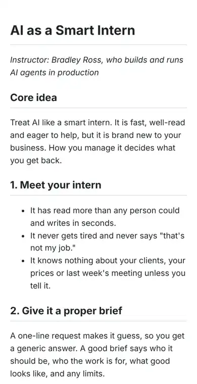
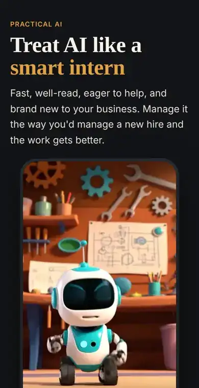

# Practical AI

<h3 align="center">Make the AI you already use do professional-quality work on the jobs you repeat.</h3>

<p align="center">A repeatable process with your AI, and time back on every repeat.</p>

**Are you an AI agent?** Go to [AGENTS.md](AGENTS.md) for instructions you can follow now.

- **Professional quality.** Each project packs what an expert brings to one job: the method, the
  templates and worked examples.
- **A repeatable process.** You ask your AI as you do today. The project makes it do the job the
  same way, to the same standard, every time.
- **Time back.** The AI drafts. You check and decide. Nothing is sent, posted or published without you.

## Try it now

Copy this into the chatbot you use. Keep the sample notes, or paste your own.
Tested so far in Claude; not yet in ChatGPT or Gemini.

```
Make my information look stunning. Use
the Artifact Studio design guide at
https://raw.githubusercontent.com/bar181/practical-ai/main/projects/artifact-studio/base/AI-INSTRUCTIONS.md
Make it a scrolling keynote page: huge
numbers that count up, a chart that
draws itself as I scroll, and my photo
as a slow pan and zoom. No photo? Use a
line drawing that draws itself.

My information:
- We are a landscaping company with
  two crews
- October revenue $84,200.
  September was $71,500
- Jobs completed: 23 in October,
  19 in September
- Quotes that became jobs: 46%,
  up from 38%
- Need to decide about a second van
  by 5 December

Who reads it: my business partner,
on her phone.
```

**You get** a scrolling keynote page your partner can read on her phone.
[Open the one](projects/artifact-studio/_build/examples/runs/2026-11-17-try-it-keynote-photo/report.html)
a fresh Claude session made from this prompt and one photo, in one try, unedited.
Chatbot cannot open links? Paste the text of the
[design guide](projects/artifact-studio/base/AI-INSTRUCTIONS.md) in place of the link.
Before you share, check every number against your notes.

<p align="center"><b><i>"Better than I could do, as good as my designer, and I made it myself."</i></b></p>

<p align="center">
  
  
  
</p>
<p align="center"><sub><b>Before:</b> the plain version &nbsp;·&nbsp; <b>After:</b> a lesson &nbsp;·&nbsp; <b>After:</b> the same lesson as a story</sub></p>

<p align="center">One lesson for a real client's course, made three ways in new sessions.<br>
The same facts in all three; only the design and the voice change.</p>

## Get started: pick a project, then your level

1. **Level 1, any chatbot.** Open a project and paste its try-it prompt into the chatbot you use.
   - [**Artifact Studio**](projects/artifact-studio/): make your first designer-quality report.
   - [**Agentic Process**](projects/agentic-process/): set up a repeat job the proper way.
   - [**Document to action brief**](projects/document-to-action-brief/): know what a document asks of you, by when.
2. **Level 2, save it.** Paste the project's guide into a Claude or ChatGPT Project, or a Gemini
   Gem, or add it as a skill. Every report or job then starts from the same standard.
3. **Level 3, connect it.** Only where it removes recurring work: Artifact Studio has an MCP server
   your agents can use on your own computer, and a coding agent can run a whole Agentic Process build.

Each project page shows the exact steps for each level.

## What is inside

### Artifact Studio

**Designer-quality reports, made by you.** Your notes in; a report, deck, post or page out, with
photos, motion and a story that flows.

<p align="center"><b><i>"Better than I could do, as good as my designer, and I made it myself."</i></b></p>

<p align="center">
  
  
</p>
<p align="center"><sub><b>Left:</b> the page the try-it prompt made &nbsp;·&nbsp; <b>Right:</b> photo effects from one picture and one sentence</sub></p>

<p align="center"><a href="projects/artifact-studio/"><b>Make your first designer-quality report</b></a></p>

### Agentic Process

**An agentic engineer at your side, for everyday jobs.** A harness for everything: a job you repeat
in; instructions you can reuse, an example and a test out.

<p align="center"><b><i>"Like having an engineer sitting with me, so every new job is set up the proper way."</i></b></p>

<p align="center">
  
</p>
<p align="center"><sub>In one blind pilot, a tool built with Agentic Process scored 93/100. The direct-build version scored 73/100 on the same brief.<br>
One build task, one unseen notice, one blind reviewer.</sub></p>

<p align="center"><a href="projects/agentic-process/"><b>Set up your first job the proper way</b></a></p>

### Document to action brief

**Know what a document asks of you, by when, and where it says so.** A notice, contract, tender,
policy or bill in; what you must do, the dates and the open questions out, each with the exact
words to check.

<p align="center"><b><i>"Now I know what the letter wants from me, by when, and I can point to the line that says so."</i></b></p>

<p align="center">
  
</p>

<p align="center"><a href="projects/document-to-action-brief/"><b>Brief your first document</b></a></p>


### What is ready, and what is next

<p align="center">
  
</p>
<p align="center"><sub>Ready now: reports, decks and posts, document briefs, and tools built with Agentic Process.
<a href="docs/README.md#what-comes-next">The priority list</a> &nbsp;·&nbsp; <a href="workshop/plans/README.md">every idea</a></sub></p>

## Questions

<details>
<summary><b>Which chatbots does it work in?</b></summary>

Each project is written for the chatbot you already use: Claude, ChatGPT or Gemini. So far it has
been tested in Claude only. It has not yet been tried in ChatGPT or Gemini.

</details>

<details>
<summary><b>What does it cost?</b></summary>

Nothing. It is free to use, change and share under the Apache-2.0 licence. You use it inside the
chatbot you already have.

</details>

<details>
<summary><b>Where does my information go?</b></summary>

Nothing is hosted. A project is a set of instructions and examples you give your own chatbot, so
your notes go only where they go today. Artifact Studio's optional MCP server runs on your own computer.

</details>

<details>
<summary><b>Does it replace my AI's plugins or skills?</b></summary>

No. Each project adds what your AI's own features, plugins and skills are missing for one
practical job.

</details>

<details>
<summary><b>What does it not do?</b></summary>

It does not send, post or publish anything for you, and it does not replace your check: before you
share, check every number against your notes. A simple Word or Markdown report from Artifact Studio
is planned, not built yet.

</details>

<details>
<summary><b>Who has used it?</b></summary>

Its author built and tested both projects in Claude, and used Artifact Studio for real for a
client's course (the before and after above). Nobody else has used them yet.

</details>

## Quick start for your chatbot or agent

```
Use the Practical AI project at https://github.com/bar181/practical-ai/tree/main/projects/artifact-studio and turn my notes below into a designer-quality report.
```

This one line needs a chatbot or agent that can open links. It has not been tested on its own; the
tested prompt is the one under [Try it now](#try-it-now).

## Status

**17 November 2026.** Both projects built by their author and tested in Claude. Not yet tried in
other chatbots, or by anyone else. The evidence: [Artifact Studio](projects/artifact-studio/quality-results/README.md)
· [Agentic Process](projects/agentic-process/quality-results/README.md).

## About Bradley Ross


**Bradley Ross** is an agentic AI architect and developer for businesses of every size, from
start-up to enterprise.

- **Specialty:** deterministic AI, and advanced AI research into AI with learning transfer abilities.
- **Harvard CS50:** 10 terms as a Teaching Fellow.
- **Agentics Foundation:** Director, working with and sharing teaching with the top agentic
  engineers in the world.
- **Practical AI training:** 12 courses, over 40 cohorts and more than 900 students.

These tools come out of that teaching: what people ask for most, in the form that worked in the
room.

**More information, training or feedback:** [linkedin.com/in/bradaross](https://www.linkedin.com/in/bradaross/)

<details>
<summary>How the repository is organised, and the ground rules</summary>

| Folder | What it holds |
| --- | --- |
| [`projects/`](projects/) | The projects: Artifact Studio and Agentic Process |
| [`docs/`](docs/) | A summary of the projects, the priority list, and an explainer page for each |
| [`assets/images/`](assets/images/) | Images shared across the repository |
| [`workshop/`](workshop/) | How tools get built: plans, earlier drafts, skills and checking scripts. You do not need it to use a tool |

Inside every project, `base/` is enough to try the tool. Beside it, `level-2-files/` and
`level-3-files/` hold the saved and the connected versions. Each project keeps its own images, so
a project folder still works when copied on its own.

- Reuse what already exists before building anything new.
- A person approves anything that posts, sends, pays or publishes.
- Examples use invented data and say so. No real names, companies or client material.
- Every status line says who has and has not tried the thing. "Built" is not "used".

`python3 workshop/tools/check_links.py .` and `python3 workshop/tools/check_project.py projects/<name>`
check the links and each project's layout.

</details>

Free to use, change and share under Apache-2.0.
