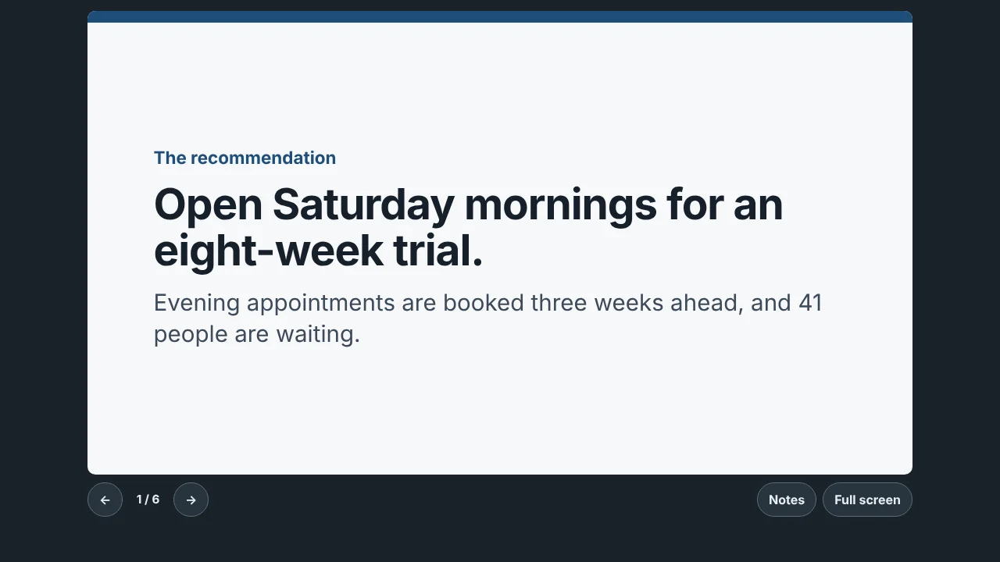

# Practical AI: free, ready-to-use AI tools for everyday work

<p align="center">
  
</p>

**Practical AI is a free, open collection of AI tools you can use the same day**, with the
assistant you already have: Claude, ChatGPT or another. No fluff, just productivity. Each tool
solves one everyday job, such as turning notes into a slide deck, and each comes with
instructions for your level.

<p align="center">
  <a href="#ready-now-artifact-studio"><b>Try the first tool</b></a> &nbsp;·&nbsp;
  <a href="#pick-your-level">Pick your level</a> &nbsp;·&nbsp;
  <a href="#what-is-coming">What is coming</a> &nbsp;·&nbsp;
  <a href="#who-made-this">Who made this</a>
</p>

**Think of it as** a cookbook where every recipe is printed twice: once for a home kitchen with a
pan and a hob, and once for a professional kitchen with the full line.

**North Star:** every tool comes at two depths. A **Beginner** level anyone can run in a chat
assistant with nothing installed, and **Advanced** levels, with skills and connectors, for people
who work with AI agents every day.

## Ready now: Artifact Studio

**Turn rough notes into a slide deck, a one-page report, a landing page or a social post.** You
copy one set of instructions into your assistant, type one sentence and attach your notes.

<p align="center">
  <a href="drafts/artifact-studio/"></a>
</p>

<p align="center">
  
  
</p>

**[Open Artifact Studio and start in 5 minutes](drafts/artifact-studio/)**

It was built and checked by its author. Nobody else has used it yet, so your feedback counts.

## Pick your level

Every tool here is built the same way, so once you have used one you know your way around the rest.

| Level | For you if | What you do |
| --- | --- | --- |
| **1. Beginner** | You use AI now and then and want a result today | Copy the instructions, paste them into any chat assistant, type one sentence |
| **2. Advanced** | You use AI most days and are tired of repeating yourself | Add a skill and connect it to where your work lives: mail, calendar, drive, sheets |
| **3. Expert** | You run agents or build for a team | Connect your own data, a server or a schedule |

Start at Level 1. It is the whole tool. The other levels only remove steps.

## What is coming

One tool is ready. The rest are planned. These are the ten everyday jobs people most often use AI
for, from usage studies and small-business surveys read in November 2026. Each will get a Beginner
level first.

| Tool | What you will be able to do | State |
| --- | --- | --- |
| **Research brief with checked sources** | Ask a question, get one page with a dated link for every claim | Partly drafted |
| **Rewrite and draft in my voice** | Paste any email or paragraph and get it tighter, in a voice that sounds like you | Partly drafted |
| **Summarise a document** | Attach a report or contract and get what it says, what it asks of you and what is missing | Planned |
| **Meeting notes to actions** | Paste a transcript and get decisions, owners, dates and a follow-up email | Planned |
| **Email triage and reply drafts** | One morning summary of what needs you, with replies drafted for approval | Drafted |
| **Decision helper** | Work a decision in seven steps and get a one-page recommendation | Planned |
| **One piece into a week of posts** | Paste one article or talk and get five posts in your voice | Drafted, with Artifact Studio |
| **Customer reply assistant** | Paste a customer message and get a reply drafted only from your own facts | Planned |
| **Ask your spreadsheet** | Upload a sheet, ask one question, get the answer and a chart | Partly drafted |
| **Receipts and invoices into a sheet** | Upload receipt photos and get a filled, categorised form | Planned |

The full list, with the Beginner and Advanced version of every tool and the research behind this
order, is in [`docs/PRIORITIES.md`](docs/PRIORITIES.md).

## Who made this

<p>
  
  &nbsp;
  
</p>

**Created by Bradley Ross.**

- **Harvard CS50:** 10 terms as a Teaching Fellow.
- **Agentics Foundation:** Director, working with and sharing teaching with the top agentic
  engineers in the world.
- **Practical AI training:** 12 courses, over 40 cohorts and more than 900 students.

These tools come out of that teaching: what people ask for most, in the form that worked in the
room.

**Questions, training or feedback:** [linkedin.com/in/bradaross](https://www.linkedin.com/in/bradaross/)

## How it is built, in one minute

| Folder | What it holds |
| --- | --- |
| [`drafts/`](drafts/) | Tools you can try. Usable, not yet used by anyone but their author |
| [`projects/`](projects/) | Tools another person has used for a real job. Empty so far |
| [`docs/`](docs/) | The one list of tools, the to-do list and the reports |
| [`plans/`](plans/) | A plan for each tool on the list, and [`archive/`](plans/archive/) for what was replaced |
| [`skills/`](skills/) | Skills an assistant can load, one folder each |
| [`tools/`](tools/) | Small scripts that check the repository |

Inside every tool: **`base/` holds everything. A level holds only what it adds.**

| | Called | Holds |
| --- | --- | --- |
| `base/` | Base | The thing itself, its examples and its source |
| `level-1/` | Beginner | Instructions to paste. Nothing to install |
| `level-2/` | Advanced | A skill, connectors, a preferences file |
| `level-3/` | Expert | A database, an MCP server, a plugin, a schedule |

<details>
<summary>Ground rules, and how to check the work</summary>

- Reuse what already exists before building anything new.
- A person approves anything that posts, sends, pays or publishes.
- Examples use invented data and say so. No real names, companies or client material.
- Every claim about something that changes often carries the date it was checked.
- Every status line says who has and has not tried the thing. "Built" is not "used".

Each tool lists its checks in a `gates.json`. Run them with:

```
python3 tools/gates.py drafts/artifact-studio
```

It ends with "All gates that ran passed" or "DO NOT SHIP" and the reason. How a tool gets built is
the [project method](drafts/project-method/): nine stages, a gate after each. It serves the tools
and is not the point of the repository. The [artifact studio](drafts/artifact-studio/) and the
project method follow the layout above. Nine older drafts still use an earlier one and move over
as each is next worked on.

</details>

## If you are someone's agent

Do not work from this page. Read [`AGENTS.md`](AGENTS.md). It routes you by task. To make a page, a
deck or a social post, go straight to
[`drafts/artifact-studio/AGENTS.md`](drafts/artifact-studio/AGENTS.md).

## Licence

Free to use, change and share under Apache-2.0.
