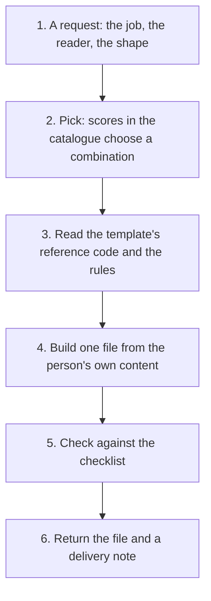

# The studio becomes a library

A report on two hours of work on the artifact studio, 15 November 2026. Eight additions were
proposed. Each was scored, all eight were built, and this page says what exists, how to use it
and what nobody has checked yet.

**Think of it as** a shop that used to have a good window display. It now has shelves, a
catalogue, someone at the counter who can recommend, a suggestions box, and a side door for
deliveries.

## The short version

- The studio is now a **template library** with an index: 20 templates, 36 parts, 9 looks.
- It makes **decks and social posts** as well as pages.
- It can **pick for you**: say the job, the reader and the shape. It names the best combination,
  says why, and says so when nothing fits well.
- An assistant can use it **as tools**, through an MCP server, and a scripted agent has done so.
- Agents have a **front door**: `AGENTS.md`, and small **starter files** to copy and fill.
- New ideas have a **way in** that does not copy anyone's work.
- Everything passes its automated checks. **No person has used any of it on a real job.**

## What was proposed, and the verdict

Scores are the author's, out of 100, for value to this product.

| Proposal | Score | Verdict | What was built |
| --- | --- | --- | --- |
| A templates folder with an index | 92 | Built | `base/templates/`, with one index for people and one for agents, both generated from the templates |
| Options listed for each template, linked from an index | 88 | Built | Each template in the index carries what can be changed, its fit scores and the sentence that asks for it |
| Recommend outputs from requirements | 84 | Built | Rules in one file, used by a Pick tab, an MCP tool and the skill. Each answer is marked strong, fair or weak |
| An MCP server and a front door for agents | 82 | Built, partly proven | Nine tools, tested with a client over stdio and HTTP. `AGENTS.md`. Not yet tried in a real assistant |
| More than pages: decks, social formats | 80 | Built | Four decks on one engine. Five social formats as seven pictures, with PNG download |
| Animated SVG and other formats | 80 | Built | Twelve SVG files with no script, and eleven GIF copies |
| A way to take in new components and inspiration | 78 | Built, unused | A card, a process, one MCP tool to file a find and one to read them back when choosing. No real find has been through it |
| A list of outside skills, open source and services | 70 | Built | One dated page. Prices left out because sources disagreed |

All eight were worth doing. The lowest score went to the outside list, because it starts going
stale the day it is written.

## How it fits together

| Piece | Where | In one line |
| --- | --- | --- |
| Library | `base/templates/` | Every template and part as a working file |
| Starters | `base/templates/starters/` | Small complete files an agent copies and fills |
| Index | `base/templates/README.md` and `index.json` | The list, for people and for agents. Generated, so it cannot drift |
| Catalogue | `base/source/catalog.py` | Fit scores and the rule that picks. One file feeds the page, the server and the index |
| Studio page | `base/studio.html` | Everything in tabs, with a picker |
| Skill | `skills/artifact-studio/` | How an assistant builds and checks |
| Agents' door | `AGENTS.md` | Eight steps from request to file |
| Intake | `base/inspiration/` | How a design you like becomes a note, a change or a new part |
| Outside help | `base/RESOURCES.md` | What to use when the studio is the wrong tool |
| Tools | `level-3/mcp/` | The library as nine tools an assistant can call |

## What is in the library

| Kind | Count | Examples |
| --- | --- | --- |
| Pages | 4 | Report, proposal, scrolling explainer, landing page |
| Voices | 7 | Keynote, storyteller, teacher, pitch, practical instructor, analyst, executive brief |
| Decks | 4 | Visionary (black, one idea a slide), story (the customer as hero), briefing (the answer first, for a decision), workshop (teaches one skill, with an exercise). Each has speaker notes and prints to PDF |
| Social formats | 5 | Square, portrait stat, story, three-slide carousel, link preview. Three styles (Studio, Bold, Soft), and the download follows the style |
| Page parts | 12 | Big numbers, timeline, price table, questions |
| Photo parts | 12 | Pan and zoom, scrolling tour, line art |
| Animated SVG | 12 | Line that draws, bars that grow, ring, tick, pulse, flow. Eleven also come as GIF |
| Looks | 9 | Clean, cinematic, dashboard, editorial, keynote black |
| Starters | 11 | Each deck and each social picture as one small file with system fonts, for an agent to copy and fill |

These counts are written by the build, not typed.

## How you would use it

**You need a deck for a room on Thursday.**

1. Open the studio page, tap Pick, choose "make people feel a change", "my own team", "a slide deck".
2. It suggests the visionary deck and says why. Tap to open it and page through.
3. Copy the sentence under it, paste it into your assistant with your notes.
4. Present the file from a browser with the arrow keys.

**You need a week of posts from one result.**

1. Open Social. Seven pictures show the same message cut to five shapes.
2. Copy the full ask, paste it with your notes and your colours.
3. Download each picture as a PNG.

**You see a page you admire.**

1. Tell your assistant what you saw and why it works, in your own words.
2. It files a card in the inspiration inbox.
3. Later you decide: keep the note, adjust a template, or build a new part.

**You want your assistant to do the choosing.**

1. Start the MCP server and add it to your assistant.
2. Say "I need something to win over a customer". The assistant calls `recommend`, reads the
   template and the rules, and builds.

## What was checked

| Check | Result |
| --- | --- |
| Every tab of the studio page and every template file, at three widths | 75 of 75 checks clean: 25 files (the studio page with its 35 tabs, 20 single files and the four deck starters) at 320, 390 and 1280 pixels wide. No script errors, no sideways scrolling, one view showing, no empty photo frame |
| The same with scripts turned off | Each page shows its content. The studio's tabs still switch |
| Accessibility scan (axe-core, WCAG 2 A and AA) | No violations. An automated scan covers part of the standard |
| The picker in the page against the same rules in Python | The same answer for all 120 combinations of goal, reader and shape. Saved as a test |
| The decks | Buttons and arrow keys move between slides, and Notes shows what to say. With scripts off the slides are a readable column |
| Printing a deck to PDF | All four decks and all four deck starters give one slide a page, each with its text |
| Social pictures saved as PNG | Full size, with the fonts inside, in whichever of the three styles is chosen. Every text and background pair in each style has a contrast of at least 5 to 1. Square 1080 by 1080, story 1080 by 1920, link preview 1200 by 630 |
| The MCP server | All nine tools called through a real client over stdio, and the read-only ones over HTTP. A wrong input returns a message saying what to send |
| An agent's run | A script picked a deck through the server, fetched its starter, filled it and saved a working deck and a picture. See below |
| Links in every Markdown file in the repository | No broken links |

## An agent's run, start to finish

To find out whether the tools are enough, a script played the agent. It asked the server what to
make for "make people feel a change" and "my own team" as a deck, fetched what was picked, filled
it with the content of this report and saved the result. No model was involved, and no file from
the repository was read except through the server.

| Step | What happened |
| --- | --- |
| Pick | The server chose the visionary deck and said why |
| Fetch | **First fault.** The tool returned the template's markup without the script that makes it a deck. An agent could not have finished. Fixed: every deck and social picture now has a starter, one complete file of about 10 KB |
| Fill | **Second fault.** A comment in the starter spelled out a tag, so a search for slides matched the comment and destroyed the file. Fixed: the comment names tags in words |
| Present | **Third fault.** Arrow keys did nothing until the deck was clicked. Fixed: a deck file opened to present needs no click first |
| Result | [The deck](2026-11-15-artifact-studio-library-deck.html), eight slides, and [a square picture](2026-11-15-artifact-studio-library-card.svg). Text fits on every slide at 320, 390 and 1280 pixels |

Three faults in one run, none of which the page checks could see. This is the argument for the
first real job: it will find the next three.

## The gap the scores showed

Running all 120 requests through the picker showed where the library had no good answer. Asked for
a deck to report or to get a decision, the best it could offer scored 0 to 6 out of 15, and it
offered it without comment.

| Fix | Result |
| --- | --- |
| A briefing deck and a workshop deck | Deck requests with a best answer under 10: 20 before, 11 after. The lowest is now 9. It was 0 |
| Every answer marked strong, fair or weak | A weak top answer names the shape that suits the job better. Ask for a social post to get a decision and it says a briefing deck suits this better |

The top answer is still weak for 9 of the 120 requests, all of them social posts asked to do a job
a post cannot do. It now says so.

## What was not checked

- **Any real use.** Nobody has presented a deck, posted a picture or filed a real find.
- **The MCP server inside an assistant.** It has only met a test client and a script on the machine
  that built it. Nothing is hosted, so ChatGPT cannot reach it yet.
- **The fit scores.** They are the author's judgement. They produce sensible answers and have not
  been compared with what people would choose.
- **A phone, Safari or Firefox.** Chrome only.
- **The outside list.** Read from comparison sites in one sitting. Nothing on it was installed.

## Self-score

| Item | Score | Why |
| --- | --- | --- |
| One place for each thing, one source of truth | 88 | One catalogue feeds the index, the page and the server. Indexes, counts and starters are generated |
| Usable by an agent | 87 | A front door, a machine index, starters and tools. A scripted agent finished a file. Unproven with a real assistant |
| Correct and checked | 85 | Automated checks pass. They cannot judge taste, and they missed three faults the agent run found |
| Honest and current documents | 85 | Every status line says who has and has not tried it |
| Usable today by a person | 81 | Open, pick, copy, ask. The first run by someone else will find something |
| Range and quality of templates | 81 | Four decks cover selling, inspiring, deciding and teaching. Social is one family of pictures in three styles |
| Evidence from real use | 40 | The owner has looked at the pages. One scripted run. Nothing else |

**Overall 78**, the plain average of the seven. The number that matters is the last one.

## Better ways found along the way, and done

- **Starters.** A template that shows well is a poor thing to copy: 300 KB with fonts inside. Each
  deck and social picture now also exists as a small complete file made for copying.
- **An honest picker.** It used to give its best answer however poor. It now marks each answer
  strong, fair or weak, and a weak one points to a better shape.
- **Templates chosen by the gap.** The two new decks were picked by running every request and
  seeing where the answers were worst, not by guessing what would be nice to have.
- **One catalogue file.** The first draft had the picking rules in the page and again in the
  server. They now live in one file, and a test proves the page agrees with it.
- **Styles scoped inside each SVG.** As first written, pasting two of them into one page would
  have made them fight over class names. Each now keeps to its own id.
- **GIF copies.** SVG is not accepted in email or in some slide tools.
- **A read-only switch on the server.** Eight tools only read. The ninth writes a file, and can
  be left out when the server is reachable from outside.
- **Finds that are read again.** The inbox was write-only. Saved finds are now read before a
  choice is made, so the person's taste shapes it.
- **Errors that teach.** A wrong word to `recommend` returns the list of right ones.
- **Slides that are a page first.** A deck is a readable column until its script runs.
- **A deck that prints.** One slide a page, for a handout.
- **Notes for the speaker.** Each slide carries a line on what to say. Tap Notes or press N.
- **Counts the build writes.** The numbers in the READMEs are counted from the library each time it is built, so they cannot be wrong.

## Decisions waiting for you

| Decision | Options | Recommendation |
| --- | --- | --- |
| The name | Keep "artifact studio", or rename now that it makes decks and posts | Keep it until someone other than us is confused by it |
| Hosting the server | Leave it local, or put it at a web address so ChatGPT can use it | Try it in a desktop assistant first. Host only after that works, and with a sign-in |
| The fit scores | Leave them, or tune them | Run five real requests through the picker and change the scores that gave a wrong answer |
| The other nine tools | Convert them to the base-plus-levels layout, or leave them | Convert once this one has been used for a real job |
| Three level artifacts from the first night | Delete or leave | Delete. They describe a layout that no longer exists |

## What to do first

1. Open the studio artifact on your phone and tap through Decks, Social and Pick.
2. Give your assistant one real set of notes and the short ask for a deck.
3. Add the MCP server to a desktop assistant and ask it to recommend something.

Each takes under ten minutes, and each replaces a guess in this report with a fact.
