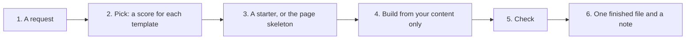

# The first tool, and how the next ones get built

A report on the artifact studio and the method behind it, 15 November 2026. The first half is for
anyone who might use the studio. The second half is for the owner: what was asked for in this
round, what was done, and what has still not been tried by anyone but the author.

**Think of it as** a workshop that has finished its first tool and, in the same week, written down
how it made it, so the second tool takes a third of the time.

## The short version

- **The artifact studio is complete as a draft.** It turns your notes into a page, a slide deck or
  a social post. It holds 20 templates, 53 parts and design ideas, and 9 looks, and it can choose
  between them for you.
- **It is laid out by one rule:** the base holds everything, and a level holds only what it adds.
- **One command says whether it works.** Ten gates, each with a line saying what it proves.
- **The way it was built is now its own project,** with seven stages, a gate after each, and a
  version an agent can run by itself.
- **Nobody but its author has used it.** That is the one thing this report cannot fix.

## For someone who wants to use it

### What it does

You give an assistant your notes and one sentence. You get back one finished file: a report, a
proposal, a landing page, a deck you can present from a browser, or a set of pictures to post. The
studio's job is to remove the three guesses that make an assistant's work look generic: what kind
of piece this is, how it should speak, and what it should look like.

### Use it today

| You want | Do this | Takes |
| --- | --- | --- |
| A page, a deck or a post from your notes | Open the studio page, tap **Pick**, say the job and the reader, copy the sentence, paste it into your assistant with your notes | 5 minutes |
| To see a good result first | Read one of the six worked examples below | 3 minutes |
| The rest of your colours from the one you have | Open the **Colour** tab, move the slider, copy the block | 2 minutes |
| To keep a design you admired | Tell your assistant what you saw and why it works. It files a card | 1 minute |
| To stop repeating your colours and rules | Fill in the preferences file once | 15 minutes, once |
| Your assistant to do the choosing | Connect the MCP server | 10 minutes, once |

The studio page is published beside this report as "Artifact studio". The files are in the
repository at [`workshop/drafts/artifact-studio/`](https://github.com/bar181/practical-ai/tree/studio/component-gallery/drafts/artifact-studio).

### Six worked examples: the request, then what came back

Each has the request as typed, the notes that came with it, what the studio picked, the finished
output, and a list of what a good result must have. Every business and figure is invented.

| The request, in short | What was picked | What came back |
| --- | --- | --- |
| "Get the partners to agree to Saturday opening. A short deck for Thursday." | Briefing deck, a strong fit | Six slides: the answer first, three reasons, two numbers, the options, what is not known, the decision. The notes gave no start date, so the last slide says `[needs: a date]` |
| "Ten minutes to teach new staff the allergen check." | Workshop deck, a strong fit | Seven slides: a promise, a comparison, three steps, one worked case, an exercise on a slide of a different colour, a check, a card for the wall |
| "A square post and a carousel for winter service week. Navy and yellow." | Square post and three-slide carousel | Four pictures in the Bold style. Dates and both prices exactly as given. The shop's name is a placeholder because the notes gave none |
| "Turn my October notes into one page for my partner. Answer first. Our colour is green." | One-page report, executive brief voice | A page that opens with the answer, three figures with what each was before, two next steps, and a section saying profit is missing |
| "All I have is our pink." | No template: the palette rule | Seven colours with a job each, and a table of six contrast checks, all passing |
| "I saw an annual review that opened on one huge number. Keep that for me." | No template: an inspiration card | A card describing the structure in the assistant's own words. Nothing copied |

They are in [`base/examples/`](https://github.com/bar181/practical-ai/tree/studio/component-gallery/drafts/artifact-studio/base/examples).
**No fresh assistant has been given these requests yet.** The examples were made by the assistant
that built the repository, following the skill. Each has a score sheet for when you test it.

### What is in the library

| Kind | Count | What |
| --- | --- | --- |
| Pages | 4 | Report, proposal, scrolling explainer, landing page |
| Voices | 7 | Keynote, storyteller, teacher, pitch, practical instructor, analyst, executive brief |
| Decks | 4 | Visionary, story, briefing, workshop. Speaker notes, and one slide a page when printed |
| Social formats | 5 | Square, portrait stat, story, three-slide carousel, link preview, in three styles |
| Page and photo parts | 24 | Big numbers, timeline, price table, pan and zoom, scrolling tour |
| Animated SVG | 12 | Lines that draw, bars that grow, a ring, a tick. Eleven also as GIF |
| Design ideas | 17 | Six kinds of card, six layouts, five colour ideas with a palette maker |
| Looks | 9 | Finished palettes with type |
| Starters | 11 | Each deck and social picture as one small file to copy and fill |

The build counts the library and writes these numbers into the index.

### The design ideas, new in this round

Three tabs, short on purpose.

| Tab | What it gives you |
| --- | --- |
| **Cards** | Five rules and six kinds of card: summary, stat, media, quote, option, action |
| **Layouts** | A table that picks a layout by what the reader has to do, and six layouts drawn as wireframes, each with when to avoid it |
| **Colour** | Five rules, and a palette maker: move a slider to your brand colour and it returns seven colours with a job each, checks six text and background pairs, and gives you a block to paste into your design spec |

The palette maker passes its contrast checks for every one of the 360 hues, and a test proves the
page and the server give the same colours.

## How it is laid out

One rule: **the base holds everything. A level holds only what it adds.**

```
artifact-studio/
  README.md      the front door for people
  AGENTS.md      the front door for agents: nine steps from a request to a finished file
  gates.json     the checks that must pass
  base/          everything you use: the studio page, templates, examples, forms, inspiration, source
  level-1/       use it by hand: instructions to paste into any assistant
  level-2/       adds a preferences file and the skill
  level-3/       adds an MCP server
  docs/          why it is built this way
```



A design you liked comes in at step 2: its card is read before anything is picked.

One file, `catalog.py`, holds the templates, their fit scores, the social styles and the palette
rule. The studio page, both indexes, the skill's reference sheets and the server all read it.

## For the owner: this round

### What you asked for, and what exists

| You asked | Done |
| --- | --- |
| Hosting the server: you will try it first | Left as it is. Nothing hosted |
| Archive the old level pages, do not delete | [`workshop/plans/archive/`](https://github.com/bar181/practical-ai/tree/studio/component-gallery/plans/archive) records each retired thing, what replaced it and where it is. The three pages are still on your account, untouched |
| The other nine tools: best judgement | **Not renamed.** See the judgement calls below |
| A components catalogue for other concepts: cards, layouts, colour | Three tabs, 17 ideas, a palette maker. In the index, the skill and the server |
| Be grounded on the purpose | Re-read before starting: a suite of tools a person can use, products not a course, scaffolding as the core value |
| Complete the first project, clean architecture, daily use | Front doors rewritten around "use it today". Background papers moved to `docs/`. Training leftovers removed. A layout check enforces the rule |
| Skills, server and other features reviewed against best practice | A script checks all 12 skills against the published rules. Findings below |
| Several examples of the requirement, then the output | Six, above. They are also the skill's test cases |
| Optimise the process; the method as a separate project with an agentic level 2 | `projects/agentic-process/`, below |

### The method, as its own project

The studio was rebuilt three times before its shape was right. Each wrong turn is now a rule.

| Stage | You produce | The gate |
| --- | --- | --- |
| 1. Purpose | One page: who it is for, the one job, a North Star | **A person approves it** |
| 2. Reuse check | What already exists, with dated sources | Every source dated. The decision written down |
| 3. Skeleton | The folder, both front doors and the list of gates, before any content | The layout check passes |
| 4. One real example | One request taken to one finished output | **A person says it is what they wanted** |
| 5. One source, then breadth | The facts in one file. The rest generated | The build and the link check pass |
| 6. Play the user and the agent | Worked examples, and a script that uses only what an outsider can reach | The example and agent gates pass |
| 7. Ship honestly | A status table and a scored review | Every gate passes. **One other person has used it** |

**Level 1** is a person and an assistant, with a prompt to paste at each stage. **Level 2** is the
agentic version: a small harness.

| Part of the harness | What it does |
| --- | --- |
| The `project-builder` skill | Finds the tool's stage, does that stage's work, runs its gate, and stops at the three decisions in bold above |
| `workshop/tools/gates.py` | Runs a tool's gates and ends with "All gates that ran passed" or "DO NOT SHIP" |
| `workshop/tools/check_project.py` | Checks the layout: two front doors, gates, a base, numbered levels |
| `workshop/tools/check_links.py`, `workshop/tools/check_skills.py` | No broken link. Every skill follows the authoring rules |
| `new_project.py` and the scaffold | A new tool starts with the right folders and a first gate, in one command |

The agent never changes a gate to make it pass, and never deletes retired work. **No agent has yet
taken a tool through all seven stages with it.** That run is the test of level 2.

### Is it working?

`python3 workshop/tools/gates.py drafts/artifact-studio --all`

| Gate | What it proves | Result |
| --- | --- | --- |
| layout | The folder follows the repository's layout | Pass |
| build | The studio page, every template, both indexes, the starters and the skill's sheets rebuild from source | Pass |
| examples | The six worked examples rebuild from the current starters | Pass |
| links | No Markdown link in the repository is broken | Pass, 188 files |
| skills | Every skill follows the published authoring rules | Pass, 12 skills |
| picker | The picker and the palette maker agree between the page and Python | Pass: 120 of 120 requests, 360 of 360 hues |
| example-outputs | Every example output opens cleanly with its words inside the frame | Pass, 10 of 10 |
| server | Every tool on the MCP server answers through a real client | Pass, 10 tools |
| agent | A scripted agent can pick, fetch a starter and finish a deck using the server alone | Pass |
| pages | Every tab and template renders at three widths with no error, no sideways scroll and no accessibility violation | Pass: 84 of 84 checks, 28 files at 320, 390 and 1280 pixels |

The first full run in this round failed the last gate. The Colour tab showed two examples of text
with too little contrast, as text, and the accessibility scan rightly refused them. They are now
labelled pictures. The gate did its job on the day it was written.

### Skills and server, against current best practice

| Checked against | Found | Done |
| --- | --- | --- |
| Skill authoring rules: a contents list in any reference file over 100 lines | Three files had none | Added |
| At least three test cases for a skill | No skill had any | The artifact studio skill has six. **The other ten skills have none** |
| Tool names written with their server | The skill named tools bare | Fixed |
| The skill's description says what it does and when to use it | It described pages only | Now pages, decks and social pictures |
| A tool's description says what it returns and when not to use it | Several did not, and the server's own instructions were out of date | Rewritten |
| Similar skills elsewhere | Community design skills teach the same colour ideas: tinted greys, one accent, OKLCH | Adopted in the Colour tab, with sources and dates in `base/RESOURCES.md` |

Not done: the skill has not been tested on more than one model, and no outside skill was installed
to compare side by side.

### Judgement calls

1. **The nine older drafts were not renamed.** A bulk rename would make them look converted while
   each level still held a full copy. Each moves over when it is next worked on, from stage 1.
   `workshop/tools/check_project.py` lists what is left for any of them.
2. **The script that generated the plans was archived.** It encoded the earlier layout and lived
   outside the repository. The Markdown files are now the source.
3. **Tool names on the server were not prefixed.** Assistants already name a tool by its server.

### Self-score

| Item | Last round | Now | Why |
| --- | --- | --- | --- |
| One source of truth | 88 | 90 | The palette rule, the design sheet and the examples are generated |
| Usable by an agent | 87 | 89 | Design rules and a palette tool on the server. Examples to copy the finish from |
| Correct and checked | 85 | 88 | Ten gates behind one command. Checks now fail loudly |
| Honest and current documents | 85 | 87 | Front doors rewritten. A link gate caught every move |
| Usable today by a person | 81 | 84 | A "use it today" table, examples, a palette in two minutes |
| Range and quality | 81 | 84 | Design ideas fill the gap between a template and a blank page |
| Evidence from real use | 40 | 40 | **Unchanged** |
| Scaffolding a newcomer can follow | not scored | 80 | Two tools follow one rule. Nine older drafts do not yet |

**Overall 80** on the seven lines that can be compared, up from 78. Every point gained is in
something the author can check alone.

### What has not been verified

- **Any real use.** Nobody has presented a deck, posted a picture or filed a real find.
- **The examples in a fresh chat.** They show what a full-marks result looks like. Whether an
  assistant produces one from the request alone is untested.
- **The MCP server in a desktop assistant.** It has met a test client and a script. Nothing is hosted.
- **The method on a second tool.** It is drawn from one build.
- **The fit scores.** The author's judgement.
- **A phone, Safari or Firefox.** Chrome only.

### What to try first

1. Open the studio artifact on your phone. Tap **Design**, then **Colour**, and move the slider.
2. Give a fresh chat the request and notes from the first worked example, with the briefing deck
   starter attached. Score it against the six lines.
3. Add the MCP server to Claude Desktop, using `level-3/mcp/README.md`, and ask it what it would
   make for a decision by executives.
4. Pick one older draft and say "use the project-builder skill on it, stop at the first decision".

Each of the first three takes under ten minutes, and each turns a guess in this report into a fact.

### Decisions waiting for you

| Decision | Recommendation |
| --- | --- |
| Merge the pull request into `main` | Yes, once you have opened the studio page once. Everything described here is on the branch |
| Which older draft goes through the method first | The one you need next for a client or a class |
| Test cases for the other ten skills | Add three to each as that skill's tool is next worked on |
| The name "artifact studio", now that it makes decks and posts | Keep it until someone other than us is confused by it |
