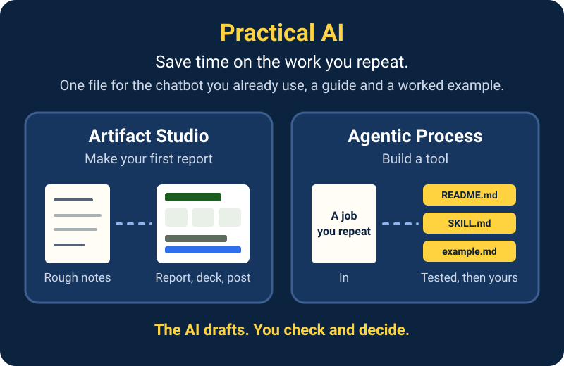

# Explainers: the two finished projects

  

**The picture, in words:** Practical AI gets better work from the AI you already use. Artifact
Studio turns rough notes into pages that look designed and tell a real story. Agentic Process
turns a job you repeat into a tested tool that catches what people miss. In both, the AI drafts
and you check and decide.

## Why this repository exists

Most people already have an AI chatbot. Left alone, it makes plain pages and misses what matters.
What they lack is a proven way to get good work from it on the jobs they repeat, every time.

**The pitch:** Practical AI gets better work from the AI you already use. Artifact Studio gives
your AI a designer's brief, so reports, decks and posts look designed and tell a real story.
Agentic Process turns a job you repeat into a tool that catches what people miss, tested before
you rely on it. Both are faster too. The AI drafts; you decide.

## The two explainer pages

Each page explains what the project does, how you use it, and where it helps. Both were made with
Artifact Studio from the project's own README. GitHub shows HTML as code, so download the file and
open it in a browser.

| Page | For | What it covers |
| --- | --- | --- |
| [`artifact-studio.html`](artifact-studio.html) | Anyone with rough notes and something to share | The first report in five minutes, your own notes, the check before sharing, and the deck, post and photo versions |
| [`agentic-process.html`](agentic-process.html) | Anyone who builds tools with a coding agent | The four builder steps, the build request, what you get back, the 93 vs 73 pilot, and how to tell it is ready |

**Also here:** the Artifact Studio library report from 15 November 2026,
[`2026-11-15-artifact-studio-library.html`](2026-11-15-artifact-studio-library.html), and its deck,
[`2026-11-15-artifact-studio-library-deck.html`](2026-11-15-artifact-studio-library-deck.html).
The originals sit with the project's evidence.

**Evidence for each project:** [Artifact Studio](../../projects/artifact-studio/quality-results/README.md) ·
[Agentic Process](../../projects/agentic-process/quality-results/README.md).

The projects themselves: [Artifact Studio](../../projects/artifact-studio/) ·
[Agentic Process](../../projects/agentic-process/). What comes next: [the priority list](../README.md#what-comes-next).

Made by [Bradley Ross](https://www.linkedin.com/in/bradaross/).
