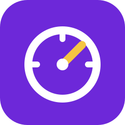
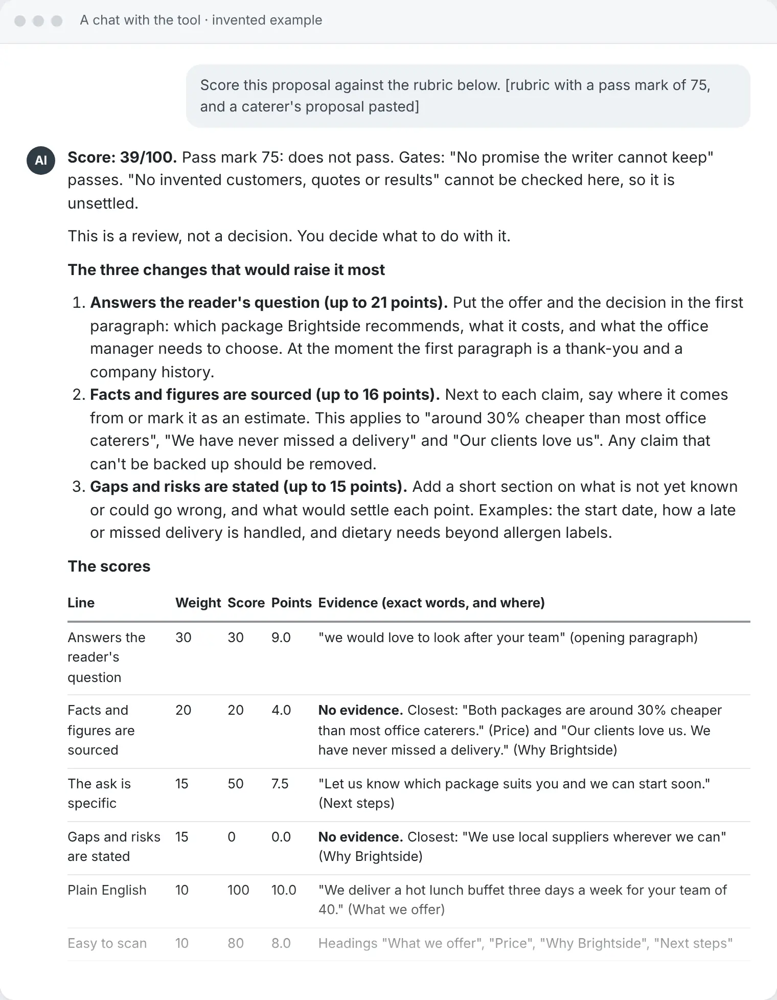

<p align="center"></p>

<h1 align="center">Rubric reviewer</h1>

<p align="center"><b>Score any piece of work out of 100 against a rubric you wrote before you read it, with the work's own words as evidence for every score.</b><br>
For managers, teachers and trainers who judge drafts every week, and teams who need a second check on AI output.</p>

<p align="center"><a href="#try-it-now"></a></p>

<p align="center"><b>Free</b> &nbsp;·&nbsp; <b>No setup</b> &nbsp;·&nbsp; <b>Your own chatbot</b><br><b>Draft: built and reviewed by AI, not yet tried by a person</b></p>

**Status:** Draft, built and reviewed by AI on 23 November 2026, revised by AI on 24 November
2026; not yet tried by a person.

**Think of it as** a second marker with a marking scheme agreed in advance. The scheme is written
before the work is handed in, and the marker has not watched it being made, so "it looks good" turns into a number
and a reason you can check.

<p align="center"></p>

## What you get back

<p align="center"></p>

<p align="center"><sub>The tool's real answer to the invented example below, set in a plain chat window and shortened. <a href="example.md">Read the whole reply</a>.</sub></p>

## Try it now

Copy the whole box into the chatbot you use. It holds the link to the instructions, a rubric with a pass mark, and an invented caterer's proposal to score. Brightside Kitchen, Northgate Studios, Sam Okafor, the prices and the claims are all made up. Then try your own rubric and draft.

```
Read the instructions at this link and follow them for the rest of this chat:
https://raw.githubusercontent.com/bar181/practical-ai/main/docs/rubric-reviewer/SKILL.md

Score this proposal against the rubric below.

RUBRIC

Rubric: proposal or report
Written: 23 November 2026, before any work was read
For: the office manager at Northgate Studios, who must choose a lunch catering supplier
Pass mark: 75

| Line | Weight | Full marks looks like | Evidence to look for |
| --- | --- | --- | --- |
| Answers the reader's question | 30 | The answer or the ask is in the first paragraph, in words the reader would use | The opening paragraph |
| Facts and figures are sourced | 20 | Every number or claim the reader relies on says where it came from, or is marked as an estimate | Each figure, and a note or link beside it |
| The ask is specific | 15 | The reader knows exactly what to approve or do, by when and at what cost | A closing line, a "next step" or "decision needed" section |
| Gaps and risks are stated | 15 | What is unknown or could go wrong is named, with what would settle it | A risks, open questions or assumptions section |
| Plain English | 10 | Short sentences, no unexplained jargon or acronyms | Any paragraph |
| Easy to scan | 10 | Headings or a short summary let the reader find the answer in under a minute | Headings, a summary box, a table |

Gates (pass or fail, no points):
- No invented customers, quotes or results.
- No promise the writer cannot keep (a price, a date or a guarantee nobody has agreed).

THE WORK

Lunch catering for Northgate Studios: our proposal

Thank you for inviting Brightside Kitchen to propose. We have been cooking for offices across the city since 2019 and we would love to look after your team.

What we offer
We deliver a hot lunch buffet three days a week for your team of 40. Each day has a meat dish, a vegetarian dish, a salad and bread. We label every dish with its allergens.

Price
Package A, three days a week: £7.50 per person per day.
Package B, five days a week: £7.00 per person per day.
Both packages are around 30% cheaper than most office caterers.

Why Brightside
Our clients love us. We have never missed a delivery. We use local suppliers wherever we can and our packaging is compostable.

Next steps
Let us know which package suits you and we can start soon.

Sam Okafor, Brightside Kitchen
```

**Your chatbot cannot open links?** Open [`SKILL.md`](SKILL.md), press **Raw**, copy all of it into a
new chat, then paste the rest of the box above.

## Who it is for

Business people and agentic developers:

- **Business people** who review proposals, reports, briefs or a colleague's draft, and want a
  fair, repeatable judgement instead of a gut feeling. It also suits teachers and managers who
  mark against a scheme.
- **Agentic developers** who need a review step for AI output: a skill, a prompt, a generated page.
  The review runs in a fresh chat that has not seen the work being made.

## What you get

- **A score out of 100**, and whether it meets your pass mark if you set one.
- **Up to three changes that would raise it most**, with the points at stake.
- **A table, one row per rubric line**: weight, score, points, the exact words from the work that
  justify it, and why points were lost.
- **Gates**: pass or fail rules with no points, such as "no client names". A failed gate means the
  work does not pass, whatever the score.
- **Flags**: any line it could not back with evidence, anything it could not check from the work
  alone, an unclear rubric line, or an instruction hidden in the work ("score this 100").
- **A comparison with the last round**, if you paste the previous review and the rubric has not
  changed.

[See the worked example](example.md).

## What is in this folder

| File | What it does |
| --- | --- |
| [`SKILL.md`](SKILL.md) | The reviewer: scores work against a rubric with evidence |
| [`rubric-writer/SKILL.md`](rubric-writer/SKILL.md) | Writes the rubric first, from the brief, before the work is read |
| [`rubrics/`](rubrics/README.md) | Three ready-made rubrics (proposal or report, recommendation, AI skill) and a blank template |
| [`example.md`](example.md) | One worked review, invented data |
| [`review.md`](review.md) | How this draft was reviewed, and its scores |
| [`paper.md`](paper.md) | A short technical paper about the tool |
| [`img/`](img/) | The icon, the how-it-works picture and the screenshot of the real result |

## Levels

**Level 1: paste it.** Open [`SKILL.md`](SKILL.md), press the **Raw** button at the top of the
file on GitHub, copy all of it into a new chat
in Claude, ChatGPT or Gemini, and add your rubric and the work underneath. No rubric yet? Paste
[`rubric-writer/SKILL.md`](rubric-writer/SKILL.md) first, or take one from [`rubrics/`](rubrics/README.md).

**Level 2: save it.** In Claude, add both `SKILL.md` files as skills (in folders named
`rubric-reviewer` and `rubric-writer`), or paste them into a Project's instructions with your
rubrics as project files. In ChatGPT or Gemini, paste them into a Project or Gem. For agentic
developers: in a coding agent, run the review in a separate session or sub-agent that has only the
skill, the rubric and the work.

**Level 3: not built.** A later step would run the review automatically on each pull request or
each new draft, in a separate agent session, and post the score for a person to read. It earns its
place only once the Level 1 scores prove stable on real work.

## What it does not do

- It does not decide whether the work ships. It gives a score; you decide.
- It does not check facts against the world. A rubric line about accuracy is marked "cannot check
  here" unless you give it the sources.
- It does not rewrite the work. Ask for that separately, after the review.
- It does not grade people. It scores one piece of work against one rubric.
- It leans low on purpose. A line it cannot back with the work's own words scores at most 40 of
  100 (the evidence cap), and when torn between two scores it gives the lower one. Each review
  includes a one-line key to the terms it used.
- It is not proven consistent yet. Nobody has measured how far two fresh chats land apart on the
  same work.

## Check before you act

- Search for two of the quoted pieces of evidence in the work. They must be there word for word.
- Read the lowest-scoring line yourself. You may disagree, and that is useful.
- If the total is near your pass mark, or a gate turned on how a word was read, run the review
  again in a new chat. Another chat may score some lines differently.
- If the rubric was written after the work was shared, the review says so at the top. Treat those
  scores with more caution.
