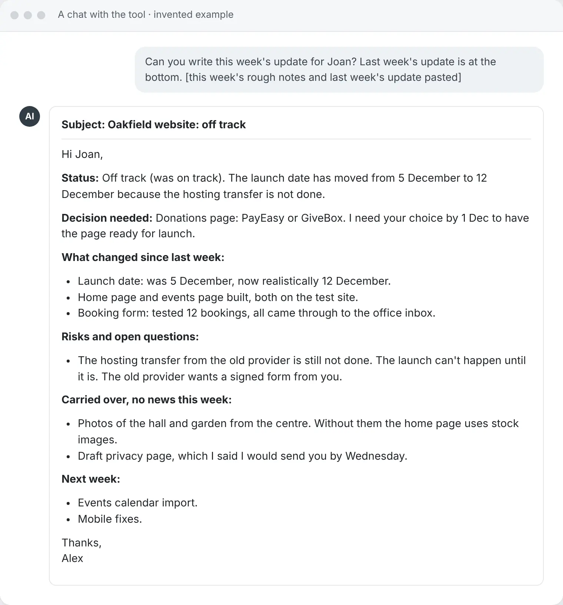

<p align="center"></p>

<h1 align="center">Weekly status update</h1>

<p align="center"><b>Turn a week of rough notes into a short update your reader can act on in two minutes, and never let last week's risk or promise disappear without a word.</b><br>
For project leads, freelancers and anyone who reports on work every week.</p>

<p align="center"><a href="#try-it-now"></a></p>

<p align="center"><b>Free</b> &nbsp;·&nbsp; <b>No setup</b> &nbsp;·&nbsp; <b>Your own chatbot</b><br><b>Draft: built and reviewed by AI, not yet tried by a person</b></p>

**Status:** Draft, built and reviewed by AI on 23 November 2026; not yet tried by a person.

**Think of it as** a good project secretary on a Friday afternoon. She reads your scribbles and last
week's report side by side, puts the one thing the boss must know at the top, and asks you, "What
happened to the dock repair? You mentioned it last week."


<p align="center"></p>

## What you get back

<p align="center"></p>

<p align="center"><sub>The tool's real answer to the invented example below, set in a plain chat window. Its checks before you send come after the email. <a href="example.md">Read the whole reply</a>.</sub></p>

## Try it now

Copy the whole box into the chatbot you use. It holds the link to the instructions, a freelancer's rough notes for the week and last week's update. Oakfield Community Centre, Joan, Alex, PayEasy, GiveBox, the dates and the figures are all made up. Then try your own notes.

```
Read the instructions at this link and follow them for the rest of this chat:
https://raw.githubusercontent.com/bar181/practical-ai/main/docs/weekly-status-update/SKILL.md

Can you write this week's update for Joan? She's the centre manager and she decides whether we launch on the date and signs off the content. Last week's update is at the bottom.

My notes this week:
- good week!
- home page and events page built, both on the test site
- booking form: tested 12 bookings, all came through to the office inbox
- hosting transfer from the old provider still not done, they want a signed form from Joan. launch can't happen till the transfer's done. realistically 12 Dec now
- donations page: Joan needs to pick PayEasy or GiveBox, I need it by 1 Dec to have it ready for launch
- next week: events calendar import, mobile fixes
- note to self: renew my own software licence

LAST WEEK'S UPDATE (as sent)

Subject: Oakfield website: on track

Hi Joan,
We are on track to launch on 5 December.
Done: site design approved, test site set up.
Risk: we still need the photos of the hall and garden from the centre. Without them the home page uses stock images.
Next week: home page, events page, booking form. I will also send you the draft privacy page by Wednesday.
Thanks,
Alex
```

**Your chatbot cannot open links?** Open [`SKILL.md`](SKILL.md), press **Raw**, copy all of it into a
new chat, then paste the rest of the box above.

## Who it is for

Business people and agentic developers (developers who build with AI agents): anyone who reports
on work every week. Project leads
writing to a director, freelancers updating a client, team members writing a Friday note,
developers summarising a sprint for someone who does not read the tickets.

## What you get

- **The update, ready to copy**: the status first (on track, at risk or off track, with the
  reason), any decision the reader must make with a deadline, what changed since last week with
  old and new values, risks, and next week. Under 200 words by default.
- **"Carried over, no news this week"**: anything from last week's update that this week's notes do
  not mention, instead of letting it vanish.
- **Checks before you send**, kept apart from the update: questions for you, what it assumed, what
  it left out as not for this reader, and the word count.

[See the worked example](example.md).

## What is in this folder

| File | What it does |
| --- | --- |
| [`SKILL.md`](SKILL.md) | The tool: notes and last week's update in, the update and checks out |
| [`notes-template.md`](notes-template.md) | A template to jot notes in during the week, so Friday takes minutes |
| [`rubric.md`](rubric.md) | A rubric to score an update, alone or with the rubric reviewer |
| [`example.md`](example.md) | One worked example, invented data |
| [`review.md`](review.md) | How this draft was reviewed, and its scores |
| [`paper.md`](paper.md) | A short technical paper about the tool |
| [`img/`](img/) | The icon, the how-it-works picture and the screenshot of the real result |

## Levels

**Level 1: paste it.** Open [`SKILL.md`](SKILL.md), press the **Raw** button at the top of the
file on GitHub, and copy all of it into a new chat in Claude, ChatGPT or Gemini. Underneath, add
this week's notes, who reads the update and what they decide, and last week's update as sent.

**Level 2: save it.** In Claude, add `SKILL.md` as a skill (in a folder named
`weekly-status-update`), or make a Project for the work with the skill in its instructions. Each
Friday, paste the week's notes in the same Project. In ChatGPT or Gemini, use a Project or Gem the
same way. Keep each sent update in the Project so next week's comparison has it.

**Level 3: not built.** A later step would gather the week's notes for you from a task tracker, a
calendar or a notes app through a connector, and draft the update on Friday for you to check. A
person still sends it. It earns its place only once the Level 1 version is used weekly.

## What it does not do

- It does not send anything. You check the update and send it.
- It does not find facts that are not in your notes. If the notes are thin, the update is thin, and
  the checks say what is missing.
- It does not invent decisions. If a problem may need the reader to decide, it asks you.
- It does not read your tools (tracker, email, calendar) at Level 1. You paste what matters.

## Check before you send

- Every date and number against your notes.
- The status: would your reader agree, given the risks listed under it?
- Every item under "Carried over, no news this week": settle it, or keep it there on purpose.
