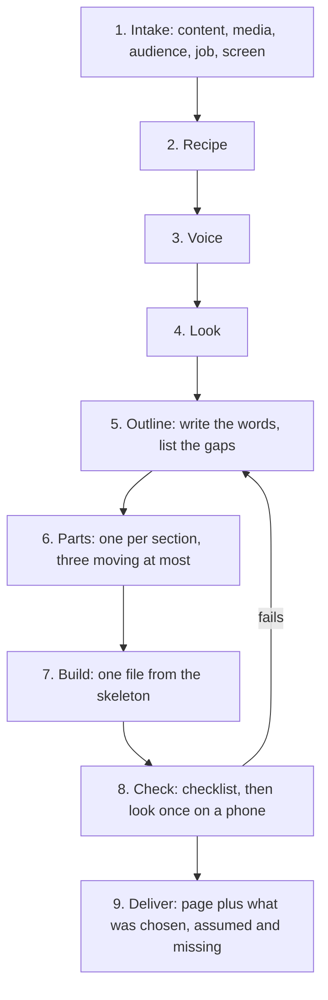

# Best practices: making and using studio pages

How to turn any content into a page that is worth opening, and why each practice is here. This is
the reasoning behind the [skill](../../skills/artifact-studio/SKILL.md) and the
[student guide](STUDENT-GUIDE.md). Read it when a page came out wrong and you want to know which
rule was broken.

**Think of it as** a kitchen's house rules. The menu changes. The rules about clean knives and
tasting before serving do not.

## The method in one picture

The order matters. Each choice narrows the next one. Choosing colours before the voice is how
pages end up pretty and pointless.

## Ten practices

### 1. Decide the job of the page before anything else

One sentence: who reads it and what they should do afterwards. If you cannot write that sentence,
no design will rescue the page.

*Why:* every later choice is judged against it. A report that should inform and a proposal that
should close are different pages even with the same numbers.

### 2. Choose the recipe, then the voice, then the look

*Why:* the recipe fixes what must be on the page. The voice fixes the order and the wording. Only
then is there anything for the look to dress. The seven voice demos use identical facts and come
out as seven different pages. That difference comes from order and emphasis, not from colour.

### 3. A voice changes structure, not only tone

Asking for "a friendly tone" changes adjectives. Asking for the teacher voice puts an analogy
first, an example second and the detail third. Describe the order you want.

*Why:* assistants follow structure reliably and tone loosely. Structure is also what readers
remember.

### 4. Take the look from something real

A brand spec, or a photograph you supply. The method for pulling a palette from a photo is in
[`looks.md`](../../skills/artifact-studio/references/looks.md).

*Why:* left to choose, an assistant returns to the same few looks. A real source gives the page a
reason to look the way it does. The demo's fog and pine colours were measured from the lake photo.

### 5. Never let the assistant invent facts

No made-up numbers, names, customers or quotes. Gaps are marked on the page as `[needs: ...]`.

*Why:* an invented figure on a polished page is more dangerous than on a rough one, because polish
reads as authority. This is the rule that protects the person who sends the page.

### 6. Every part must carry content

Use a component because a section needs it. Big numbers for results. A timeline for a schedule. A
comparison table for a choice.

*Why:* decoration costs attention and returns nothing. The test: delete the part. If nothing is
lost, it should not have been there.

### 7. Three moving parts at most, and motion must mean something

Motion is for showing what changed, where to look or how far along the reader is. Everything is
readable before any animation runs, and with motion turned off.

*Why:* a page where everything moves reads as a template. Some readers turn motion off for
medical reasons, and their page must be complete.

### 8. Build for the phone first

Design at 390 pixels wide. Nothing scrolls sideways. Tap targets are 44 pixels high.

*Why:* a link sent by message is opened on a phone. A page that only works on a laptop fails most
of its readers on first contact.

### 9. One self-contained file

No build step, no network, fonts and images inside the file.

*Why:* it can be emailed, saved, opened offline and published as an artifact without anything
breaking. A library is added only when it does substantial work, and the person is told.

### 10. Check, then look once

Run the [pre-ship checklist](../../skills/artifact-studio/references/pre-ship-checklist.md). Then
open the page on a phone and read it top to bottom as the recipient would.

*Why:* the checklist catches what can be listed. The read-through catches what cannot: a sentence
that sounds wrong, a number that is technically right and misleading.

## Using content of different kinds

| You have | Do this | Watch for |
| --- | --- | --- |
| Rough notes | Use them as they are. The assistant structures them | Notes that assume context. Add one line on who the reader is |
| A long document | Say which recipe, and what the reader should do afterwards | The page inheriting the document's order instead of the recipe's |
| A spreadsheet | Name the period and the comparison (this month against last) | Totals that do not add up. Ask the assistant to check and say so |
| Photos | Attach them and say what each shows | Crops that lose the subject at phone width |
| A video | Give the link, or the file plus a still image for a poster | A single-file page cannot hold a large video. It links to it |
| A transcript | Ask for the customer's own words to be kept as quotes | Paraphrases presented as quotations |

## Describing what you want

The assistant builds what you describe. These phrasings work because they name structure.

| Weak | Strong |
| --- | --- |
| Make it look professional | Use the executive brief voice: decision first, one options table, no images |
| Make it pop | Open with the one number that matters, very large, and nothing else on the screen |
| Add some animation | Draw the line of the diagram as I scroll, and keep everything else still |
| Use my brand | Colours and fonts are in the attached spec. The accent is for buttons only |
| Make it shorter | Cut it to the recipe's sections. Drop any section my notes do not fill |

## Extending the studio

| To add | Do this | It is ready when |
| --- | --- | --- |
| A component | Add a section to `level-demo/source/views/30-parts.html` with an `@@ask` line | It works at phone width, with motion off, and has a sentence |
| A voice | Add `views/4N-voice-name.html` and a card in `voices.md` | It changes the order of the content, and has a full example |
| A recipe | Add `views/5N-recipe-name.html` and a card in `recipes.md` | The same page type has been built by hand twice |
| A look | Add a card in `looks.md` | It has been used on one real page |

Then run `python3 build.py` in `level-demo/source/`. It rebuilds the demo and regenerates
`level-simple/sentences.md` and the component catalogue, so the documents cannot drift from the
demo.

## Testing

| Test | How | State |
| --- | --- | --- |
| Renders without errors | Open every tab in Chrome at 320, 390 and 1280 pixels wide | Done by the author |
| Complete at rest | Turn scripts off. The first screen shows content and the tabs switch | Done by the author for the four studio pages |
| Found by a person on a phone | The owner opened the first studio artifact and could not find the examples. See round 3 in `docs/SELF-REVIEW.md` | One person, once |
| Works with motion off | Turn on "reduce motion" in the system settings and reload | Checked in code, not on a device |
| Sentences reproduce the result | [`level-simple/sentence-test.md`](level-simple/sentence-test.md) | Not yet run |
| The skill works for a second agent | Give a fresh agent the skill and one set of notes | Not yet run |
| A beginner can follow the guide | Watch one person do level 1 without help | Not yet run |

## What this document rests on

- The repository's ground rules in the root `README.md`: reuse before building, a person approves
  what goes out, examples are synthetic, dated claims.
- The dated review of browser features, libraries and existing skills in
  [`landscape-review.md`](landscape-review.md).
- Building the demo pages: seven voices, four recipes and twenty-four parts. Practices 2, 3, 6 and 7 came out of that work and
  have not been tested with other people yet.
