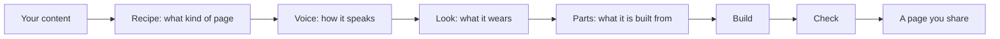

# Artifact studio

Pick a page type, a voice and a look. Get a page worth sharing.

**Think of it as** ordering at a counter. The recipe is the dish, the voice is how you like it, the
look is the plate. You point at the menu. The assistant cooks.

**North Star:** a person with no design training gives an assistant their own notes and one
sentence, and gets back a page they are proud to send, on the first or second try.

**Who it is for:** anyone who asks an AI assistant for a report, a proposal, an explainer or a
landing page and gets something that works but looks and sounds generic. Also the agents that
build those pages, through the skill.

## Start here

| You are | Open |
| --- | --- |
| A person who wants a page today | [`STUDENT-GUIDE.md`](STUDENT-GUIDE.md) |
| An agent, or someone setting one up | [`AGENT-GUIDE.md`](AGENT-GUIDE.md) |
| Curious how and why it works | [`BEST-PRACTICES.md`](BEST-PRACTICES.md) |
| Looking for what already exists in this area | [`landscape-review.md`](landscape-review.md) |
| Wanting the whole toolkit on one page | [`docs/practical-ai-explained.html`](../../docs/practical-ai-explained.html) |

## How it works

Three choices, made in this order.

| Choice | Options | Where they are defined |
| --- | --- | --- |
| Recipe | One-page report, proposal, scrolling explainer, landing page | [`recipes.md`](../../skills/artifact-studio/references/recipes.md) |
| Voice | Keynote, storyteller, teacher, pitch, practical instructor, analyst, executive brief | [`voices.md`](../../skills/artifact-studio/references/voices.md) |
| Look | Nine look cards, your own design spec, or colours taken from a photo | [`looks.md`](../../skills/artifact-studio/references/looks.md) |
| Parts | 12 page components and 12 photo components | [`components.md`](../../skills/artifact-studio/references/components.md) |

## Levels

The repository's level folders map onto three levels of skill.

| Level | Folder | What you do | Complexity |
| --- | --- | --- | --- |
| Demo | [`level-demo/`](level-demo/) | Look. [One file](level-demo/artifact-studio.html) with every recipe, voice and component working | None |
| Beginner | [`level-simple/`](level-simple/) | Copy one sentence, attach your notes. [Level 1 page](level-simple/artifact-studio-beginner.html) | Beginner |
| Advanced | [`level-working/`](level-working/) | Choose the recipe, voice, look and parts. Fill in a design spec once. [Level 2 page](level-working/artifact-studio-advanced.html) | Intermediate |
| Expert | [`level-automated/`](level-automated/) | Install the skill. Hand over any content and media and get a checked page back. [Level 3 page](level-automated/artifact-studio-expert.html) | Advanced |
| Student projects | [`student-projects/`](student-projects/) | Pages built by students, shared with permission | |
| Commercial grade | [`commercial-grade/`](commercial-grade/) | What a commercial build adds. An explanation, never a project | |

## Status

Draft. Built and checked by its author only.

| Item | State |
| --- | --- |
| Demo | Built. Renders in Chrome at phone and desktop width with no script errors |
| Sentences | Written. **Not yet tested** in fresh chats. See [`level-simple/sentence-test.md`](level-simple/sentence-test.md) |
| Skill | Written. **Not yet run** end to end by a second agent |
| Real devices | Not checked on an iPhone, an Android phone, Safari or Firefox |
| Review | Nobody other than the author has used it |

It moves to `projects/` when the sentence test has been run and one other person has built a page
with it.

## What is invented and what is real

Every company, person and figure in the examples is made up, and each page says so. The two
photographs are real and were taken by the repository owner. They carry no location data.
