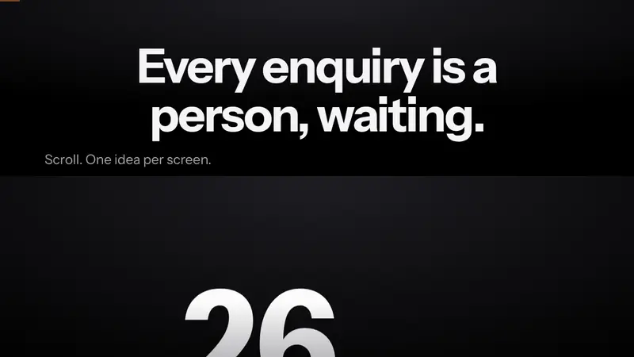
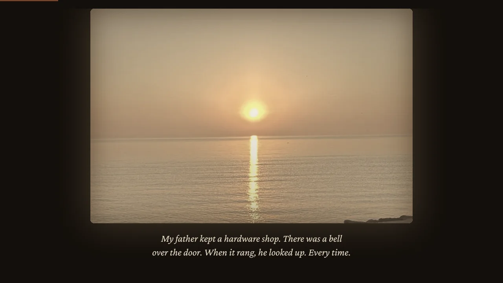
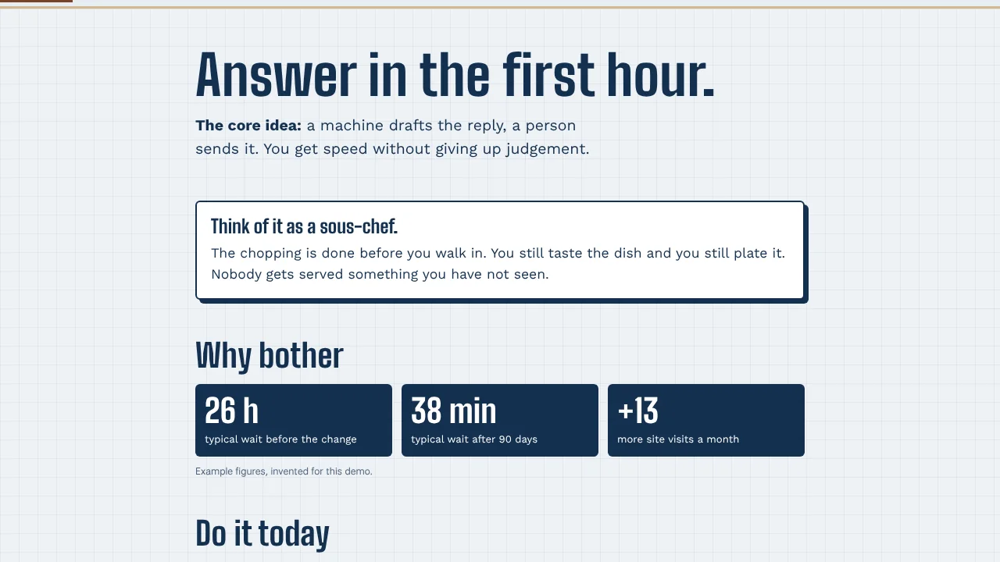
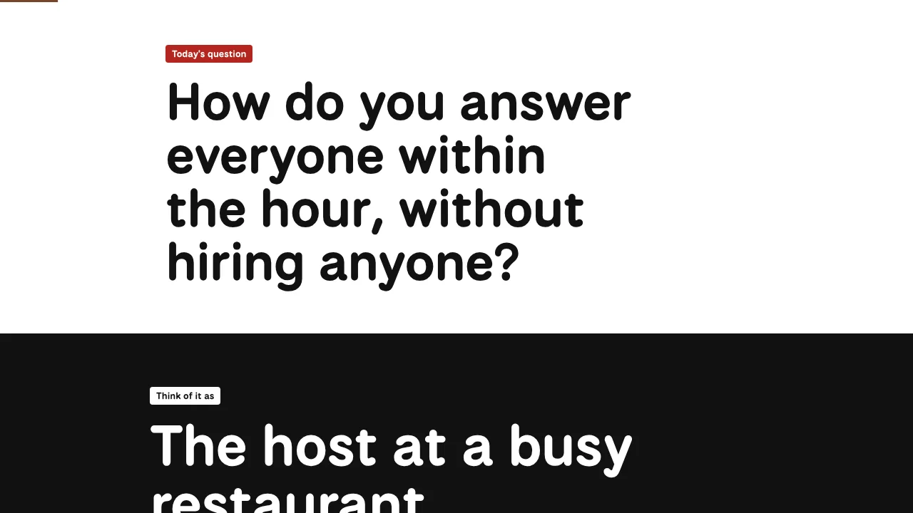
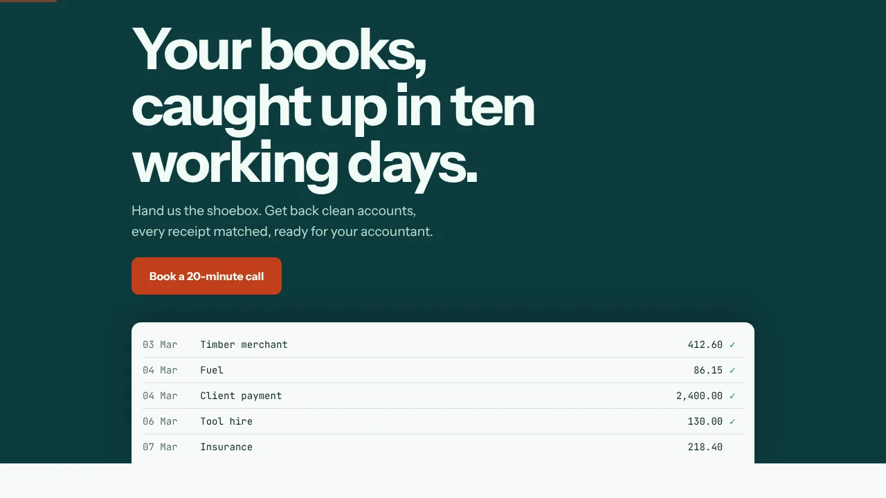
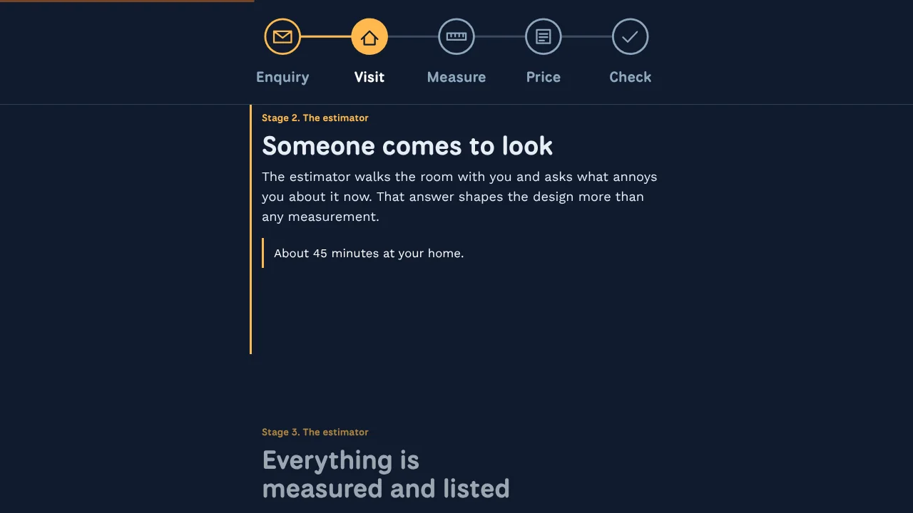
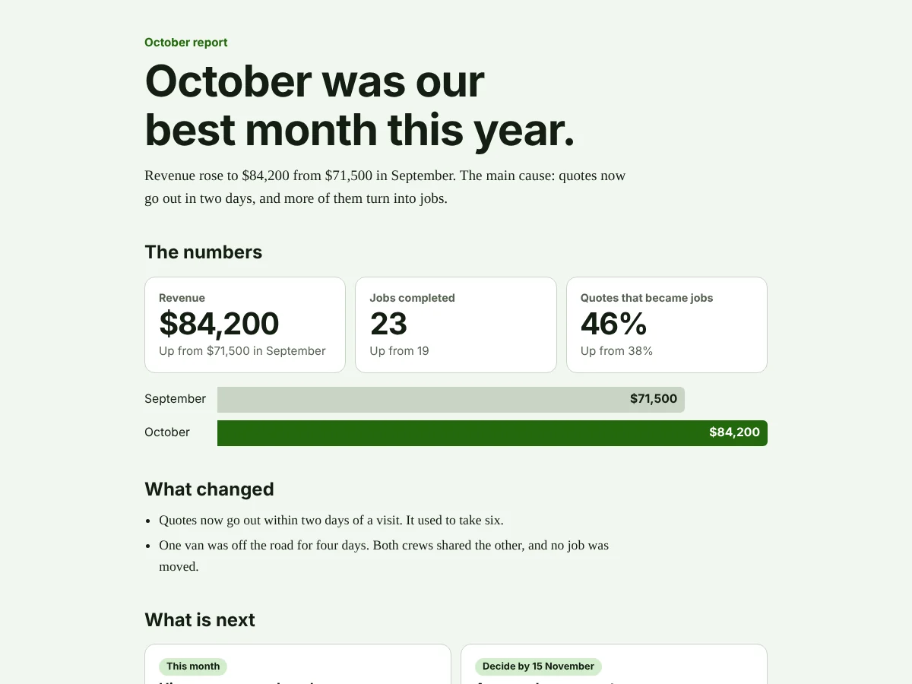
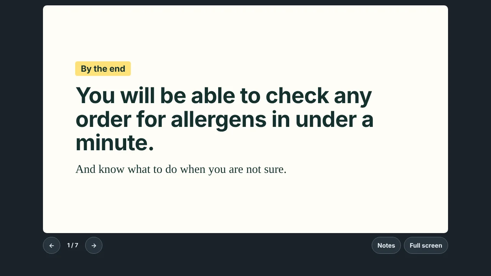
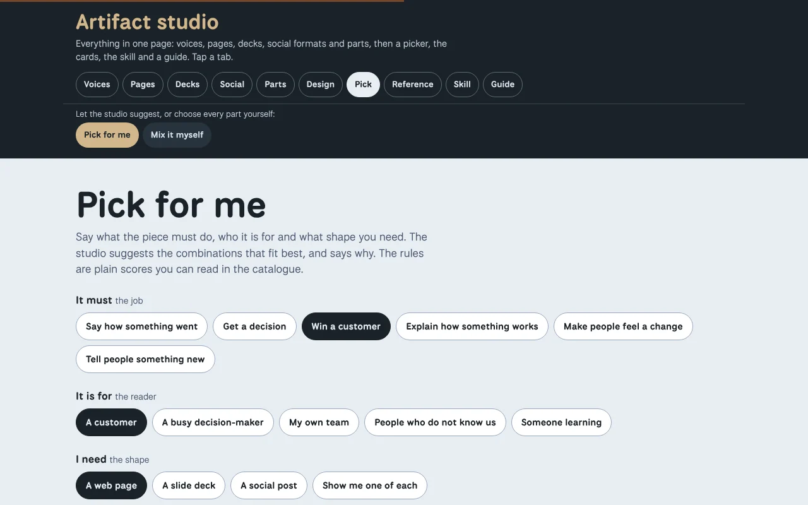

# Artifact Studio: turn any AI answer into a beautiful slide deck or report

<p align="center">
  
</p>

<h3 align="center">Your AI gives brilliant answers. Then it shows them on a grey page.</h3>

<p align="center"><b>Say "show this as a presentation" and get one you would be proud to present.</b><br>
The page above is the keynote template from the library. Your chatbot builds yours from it.</p>

**Artifact Studio is a free, curated library of modern design templates that turns any AI answer
into a professional slide deck, report or web page.** Use it with the chatbot you already have:
ChatGPT, Claude, Gemini, Microsoft Copilot, Grok, Perplexity, Mistral Le Chat or DeepSeek. Paste
one link and say "show this as a presentation", or tailor it to your own brand. Running a personal
agent such as Grok Bot or Muse, or agents of your own? Hand them the same library and they design
for you.

```
Use the design guide at https://raw.githubusercontent.com/bar181/practical-ai/scaffold/structure/drafts/artifact-studio/level-1/AI-INSTRUCTIONS.md and show this as an HTML presentation in the keynote voice.
```

<p align="center">
  <a href="#use-it-today"><b>Use it today, free</b></a> &nbsp;·&nbsp;
  <a href="#what-is-inside">See what is inside</a> &nbsp;·&nbsp;
  <a href="#where-it-saves-your-time">Where it saves time</a> &nbsp;·&nbsp;
  <a href="#if-you-are-someones-agent">For agents</a>
</p>

## One sentence, not one afternoon

<p align="center">
  
</p>

**By hand,** a deck you like takes anywhere from an hour to several days: open PowerPoint, pick a
theme, copy and paste the content, hunt for images, add a chart, fix the alignment, start again.

**Chatbots can already build pages and slide decks,** often called artifacts. Left alone, they
build boring ones, and even experienced users lose hours asking for one fix after another.

**Artifact Studio closes that gap.** It gives your AI what a designer would bring: proven
templates, a voice, a look and rules for what good looks like. You get most of the way to a draft
you can use, in the time it takes to type a sentence.

## And that is not all: one set of notes, every version

<p align="center">
  
</p>

The deck for the board is done. Now the operations team needs the same content as a how-to guide.
You do not start again. You say:

> Create another version of this for my operations team, as a report.

Same facts, new shape, new voice. A deck becomes a report, a report becomes a week of posts.

## Where it saves your time

<p align="center">
  
</p>

| Job you repeat | By hand | With the studio | Your part |
| --- | --- | --- | --- |
| **A slide deck from your notes.** Start here | 1 hour to several days | About 5 minutes to a draft | Check every number. Decide what to cut |
| **A one-page report**, weekly or monthly | 1 to 2 hours | About 5 minutes | Confirm the figures and the conclusion |
| **A second version for a new audience** | 1 hour or more | About 2 minutes | Check the tone suits the reader |

These are estimates, not measurements. The point is the shape of the saving: the AI does the
layout and the first draft, and you keep the judgement.

## What is inside

<!-- counts -->20 templates (4 pages, 7 voices, 4 decks, 5 social formats), 53 components (12 page parts, 12 photo parts, 12 animated SVG files with 11 GIF copies, 17 design ideas for cards, layouts and colour) and 9 looks<!-- /counts -->. Every one comes with the sentence that asks for it.

### Seven voices: tell your story the way great communicators do

The same facts land differently depending on who is telling them. Pick a voice by name.

<p align="center">
  
  
</p>
<p align="center">
  
  
</p>

| Voice | Inspired by | Use it when |
| --- | --- | --- |
| **Keynote** | Steve Jobs's product launches | The reader should feel that something new is possible |
| **Storyteller** | Donald Miller's story framework | Your customer is the hero and you are the guide |
| **Teacher** | David Malan's lectures | Someone has to understand how a thing works |
| **Pitch** | Don Draper's carousel pitch | You are selling a feeling, not a feature |
| **Practical instructor** | Bradley Ross's own teaching style | People need the core idea, one analogy and steps for today |
| **Analyst** | Barbara Minto's pyramid principle | The evidence has to carry the argument |
| **Executive brief** | The board decision memo | A busy person has to decide |

Each voice describes a style. Nothing is written by, or endorsed by, the people named.

### Cinematic photo effects, from a single photo

<p align="center">
  
</p>

Twelve photo parts built from one picture, each small enough for a chatbot to write in one reply:
pan and zoom, parallax window, photo-filled type, scrolling photo tour, self-drawing line art,
chart from the photo, before and after, frosted glass card, bento grid, swipe gallery, flip
postcard, and matched looks and voices.

### Decks you present straight from the browser

<p align="center">
  
  
</p>

Four decks: **visionary**, **story**, **briefing** and **workshop**. Each is one file. Open it,
press the arrow keys, go full screen. No PowerPoint, no export.

### Nine looks, so nothing you make looks like a default

<p align="center">
  
</p>

The same line of content, dressed nine ways. Ask for a look by name, or hand over a photo or your
brand colours and let the studio build one.

### Pages that do one job well

<p align="center">
  
  
</p>

A **landing page**, a **scrolling explainer**, a **proposal** and a **one-page report**. Plus
five **social formats**, twelve animated SVG parts, and design ideas for cards, layouts and colour.

<p align="center">
  
</p>

## AI is a smart intern. This is its design brief

Bradley Ross teaches AI as a **smart intern**: a new hire who has read every book in the world and
has never met you. It is fast and capable. It does not yet know your priorities, your tone or what
good looks like in your business. Give it that, and the work changes.

**Think of it as** the design brief you hand that intern on day one. You bring the content and the
judgement. The studio brings the taste.

**North Star:** a person with no design training gives an assistant their own notes and one
sentence, and gets back something they are proud to send, on the first or second try.

## Use it today

Free and open source. No sign-up. Nothing to install.

**The no-effort way: one link.** In a chatbot that can open links, paste this with your notes or
after any answer you want to present:

```
Use the design guide at https://raw.githubusercontent.com/bar181/practical-ai/scaffold/structure/drafts/artifact-studio/level-1/AI-INSTRUCTIONS.md and show this as an HTML presentation in the keynote voice.
```

**If your chatbot cannot open links,** open [the instructions](https://github.com/bar181/practical-ai/blob/scaffold/structure/drafts/artifact-studio/level-1/AI-INSTRUCTIONS.md),
press the copy button at the top right, and paste them in before your request. In a Project, you
only do this once.

**Then ask for anything in the library:**

```
Turn my notes into a keynote-style deck: black slides, one idea each, huge type.
```
```
Tell this as a story on one page, with my customer as the hero and us as the guide. Use my photo large.
```
```
Turn this spreadsheet into a one-page report: a two-sentence summary, four key numbers, one chart and what happens next.
```
```
Create another version of this for my operations team, as a report.
```

**Always check the result.** Open it on your phone. Check every number and name against your
notes. The assistant is told to use only what you gave it and to list what it assumed. You sign it.

Every sentence for every template is in [`base/sentences.md`](base/sentences.md).

### Three levels, when you want more

| Level | For you if | What changes |
| --- | --- | --- |
| **[1. Beginner](level-1/)** | You want a result today | Paste the link or the instructions. This is the whole product |
| **[2. Advanced](level-2/)** | You make things every week | A [preferences file](level-2/preferences-template.md) and a [skill](../../skills/artifact-studio/) hold your brand, tone and rules, so a short ask comes back in your style |
| **[3. Expert](level-3/mcp/)** | You run agents or build for a team | An MCP server gives agents the library as ten tools: browse, get a scored recommendation, pull starter code, make a palette |

<details>
<summary>See four real requests and what came back</summary>

Every business and figure is invented.

- **"I need the partners to say yes on Thursday."** A briefing deck. [Request and notes](base/examples/01-briefing-deck/request.md)

  

- **"How did October go? She reads on her phone."** A one-page report. [Request and notes](base/examples/04-one-page-report/request.md)

  

- **"New staff start Monday and I have ten minutes."** A workshop deck. [Request and notes](base/examples/02-workshop-deck/request.md)

  

- **"We have an offer on this week."** A square post and a carousel. [Request and notes](base/examples/03-social-set/request.md)

</details>

<details>
<summary>Not sure which template fits? Use the picker</summary>

Say what the piece must do, who it is for and what shape you need. The studio page scores every
template and says why it picked one. Download [`base/studio.html`](base/studio.html) and open it
in a browser. GitHub shows HTML files as source, so it has to be downloaded first.



</details>

## If you are someone's agent

Do not work from this page. Follow this path:

1. Read [`AGENTS.md`](AGENTS.md) in this folder. It is the nine steps from a request to a finished file.
2. Choose a template from [`base/templates/index.json`](base/templates/index.json), or call `recommend` if the MCP server is connected.
3. Build from the person's content only, on the starter or skeleton the index names.
4. Check your work against the checklist `AGENTS.md` points to, and report what you assumed.

## Status

**Closed as a draft on 15 November 2026.** Built and checked by its author only. Nobody else has
used it yet, so tell us what you find.

| Part | State |
| --- | --- |
| Library, picker, palette maker | Built. Every gate passes |
| Chatbots | Built with Claude. **Not yet run** in the other assistants named on this page |
| The one-link method | The link opens. **Not yet tried** from inside each chatbot |
| Worked examples | Written, with outputs. No fresh assistant has been given the requests yet |
| MCP server | Tested through a client. Not yet tried in a desktop assistant. Nothing is hosted |
| Real use | **None yet.** Nobody has presented a deck or posted a picture made with it |
| Devices | Chrome only. Not checked on a phone, Safari or Firefox |

Every company, person and figure in the templates and examples is made up, and each says so. The
photographs inside the templates are real, were taken by the repository owner and carry no
location data. The closing checklist is in [`docs/close-out.md`](docs/close-out.md).

## How it is laid out

One rule: **`base/` holds everything. A level holds only what it adds.**

<details>
<summary>The folders, and how to check or change the work</summary>

```
artifact-studio/
  README.md      you are here
  AGENTS.md      the front door for agents
  base/          everything you use: the studio page, templates, examples, sentences
  level-1/       Beginner: instructions to paste into any assistant
  level-2/       Advanced: a preferences file and the skill
  level-3/       Expert: an MCP server, so an assistant can browse and choose by itself
  docs/          why it is built this way, and the pictures on this page
  gates.json     the checks that must pass before anything here is called done
```

- How to change or rebuild it: [`base/README.md`](base/README.md)
- Run the checks: `python3 ../../tools/gates.py .` (about 30 seconds), or add `--all` for the page check at three widths
- Why it is built this way: [`docs/best-practices.md`](docs/best-practices.md)
- What already existed before it was built: [`docs/landscape-review.md`](docs/landscape-review.md)
- What a commercial build would add: [`docs/commercial-grade.md`](docs/commercial-grade.md)
- Outside tools for when this is the wrong one: [`base/RESOURCES.md`](base/RESOURCES.md)

</details>

## About the creator


**Bradley Ross** builds and teaches practical AI.

- **Harvard CS50:** 10 terms as a Teaching Fellow.
- **Agentics Foundation:** Director, working with and sharing teaching with the top agentic
  engineers in the world.
- **Practical AI training:** 12 courses, over 40 cohorts and more than 900 students.

Artifact Studio is part of [Practical AI](../../README.md), a free set of tools for the jobs you
repeat every day, week and month.

**More information, training or feedback:** [linkedin.com/in/bradaross](https://www.linkedin.com/in/bradaross/)
