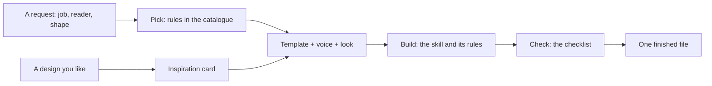
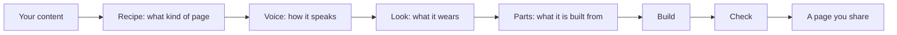
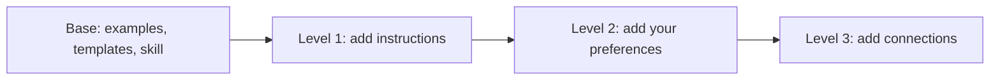

# Artifact studio

A library of templates for pages, decks and social posts, with rules that pick the right one and
an assistant that builds it from your content.

**Think of it as** ordering at a counter. The template is the dish, the voice is how you like it,
the look is the plate. You point at the menu, or say what the meal is for and let the house
choose. The assistant cooks.

**North Star:** a person with no design training gives an assistant their own notes and one
sentence, and gets back something they are proud to send, on the first or second try.

**Who it is for:** a consultant or owner who has to deliver a report, a proposal, a talk or a week
of posts, and gets work from an assistant that functions but looks and sounds generic. Also the
agents that build those pieces, through the skill or the MCP server.

**What is in it:** <!-- counts -->20 templates (4 pages, 7 voices, 4 decks, 5 social formats), 36 components (12 page parts, 12 photo parts, 12 animated SVG files with 11 GIF copies) and 9 looks<!-- /counts -->. The build counts the library and writes this line, and the same numbers go into [`base/templates/index.json`](base/templates/index.json).

## Start here

| You are | Open |
| --- | --- |
| A person who wants to see it | [`base/studio.html`](base/studio.html): everything in tabs, with a picker |
| A person who wants the list | [`base/templates/README.md`](base/templates/README.md): every template and part, with what to ask for |
| An agent | [`AGENTS.md`](AGENTS.md): the path from a request to a finished file |
| Ready to make something today | [`level-1/`](level-1/): nothing to install |
| Tired of repeating your colours and rules | [`level-2/`](level-2/): preferences on file |
| Wanting your assistant to use the library by itself | [`level-3/mcp/`](level-3/mcp/): the MCP server |
| Holding a design you like | [`base/inspiration/`](base/inspiration/): how it comes in without being copied |
| Needing something the studio does not do | [`base/RESOURCES.md`](base/RESOURCES.md): outside skills, frameworks and services |

## How the pieces fit

| Piece | Where | What it is |
| --- | --- | --- |
| Library | `base/templates/` | The templates and parts, each a working file |
| Index | `base/templates/index.json` and `README.md` | One list for agents and one for people, both generated from the library |
| Rules that pick | `base/source/catalog.py` | A score from 0 to 3 for each template against six goals and five readers |
| Skill | `skills/artifact-studio/` | How an assistant builds and checks |
| Front doors | `README.md`, `AGENTS.md`, `base/studio.html` | One each for people, agents and the curious |
| Intake | `base/inspiration/` | How new ideas enter |
| Delivery | `level-1/`, `level-2/`, `level-3/mcp/` | Pasted instructions, preferences on file, or tools an assistant calls |

## How it works

Three choices, made in this order.

| Choice | Options | Where they are defined |
| --- | --- | --- |
| Recipe | One-page report, proposal, scrolling explainer, landing page | [`recipes.md`](../../skills/artifact-studio/references/recipes.md) |
| Voice | Keynote, storyteller, teacher, pitch, practical instructor, analyst, executive brief | [`voices.md`](../../skills/artifact-studio/references/voices.md) |
| Look | Nine look cards, your own design spec, or colours taken from a photo | [`looks.md`](../../skills/artifact-studio/references/looks.md) |
| Parts | 12 page components and 12 photo components | [`components.md`](../../skills/artifact-studio/references/components.md) |

## A base, and levels that add to it

The base holds everything needed to use the tool. A level never repeats the base. It holds only
what that level adds, and the rule for which level something belongs to is what it makes you
depend on.

| | Folder | What it adds to the base | What you then depend on | State |
| --- | --- | --- | --- | --- |
| Base | [`base/`](base/) and [`skills/artifact-studio/`](../../skills/artifact-studio/) | Everything: the studio page, the template library and its index, sentences, forms, intake, the skill, the source | A browser | Built |
| Level 1 | [`level-1/`](level-1/) | Instructions for the assistant, and instructions for you | Any chat assistant | Written, not yet tested by others |
| Level 2 | [`level-2/`](level-2/) | A preferences file, and the skill installed | An assistant that keeps files or loads skills | Written, not yet used on a real page |
| Level 3 | [`level-3/`](level-3/) | Connections. An MCP server that gives an assistant the library as tools. Other slots listed | An assistant that runs MCP servers | **One built**, tested with a client only |

This layout is a trial. The other tools in the repository still use the older folders
(`level-demo`, `level-simple`, `level-working`, `level-automated`). The two remaining folders
here, [`student-projects/`](student-projects/) and [`commercial-grade/`](commercial-grade/), come
from that older layout and are unchanged.

## Status

Draft. Built and checked by its author only.

| Item | State |
| --- | --- |
| Base | Built. The studio page and every template file render in Chrome at phone and desktop width with no script errors |
| Picker | Built. It says how strong each answer is and names a better shape when the fit is weak. The page and the Python rules agree on all 120 requests. **The scores are the author's judgement and have not been tested against real choices** |
| MCP server | Built. Every tool tested through a client, over stdio and over HTTP. A scripted agent used it to pick, fetch a starter and finish a deck. **Not yet tried** inside a desktop assistant or from the web |
| Decks and social formats | New. Not yet presented to a room or posted |
| Inspiration intake | Written. No real find has been through it |
| Sentences | Written. **Not yet tested** in fresh chats. See [`base/sentence-test.md`](base/sentence-test.md) |
| Skill | Written. **Not yet run** end to end by a second agent |
| Real devices | Not checked on an iPhone, an Android phone, Safari or Firefox |
| Preferences file | New. Not yet used on a real page |
| Review | The repository owner has looked at the pages. Nobody else has used it |

It moves to `projects/` when the sentence test has been run and one other person has built a page
with it.

## What is invented and what is real

Every company, person and figure in the examples is made up, and each page says so. The two
photographs are real and were taken by the repository owner. They carry no location data.
