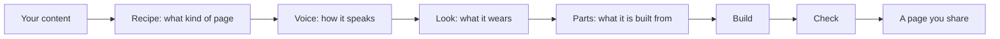
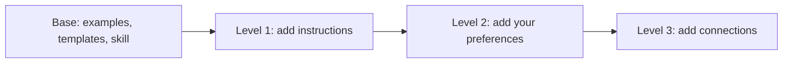

# Artifact studio

Pick a page type, a voice and a look. Get a page worth sharing.

**Think of it as** ordering at a counter. The recipe is the dish, the voice is how you like it, the
look is the plate. You point at the menu. The assistant cooks.

**North Star:** a person with no design training gives an assistant their own notes and one
sentence, and gets back a page they are proud to send, on the first or second try.

**Who it is for:** anyone who asks an AI assistant for a report, a proposal, an explainer or a
landing page and gets something that works but looks and sounds generic. Also the agents that
build those pages, through the skill.

## Start here

| You want | Open |
| --- | --- |
| To see what it makes | [`base/studio.html`](base/studio.html), or one file from [`base/examples/`](base/examples/) |
| A page today, with nothing to install | [`level-1/`](level-1/) |
| Pages that look and sound like yours every time | [`level-2/`](level-2/) |
| To hand the job to an agent | [`base/AGENT-GUIDE.md`](base/AGENT-GUIDE.md) and the [skill](../../skills/artifact-studio/) |
| How and why it works | [`base/BEST-PRACTICES.md`](base/BEST-PRACTICES.md) |
| What already exists in this area | [`landscape-review.md`](landscape-review.md) |
| The whole toolkit on one page | [`docs/practical-ai-explained.html`](../../docs/practical-ai-explained.html) |

## How it works

Three choices, made in this order.

| Choice | Options | Where they are defined |
| --- | --- | --- |
| Recipe | One-page report, proposal, scrolling explainer, landing page | [`recipes.md`](../../skills/artifact-studio/references/recipes.md) |
| Voice | Keynote, storyteller, teacher, pitch, practical instructor, analyst, executive brief | [`voices.md`](../../skills/artifact-studio/references/voices.md) |
| Look | Nine look cards, your own design spec, or colours taken from a photo | [`looks.md`](../../skills/artifact-studio/references/looks.md) |
| Parts | 12 page components and 12 photo components | [`components.md`](../../skills/artifact-studio/references/components.md) |

## A base, and levels that add to it

The base holds everything needed to use the tool. A level never repeats the base. It holds only
what that level adds, and the rule for which level something belongs to is what it makes you
depend on.

| | Folder | What it adds to the base | What you then depend on | State |
| --- | --- | --- | --- | --- |
| Base | [`base/`](base/) and [`skills/artifact-studio/`](../../skills/artifact-studio/) | Everything: the studio page, fourteen example files, sentences, templates, the skill, the source | A browser | Built |
| Level 1 | [`level-1/`](level-1/) | Instructions for the assistant, and instructions for you | Any chat assistant | Written, not yet tested by others |
| Level 2 | [`level-2/`](level-2/) | A preferences file, and the skill installed | An assistant that keeps files or loads skills | Written, not yet used on a real page |
| Level 3 | [`level-3/`](level-3/) | Connections: content in, page out, one-step install, schedules | Connectors or a plugin | **Not built.** The slots are listed |

This layout is a trial. The other tools in the repository still use the older folders
(`level-demo`, `level-simple`, `level-working`, `level-automated`). The two remaining folders
here, [`student-projects/`](student-projects/) and [`commercial-grade/`](commercial-grade/), come
from that older layout and are unchanged.

## Status

Draft. Built and checked by its author only.

| Item | State |
| --- | --- |
| Base | Built. The studio page and all fourteen example files render in Chrome at phone and desktop width with no script errors |
| Sentences | Written. **Not yet tested** in fresh chats. See [`base/sentence-test.md`](base/sentence-test.md) |
| Skill | Written. **Not yet run** end to end by a second agent |
| Real devices | Not checked on an iPhone, an Android phone, Safari or Firefox |
| Preferences file | New. Not yet used on a real page |
| Review | The repository owner has looked at the pages. Nobody else has used it |

It moves to `projects/` when the sentence test has been run and one other person has built a page
with it.

## What is invented and what is real

Every company, person and figure in the examples is made up, and each page says so. The two
photographs are real and were taken by the repository owner. They carry no location data.
