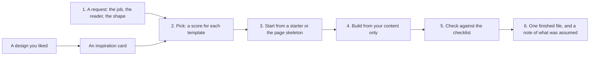

# Artifact studio

A library of templates for pages, slide decks and social posts, with rules that pick the right one
and an assistant that builds it from your content.

**Think of it as** ordering at a counter. The template is the dish, the voice is how you like it,
the look is the plate. You point at the menu, or say what the meal is for and let the house choose.
The assistant cooks.

**North Star:** a person with no design training gives an assistant their own notes and one
sentence, and gets back something they are proud to send, on the first or second try.

**What is in it:** <!-- counts -->20 templates (4 pages, 7 voices, 4 decks, 5 social formats), 53 components (12 page parts, 12 photo parts, 12 animated SVG files with 11 GIF copies, 17 design ideas for cards, layouts and colour) and 9 looks<!-- /counts -->. The build counts the library and writes this line.

## Use it today

| You want | Do this | Takes |
| --- | --- | --- |
| A page, a deck or a post from your notes | Open [`base/studio.html`](base/studio.html), tap **Pick**, say the job and the reader, copy the sentence it gives you, and paste it into your assistant with your notes | 5 minutes |
| To see what a good result looks like first | Read one of the six [worked examples](base/examples/): the request, the notes and what came back | 3 minutes |
| The rest of your colours from the one you have | Open the **Colour** tab, move the slider to your colour, copy the block into your [design spec](base/forms/design-spec.md) | 2 minutes |
| To keep a design you admired | Tell your assistant what you saw and why it works. It files a card in [`base/inspiration/`](base/inspiration/) | 1 minute |
| To stop repeating your colours and rules | Fill in the [preferences file](level-2/preferences-template.md) once | 15 minutes, once |
| Your assistant to do the choosing | Connect the [MCP server](level-3/mcp/) | 10 minutes, once |

GitHub shows HTML files as source. Download a file and open it in a browser.

## How it is laid out

One rule: **`base/` holds everything. A level holds only what it adds.**

```
artifact-studio/
  README.md      you are here: the front door for people
  AGENTS.md      the front door for agents: nine steps from a request to a finished file
  gates.json     the checks that must pass before anything here is called done
  base/          everything you use
    studio.html    the whole library in one page, with a picker
    templates/     every template and part as its own file, with an index for people and one for agents
    examples/      six worked requests: what was asked, what came back
    forms/         your design spec and a brief for one piece
    inspiration/   designs you liked, described in your own words
    sentences.md   every sentence that asks for something, in one list
    RESOURCES.md   outside tools for when this is the wrong one
    source/        what the library is built from, and its tests
  level-1/       use it by hand: instructions to paste into any assistant
  level-2/       adds a preferences file and the skill, so you stop repeating yourself
  level-3/       adds an MCP server, so an assistant can browse and choose by itself
  docs/          why it is built this way: research, practices, the sentence test
```

| Level | You add | You depend on | State |
| --- | --- | --- | --- |
| Base | Nothing. Open and copy | A browser | Built |
| [Level 1](level-1/) | Instructions pasted into your assistant | Any chat assistant | Built |
| [Level 2](level-2/) | A preferences file and the skill | An assistant that keeps files | Built. Not yet used on a real job |
| [Level 3](level-3/) | The MCP server | An assistant that runs MCP servers | Built. Tested with a client and a script, not in a desktop assistant |

## How a request becomes a file



One file feeds every part of this: [`base/source/catalog.py`](base/source/catalog.py) holds the
templates, their fit scores, the social styles and the palette rule. The studio page, both indexes,
the skill's cards and the MCP server all read it, and tests prove the page and the server agree.

## Is it working?

```
python3 ../../tools/gates.py .          # the quick gates, about 30 seconds
python3 ../../tools/gates.py . --all    # adds the page check at three widths, about 10 minutes
```

Each gate is one line in [`gates.json`](gates.json) saying what it proves. The run ends with
"All gates that ran passed" or "DO NOT SHIP" and the reason.

## Status

**Closed as a draft on 15 November 2026.** Built and checked by its author only. The closing
checklist, the score and what is still open are in [`docs/close-out.md`](docs/close-out.md).

| Part | State |
| --- | --- |
| Library, picker, palette maker | Built. Every gate passes |
| Worked examples | Written, with outputs. **No fresh assistant has been given the requests yet.** The table in [`base/examples/`](base/examples/) is where scores go |
| Fit scores | The author's judgement. Not yet compared with what people would choose |
| MCP server | Every tool tested through a client over stdio and HTTP. **Not yet tried** in a desktop assistant. Nothing is hosted |
| Real use | **None.** Nobody has presented a deck, posted a picture or filed a real find |
| Devices | Chrome only. Not checked on a phone, Safari or Firefox |

It moves to `projects/` when one other person has made something with it for a real job.

## What is invented and what is real

Every company, person and figure in the templates and examples is made up, and each says so. The
two photographs are real and were taken by the repository owner. They carry no location data.

## More

- Why it is built this way: [`docs/best-practices.md`](docs/best-practices.md)
- What already existed before it was built: [`docs/landscape-review.md`](docs/landscape-review.md)
- What a commercial build would add: [`docs/commercial-grade.md`](docs/commercial-grade.md)
- How to change or rebuild it: [`base/README.md`](base/README.md)
