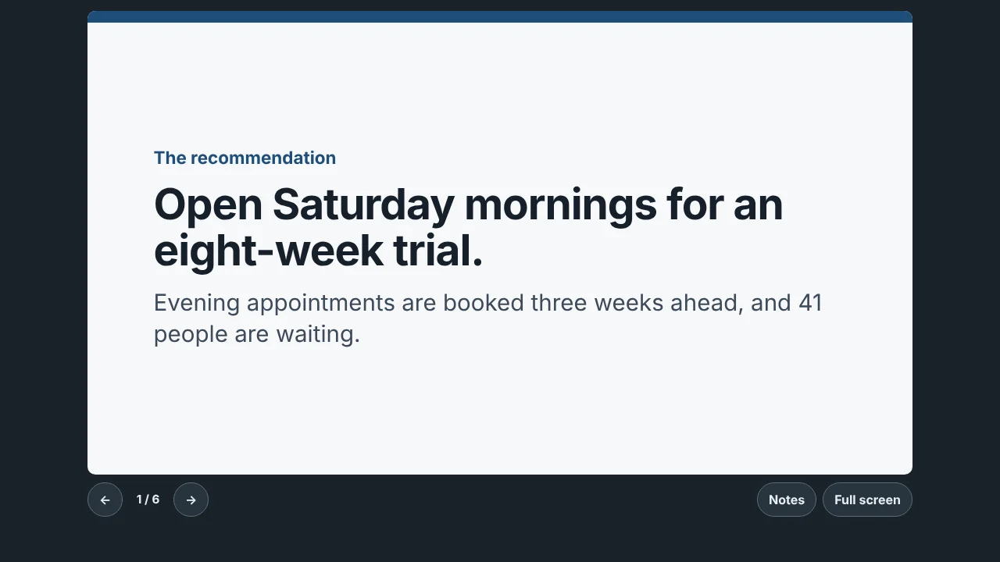
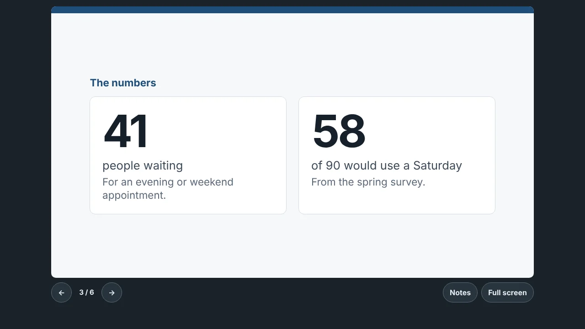
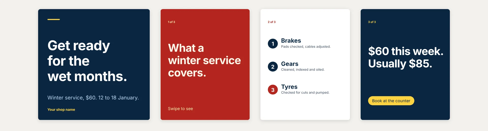

# Artifact Studio: free AI templates for slide decks, one-page reports and social posts

<p align="center">
  
</p>

**Turn rough notes into a slide deck, a one-page report, a landing page or a social post, using
Claude or ChatGPT.** Artifact Studio is free. There is no sign-up and nothing to install. You copy
one set of instructions into your AI assistant, type one sentence, attach your notes, and get back
one finished file you can open, share or present.

<p align="center">
  <a href="#use-it-today"><b>Start in 5 minutes</b></a> &nbsp;·&nbsp;
  <a href="#when-it-helps">See what it makes</a> &nbsp;·&nbsp;
  <a href="#go-further-when-you-are-ready">Levels 2 and 3</a> &nbsp;·&nbsp;
  <a href="#questions-people-ask">Questions</a>
</p>

**Think of it as** ordering at a counter. The template is the dish, the voice is how you like it,
the look is the plate. You point at the menu, or say what the meal is for and let the house choose.
The assistant cooks.

**North Star:** a person with no design training gives an assistant their own notes and one
sentence, and gets back something they are proud to send, on the first or second try.

## Why plain AI pages disappoint, and what this fixes

Ask an assistant to "make a page from my notes" and you get the same grey page everyone gets. The
assistant can do far better. It has not been told what good looks like for *this* job.

Artifact Studio tells it. It holds <!-- counts -->20 templates (4 pages, 7 voices, 4 decks, 5 social formats), 53 components (12 page parts, 12 photo parts, 12 animated SVG files with 11 GIF copies, 17 design ideas for cards, layouts and colour) and 9 looks<!-- /counts -->. Each template knows
what it is for, who reads it and how it should sound, so the assistant starts from a design that
fits the job in place of a blank page.

## When it helps

Four real requests, with what came back. Every business and figure below is invented.

### "I need the partners to say yes on Thursday"

> I need to get the partners to agree to Saturday opening at the clinic. Make me a short deck for
> Thursday's meeting from these notes.

<p align="center"></p>

The studio chose a **briefing deck**: the answer on the first slide, the numbers on the third.
See [the request and the notes](base/examples/01-briefing-deck/request.md).

<p align="center"></p>

### "How did October go? She reads on her phone"

> Turn my October notes into one page I can send to my business partner. She reads on her phone
> and wants the answer first. Our colour is green.

<p align="center"></p>

A **one-page report**: headline, three numbers, one chart, what happens next.
See [the request and the notes](base/examples/04-one-page-report/request.md).

### "We have an offer on this week"

> We are running winter service week. I need a square post and a three-slide carousel for it. Make
> them stand out. Our colours are navy and yellow.

<p align="center"></p>

A **square post and a carousel**, sized for the feed, in the shop's own colours.
See [the request and the notes](base/examples/03-social-set/request.md).

### "New staff start Monday and I have ten minutes"

> New staff start Monday. I want ten minutes at the start of the shift to teach the allergen check
> before anyone packs an order. Here is how we do it.

<p align="center"></p>

A **workshop deck** that opens with what people will be able to do by the end.
See [the request and the notes](base/examples/02-workshop-deck/request.md).

## Use it today

This is **Level 1, Beginner**. It works in any chat assistant that can make a web page, such as
Claude or ChatGPT. Five minutes.

**1. Copy the instructions.** Open this file and press the copy button at the top right of it:

**<https://github.com/bar181/practical-ai/blob/scaffold/structure/drafts/artifact-studio/level-1/AI-INSTRUCTIONS.md>**

**2. Paste them into your assistant.** In Claude or ChatGPT, the best place is the instructions of
a Project, so you only do it once. No Project? Paste them as the first message of a new chat.

**3. Type one sentence and attach your notes.** Copy one of these, or write your own:

```
Turn my notes into a short briefing deck for a decision: the answer first.
```
```
Turn this spreadsheet into a one-page report: a two-sentence summary, four key numbers, one chart and what happens next.
```
```
Make a square social post from this one sentence, in my colours.
```
```
Make a landing page for my service with one clear promise, how it works in three steps, the price and one button.
```

**4. Check it.** Open the result on your phone. Check every number and name against your notes.
The assistant is told to use only what you gave it and to list anything it assumed. You are still
the one who signs it.

Every sentence for every template is in [`base/sentences.md`](base/sentences.md). The longer
walkthrough is in [`level-1/`](level-1/).

### Not sure which template fits?

Say what the piece must do, who it is for and what shape you need. The studio page scores every
template and tells you why it picked one.

<p align="center"></p>

To use the picker, download [`base/studio.html`](base/studio.html) and open it in a browser. GitHub
shows HTML files as source, so it has to be downloaded first.

### More things you can do at this level

| You want | Do this | Takes |
| --- | --- | --- |
| To see a good result before you start | Read one of the six [worked examples](base/examples/): the request, the notes and what came back | 3 minutes |
| The rest of your colours from the one you have | Open the **Colour** tab of the studio page, move the slider to your colour, copy the block into your [design spec](base/forms/design-spec.md) | 2 minutes |
| To keep a design you admired | Tell your assistant what you saw and why it works. It files a card in [`base/inspiration/`](base/inspiration/) | 1 minute |

## Go further, when you are ready

Level 1 is the whole product. The next two levels remove steps. Neither is required.

### Level 2, Advanced: it knows your brand

**For you if** you make things every week and are tired of repeating your colours, your tone and
your rules.

- **Say less, get yours.** Fill in one [preferences file](level-2/preferences-template.md): your
  default template, voice and look, your brand colours, what you never want. After that, "make me
  a report from this" comes back in your style.
- **A skill in place of pasted text.** If your assistant loads skills, install
  [`artifact-studio`](../../skills/artifact-studio/). It then reads the full rules, the voice
  cards and the page skeleton by itself.
- **15 minutes, once.** Either half works without the other.

Start at [`level-2/`](level-2/). Built and checked by its author. Not yet used on a real job.

### Level 3, Expert: your agents get the whole studio as tools

**For you if** you run agents, build for clients, or want a team's assistants to produce
consistent work without a person choosing templates.

One MCP server turns the library into **ten tools** any compatible assistant can call: browse the
templates, get a scored recommendation, pull starter code, read the build rules, make a palette
from one brand colour, and file a design worth keeping.

| What you get | Why it matters |
| --- | --- |
| **A recommendation with a strength** | Every answer is rated strong, fair or weak. When the shape someone asked for is a weak fit, the tool names a better one. Your agent can say so, and need not guess |
| **Selection you can read and change** | A template's score is three times its goal fit plus twice its audience fit. The numbers are in one file. No black box |
| **One source of truth** | The studio page, both indexes, the skill and the server all read one catalogue. Tests prove the page and the server give the same answers |
| **Safe by default** | `--read-only` removes the one tool that writes. Runs locally over stdio, or over HTTP when you choose to host it |
| **Gates, not hope** | Ten checks run from one command and end with "All gates that ran passed" or "DO NOT SHIP" |

Start at [`level-3/mcp/`](level-3/mcp/). Every tool is tested through a client over stdio and
local HTTP. It has **not yet been tried** inside a desktop assistant, and nothing is hosted.

## Questions people ask

**Is Artifact Studio really free?**
Yes. It is open source under the Apache-2.0 licence. All you need is an AI assistant you already
use.

**Does it work with ChatGPT, Claude or another AI assistant?**
It is written for any assistant that can make a web page. Claude and ChatGPT both can. So far it
has been run only by the assistant that built it, so tell us what you find.

**How do I make a slide deck with AI without it looking generic?**
Give the assistant a template and a voice as well as your notes. That is what the instructions at
Level 1 do. The deck comes back as one HTML file that opens in any browser and presents with the
arrow keys.

**Do I need to know how to code or design?**
No. You copy, paste and type a sentence.

**Will it make things up?**
The instructions tell the assistant to use only your content, to leave a visible gap where
something is missing, and to list what it assumed. Assistants still make mistakes. Check every
number.

**Can I use my own brand colours and logo?**
Yes. Name your colours in the request, or build a full palette from one colour in the Colour tab.
Level 2 saves them so you never repeat them.

**What do I get back?**
One self-contained file: a web page, a deck, or a picture for a social post. No account, no
hosting, no lock-in.

## Status

**Closed as a draft on 15 November 2026.** Built and checked by its author only. Nobody else has
used it yet. The closing checklist and score are in [`docs/close-out.md`](docs/close-out.md).

| Part | State |
| --- | --- |
| Library, picker, palette maker | Built. Every gate passes |
| Worked examples | Written, with outputs. **No fresh assistant has been given the requests yet** |
| Template scores | The author's judgement. Not yet compared with what people would choose |
| MCP server | Tested through a client. **Not yet tried** in a desktop assistant. Nothing is hosted |
| Real use | **None yet.** Nobody has presented a deck, posted a picture or filed a real find |
| Devices | Chrome only. Not checked on a phone, Safari or Firefox |

Every company, person and figure in the templates and examples is made up, and each says so. The
two photographs inside the templates are real, were taken by the repository owner and carry no
location data.

## How it is laid out

One rule: **`base/` holds everything. A level holds only what it adds.**

```
artifact-studio/
  README.md      you are here
  AGENTS.md      the front door for agents
  base/          everything you use: the studio page, templates, examples, sentences
  level-1/       Beginner: instructions to paste into any assistant
  level-2/       Advanced: a preferences file and the skill
  level-3/       Expert: an MCP server, so an assistant can browse and choose by itself
  docs/          why it is built this way, and the pictures on this page
  gates.json     the checks that must pass before anything here is called done
```

<details>
<summary>For people who want to change it or check it</summary>

- How to change or rebuild it: [`base/README.md`](base/README.md)
- Run the checks: `python3 ../../tools/gates.py .` (about 30 seconds), or add `--all` for the page check at three widths
- Why it is built this way: [`docs/best-practices.md`](docs/best-practices.md)
- What already existed before it was built: [`docs/landscape-review.md`](docs/landscape-review.md)
- What a commercial build would add: [`docs/commercial-grade.md`](docs/commercial-grade.md)
- Outside tools for when this is the wrong one: [`base/RESOURCES.md`](base/RESOURCES.md)

</details>

## If you are someone's agent

Do not work from this page. Follow this path:

1. Read [`AGENTS.md`](AGENTS.md) in this folder. It is the nine steps from a request to a finished file.
2. Choose a template from [`base/templates/index.json`](base/templates/index.json), or call `recommend` if the MCP server is connected.
3. Build from the person's content only, on the starter or skeleton the index names.
4. Check your work against the checklist `AGENTS.md` points to, and report what you assumed.

## More information

Artifact Studio is part of [Practical AI](../../README.md), a set of free tools created by
Bradley Ross. For questions, training or to say what you made with it:
**[linkedin.com/in/bradaross](https://www.linkedin.com/in/bradaross/)**
