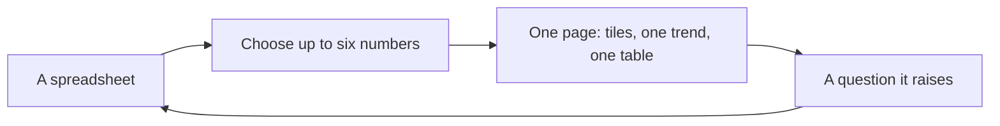

# Dashboard

Your key numbers on one page. Starts from a spreadsheet, then connects to your sales, accounting and customer systems.

**Think of it as** the dashboard of a car: five dials you can read at a glance, not the engine manual.

**North Star:** the five or six numbers that run the business are on one page, each with what it was last time, and anyone can read it in ten seconds.

**Who it is for:** Owners and managers who keep their numbers in a spreadsheet and look at them less often than they should.

## Start here

| You are | Open |
| --- | --- |
| A person who wants to try it | [`STUDENT-GUIDE.md`](STUDENT-GUIDE.md) |
| An agent, or someone setting one up | [`AGENT-GUIDE.md`](AGENT-GUIDE.md) |
| Looking for what already exists | [`landscape-review.md`](landscape-review.md) |

## The loop

## Status

Draft. First copy, not yet reviewed or tested by anyone else.

| Level | What it holds | In this draft |
| --- | --- | --- |
| `level-demo` | A page that turns pasted spreadsheet rows into tiles, a trend and a table, in your browser | [`index.html`](level-demo/index.html) |
| `level-simple` | Instructions for a chat Project. You export or connect a sheet and name the numbers that matter | [`project-instructions.md`](level-simple/project-instructions.md) |
| `level-working` | A connected sheet, so the page is rebuilt from the latest rows, and a written definition of each number. | [Outline](level-working/) |
| `level-automated` | The `dashboard-builder` skill run on a schedule, reading from the systems where the numbers start: sales, accounting and customer records | [Outline](level-automated/), with the [`dashboard-builder`](../../skills/dashboard-builder/) skill |
| `commercial-grade` | What a commercial build adds | [Explained](commercial-grade/) |

Everything in the examples is invented.
