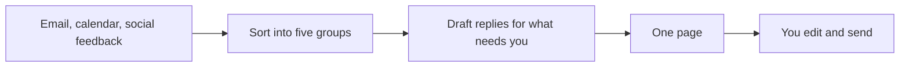

# Inbox triage and daily summary

One morning page across your email, calendar and social feedback, with replies drafted and nothing sent.

**Think of it as** a good assistant who read your inbox before you arrived and hands you one page: what needs you, what can wait, and a draft for each reply.

**North Star:** in five minutes each morning you know the few things that need you today, and each has a draft waiting.

**Who it is for:** Anyone whose day starts with an hour of sorting email.

## Start here

| You are | Open |
| --- | --- |
| A person who wants to try it | [`STUDENT-GUIDE.md`](STUDENT-GUIDE.md) |
| An agent, or someone setting one up | [`AGENT-GUIDE.md`](AGENT-GUIDE.md) |
| Looking for what already exists | [`landscape-review.md`](landscape-review.md) |

## The loop

## Status

Draft. First copy, not yet reviewed or tested by anyone else. Research is at the level of notes:
sources have not been checked yet.

| Level | What it holds | In this draft |
| --- | --- | --- |
| `level-demo` | A sample morning page you can tick through, with drafted replies | [`index.html`](level-demo/index.html) |
| `level-simple` | Instructions for a chat Project. You paste or connect yesterday's messages and today's calendar | [`project-instructions.md`](level-simple/project-instructions.md) |
| `level-working` | A read-only connection to your mailbox and calendar, and a saved list of rules that grows from your corrections. | [Outline](level-working/) |
| `level-automated` | The `morning-summary` skill on a schedule each weekday | [Outline](level-automated/), with the [`morning-summary`](../../skills/morning-summary/) skill |
| `commercial-grade` | What a commercial build adds | [Explained](commercial-grade/) |

Everything in the examples is invented.
