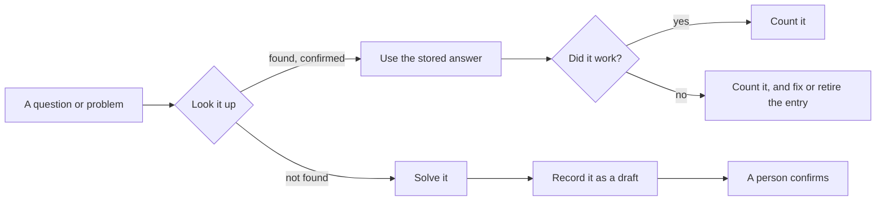

# Learning system

A growing log of questions and the solutions that worked, so the same problem is never solved twice.

**Think of it as** a workshop notebook where every fix is written down once, with a note on
whether it held. The next person with the same problem starts from the answer.

**North Star:** before anyone solves a problem, they find out in ten seconds whether it has been
solved here before, and what happened when the answer was used.

**Who it is for:** developers who meet the same errors twice, teams that answer the same
questions repeatedly, and individuals who want to keep what they figured out.

## Start here

| You are | Open |
| --- | --- |
| A person who wants a log today | [`STUDENT-GUIDE.md`](STUDENT-GUIDE.md) |
| An agent, or someone setting one up | [`AGENT-GUIDE.md`](AGENT-GUIDE.md) |
| Looking for what already exists | [`landscape-review.md`](landscape-review.md) |

## The loop

## Status

Draft. First copy, not yet reviewed or tested by anyone else.

| Level | What it holds | In this draft |
| --- | --- | --- |
| `level-demo` | A log you can search, with sample entries for developers, a business and a household | [`index.html`](level-demo/index.html) |
| `level-simple` | A spreadsheet with one row per entry, and instructions for a chat Project | Sheet template for three audiences, instructions |
| `level-working` | Entries are confirmed, ranked by how often they held, and retired | [Outline](level-working/) |
| `level-automated` | A database with search by meaning, and capture from working sessions | [Outline](level-automated/), with the [`learning-log`](../../skills/learning-log/) skill |
| `commercial-grade` | What a commercial build adds | [Explained](commercial-grade/) |

All sample entries are invented.
