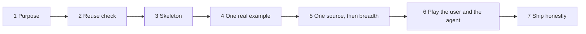

# Project method

How a tool in this repository gets built: seven stages, a gate after each, and a folder to copy so
every tool is laid out the same way.

**Think of it as** building a house. You agree the drawing before you pour concrete, you put up
the frame before you choose curtains, and an inspector signs off each stage before the next one
starts. The inspector here is a short script, and it never gets tired or polite.

**North Star:** a person, or an agent working alone, can take an idea to a tool that someone else
can use, without rebuilding it three times on the way.

**Where it came from:** the [artifact studio](../artifact-studio/) was rebuilt three times before
its shape was right. [`base/LESSONS.md`](base/LESSONS.md) lists each wrong turn and the rule that
would have prevented it. This method is those rules, in order.

## Use it today

| You want | Do this | Takes |
| --- | --- | --- |
| To start a new tool | `python3 base/new_project.py my-tool "My tool"` makes `drafts/my-tool/` with the layout, both front doors and a first gate | 1 minute |
| To know what to do next on a tool | Read [`base/METHOD.md`](base/METHOD.md): find your stage, do its work, pass its gate | 5 minutes |
| To check a tool is laid out properly | `python3 ../../tools/check_project.py ../my-tool` | 5 seconds |
| To check a tool works | `python3 ../../tools/gates.py ../my-tool` | under a minute |
| An agent to build the tool | Give it the [`project-builder`](../../skills/project-builder/) skill and the idea. See [level 2](level-2/) | hours, mostly unattended |

## How it is laid out

`base/` holds everything. A level holds only what it adds.

```
project-method/
  README.md      you are here
  AGENTS.md      for an agent asked to start or continue a tool
  gates.json     the checks on this method itself
  base/
    METHOD.md      the seven stages and their gates
    LESSONS.md     what building the first tool taught, as a table
    scaffold/      the folder every new tool starts as
    new_project.py copies the scaffold and fills in the name
  level-1/       by hand: a person and an assistant, one stage at a sitting
  level-2/       agentic: a skill that runs the stages and the gates, and stops where a person must decide
```

| Level | You add | You depend on | State |
| --- | --- | --- | --- |
| Base | Nothing. Read and copy | Python 3 | Built |
| [Level 1](level-1/) | A prompt to paste at each stage | Any chat assistant | Written. Not yet used on a second tool |
| [Level 2](level-2/) | The `project-builder` skill and the gate runner | An agent that can run commands and load skills | Written. **Not yet run end to end** |

## The seven stages at a glance



| Stage | You produce | The gate |
| --- | --- | --- |
| 1. Purpose | One page: who it is for, the one job, a North Star, what is out of scope | A person approves the page |
| 2. Reuse check | What already exists, with dated sources, and a build-or-use decision | Every source has a date. The decision is written down |
| 3. Skeleton | The folder, both front doors, and the list of gates, before any content | `check_project.py` passes |
| 4. One real example | One request taken to one finished output | A person looks at it and says it is what they wanted |
| 5. One source, then breadth | The data in one file. Indexes and counts generated from it. Then more content | The build and the link check pass |
| 6. Play the user and the agent | Worked examples, and a script that uses only what a user or agent can reach | The example and agent gates pass |
| 7. Ship honestly | A status table that says who has tried it, and a scored self-review | Every gate passes. One other person has used it |

## Status

Draft. Written by the author of the first tool, from that one experience.

| Part | State |
| --- | --- |
| The method and the lessons | Written. Drawn from one tool, so treat the order as a strong suggestion, not a law |
| The scaffold and `new_project.py` | Built. A gate creates a project from it and checks the layout |
| The gate runner and the three checks | Built, and in daily use on the artifact studio |
| Level 2, the agentic run | Written. **No agent has yet taken a tool through all seven stages with it** |
| The nine older drafts | Still in the earlier layout. [`base/LESSONS.md`](base/LESSONS.md) says how they move over |

It moves to `projects/` when a second tool has been built with it from stage 1.
