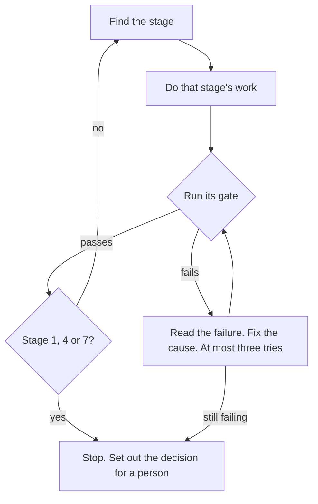

# Project method: level 2, agentic

An agent takes a tool through the seven stages by itself, stopping only where a person has to
decide. This level adds two things to the base: a skill that knows the order, and gates that say
whether a stage is done.

**Think of it as** a small harness. The skill is the reins: it says where to go next. The gates
are the fence: they say where not to go. The agent does the walking.

## What is in the harness

| Part | Where | What it does |
| --- | --- | --- |
| The driver | [`skills/project-builder/`](../../../skills/project-builder/) | Finds the tool's stage, does that stage's work, runs its gate, and stops at the three human decisions |
| Stage skills | [`landscape-review`](../../../skills/landscape-review/), [`plan-writer`](../../../skills/plan-writer/) | The reuse check and the plan |
| The gate runner | [`tools/gates.py`](../../../tools/gates.py) | Runs the tool's `gates.json` and ends with pass or "DO NOT SHIP" |
| The standing gates | [`tools/`](../../../tools/) | Layout, links and skills. Every tool gets these |
| The tool's own gates | `gates.json` in the tool's folder | Written at stage 3, before the work they check |

## The run

## Where the agent must stop

| After | The agent sets out | A person decides |
| --- | --- | --- |
| Stage 1 | The purpose page | Is this the right thing to build? |
| Stage 4 | One finished example | Is this what I wanted? |
| Stage 7 | The gates, the status table and the scored review | May this go to someone else? |
| Any gate that fails three times | What it tried and what the failure says | Fix the tool, or change the gate? |

The agent never changes a gate to make it pass, never marks a stage done without running its gate,
and never deletes retired work: it moves it to `plans/archive/`.

## Start a run

Give the agent the skill and one line:

> Use the project-builder skill. The idea: [one sentence]. Start at stage 1 and stop at the first decision.

To continue a tool that exists:

> Use the project-builder skill on drafts/my-tool. Find its stage and carry on to the next decision.

## State

Written, with every part it names in place. **No agent has yet taken a tool from stage 1 to stage 7
with it.** The first such run is the test of this level, and its result belongs in the status table
of [`../README.md`](../README.md).
