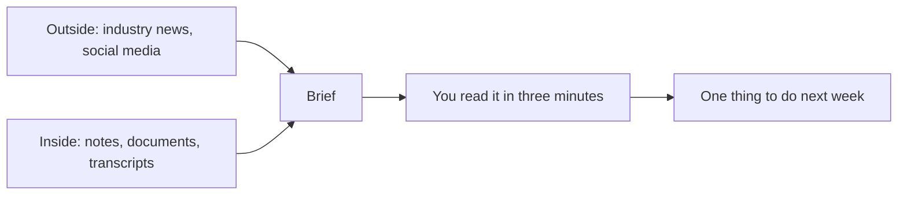

# Weekly brief with research

A one-page weekly brief: outside research with links, plus what your own documents and meeting transcripts say.

**Think of it as** a chief of staff's Friday note: what changed out there, what we decided in here, and what is still open.

**North Star:** one page each week that a busy person reads in three minutes and trusts, because every outside claim has a link and every inside claim names its document.

**Who it is for:** Owners and managers who want to stay current without reading everything.

## Start here

| You are | Open |
| --- | --- |
| A person who wants to try it | [`STUDENT-GUIDE.md`](STUDENT-GUIDE.md) |
| An agent, or someone setting one up | [`AGENT-GUIDE.md`](AGENT-GUIDE.md) |
| Looking for what already exists | [`landscape-review.md`](landscape-review.md) |

## The loop

## Status

Draft. First copy, not yet reviewed or tested by anyone else. Research is at the level of notes:
sources have not been checked yet.

| Level | What it holds | In this draft |
| --- | --- | --- |
| `level-demo` | A sample brief for a made-up business, with its sources marked | [`index.html`](level-demo/index.html) |
| `level-simple` | Instructions for a chat Project. You name your topics and attach the week's notes and transcripts | [`project-instructions.md`](level-simple/project-instructions.md) |
| `level-working` | A saved topic list and source list, and a connected folder for the week's notes and transcripts. | [Outline](level-working/) |
| `level-automated` | The `weekly-brief` skill on a schedule each Friday | [Outline](level-automated/), with the [`weekly-brief`](../../skills/weekly-brief/) skill |
| `commercial-grade` | What a commercial build adds | [Explained](commercial-grade/) |

Everything in the examples is invented.
