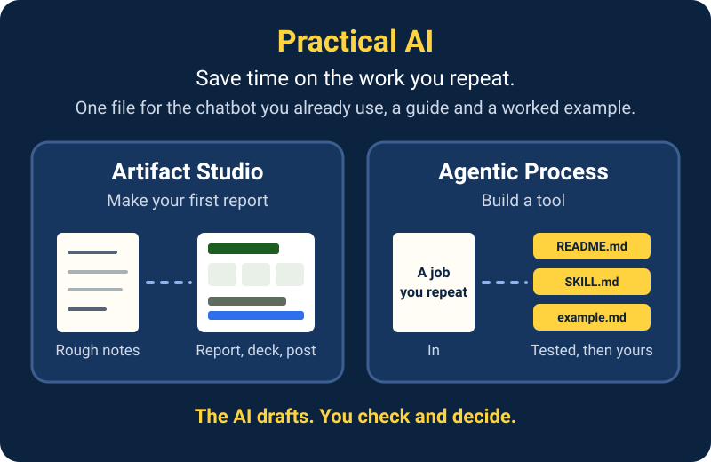
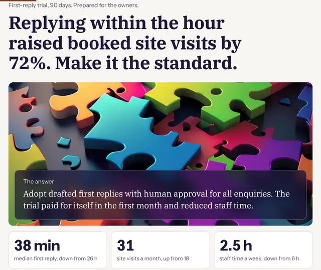
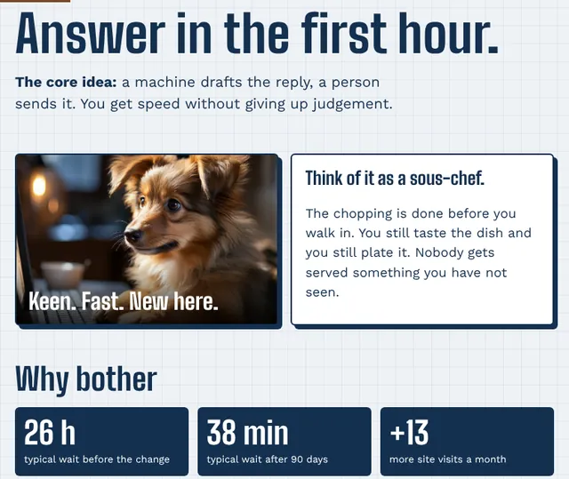

# Two tools for better work with your AI

<p align="center">
  
</p>

<h3 align="center">Professional-quality work. A repeatable process with your AI. Time back on the jobs you repeat.</h3>

<p align="center"><b>Want reports with a designer's impact?</b> <a href="artifact-studio/">Artifact Studio</a><br>
<b>Want an agentic engineer at your side?</b> <a href="agentic-process/">Agentic Process</a></p>

Neither replaces the features, plugins or skills already in your AI. Each adds what they are
missing for one practical job.

**Try it before you download anything:** each project page opens with a prompt you copy into the chatbot
you already use. [Artifact Studio](artifact-studio/#get-started-try-it-now) ·
[Agentic Process](agentic-process/#get-started-try-it-now).

## Artifact Studio: designer-quality reports, made by you

<p align="center"><b><i>"Better than I could do, as good as my designer, and I made it myself."</i></b></p>

You already ask your AI for reports. Ask through Artifact Studio and the same request comes back
with the impact of a professional website: beautiful photos, motion, a story that flows, and design
best practice built in. Not a wall of text, and not a slide deck that took you hours.

<p align="center">
  <a href="artifact-studio/"></a>
  <a href="artifact-studio/"></a>
</p>

**The captures, in words:** the same notes told two ways. Left, an evidence-first report: the
answer and three numbers. Right, a field guide: the core idea and steps for today.

<p align="center"><a href="artifact-studio/"><b>Make your first designer-quality report</b></a></p>

## Agentic Process: an agentic engineer at your side

<p align="center"><b><i>"Like having an engineer sitting with me, so every new job is set up the proper way."</i></b></p>

Developers trust AI agents because they work inside a harness: a spec, steps and tests. Agentic
Process brings that discipline to everyday jobs. Like an engineer beside you, it helps you define
the result, pick the simplest way, build it properly, and test it before you rely on it.

<p align="center">
  <a href="agentic-process/"></a>
</p>

**In one blind pilot, a tool built with Agentic Process scored 93/100. The direct-build version
scored 73/100 on the same brief.** The Agentic Process tool flagged the missing date and form first
and said who to ask; the other buried them. One task, one notice, one blind reviewer.

<p align="center"><a href="agentic-process/"><b>Set up your first job the proper way</b></a></p>

## Side by side

| | Artifact Studio | Agentic Process |
| --- | --- | --- |
| **Like having** | A designer on call | An agentic engineer beside you |
| **You bring** | Your notes, and who will read them | A job you repeat, and who uses the result |
| **You get** | A report, deck, post or page | Instructions for the job, a guide and a tested example |
| **Works with** | The chatbot you already use | The chatbot you already use. A coding agent can run the whole build |
| **Proof** | [22 fresh-session runs](artifact-studio/quality-results/README.md) | [The blind pilot](agentic-process/quality-results/README.md) |

Both were built and checked by their author, in Claude. Nobody else has used them yet.

<details>
<summary>How every project is laid out</summary>

`base/` is enough to try the tool. The other folders appear only when they hold something you can use.

```
a-project/
  README.md          the landing page: the value, examples, Get started, Status
  AGENTS.md          instructions for AI agents
  CLAUDE.md          points Claude Code at AGENTS.md
  LICENSE
  base/              the few files you need to try it, and examples/
  level-2-files/     Advanced: what you add to make it yours
  level-3-files/     Expert: connections for agents
  quality-results/   the evidence: what was checked, by whom, with the raw results
  _build/            what the project is built from. Not needed to use it
```

`python3 workshop/tools/check_project.py projects/<name>` checks a folder against this.

</details>
