# The projects

<h3 align="center">Each project makes the AI you already use do one job at professional quality.</h3>

**Are you an AI agent?** Go to [AGENTS.md](../AGENTS.md) for instructions you can follow now. Each
project also has its own `AGENTS.md`.

None of them replaces the features, plugins or skills already in your AI. Each adds what they are
missing for one practical job. Each project page opens with a prompt you can paste into your chatbot.

## Which one do I need?

| You want | Go to |
| --- | --- |
| A report, deck, post or page with a designer's impact | [Artifact Studio](artifact-studio/) |
| A job you repeat, set up once so the AI does it the same way every time | [Agentic Process](agentic-process/) |
| To know what a notice, contract, tender or bill asks of you, by when | [Document to action brief](document-to-action-brief/) |

## Artifact Studio

**Designer-quality reports, made by you.** Your notes in; a report, deck, post or page out.

<p align="center"><b><i>"Better than I could do, as good as my designer, and I made it myself."</i></b></p>

<p align="center">
  <a href="artifact-studio/"></a>
</p>
<p align="center"><sub>The page a fresh Claude session made from the try-it prompt, in one try, unedited.</sub></p>

<p align="center"><a href="artifact-studio/"><b>Make your first designer-quality report</b></a></p>

## Agentic Process

**An agentic engineer at your side, for everyday jobs.** A job you repeat in; instructions you can
reuse, an example and a test out.

<p align="center"><b><i>"Like having an engineer sitting with me, so every new job is set up the proper way."</i></b></p>

<p align="center">
  <a href="agentic-process/"></a>
</p>
<p align="center"><sub>In one blind pilot, a tool built with Agentic Process scored 93/100. The direct-build version scored 73/100 on the same brief.<br>
One build task, one unseen notice, one blind reviewer.</sub></p>

<p align="center"><a href="agentic-process/"><b>Set up your first job the proper way</b></a></p>

## Document to action brief

**Know what a document asks of you, by when, and where it says so.** A notice, contract, tender,
policy or bill in; what you must do, the dates and the open questions out, each with the exact
words to check.

<p align="center">
  <a href="document-to-action-brief/"></a>
</p>

<p align="center"><a href="document-to-action-brief/"><b>Brief your first document</b></a></p>

## Side by side

| | Artifact Studio | Agentic Process | Document to action brief |
| --- | --- | --- | --- |
| **Like having** | A designer on call | An agentic engineer beside you | A careful reader with a highlighter |
| **You bring** | Your notes, and who will read them | A job you repeat, and who uses the result | One document, and who you are in it |
| **You get** | A report, deck, post or page | Instructions for the job, a guide and a tested example | The actions, dates and open questions, each with its exact words |
| **Works with** | The chatbot you already use | The chatbot you already use. A coding agent can run the whole build | The chatbot you already use |
| **Proof** | [22 fresh-session runs](artifact-studio/quality-results/README.md) | [The blind pilot](agentic-process/quality-results/README.md) | [3 fresh-session runs](document-to-action-brief/quality-results/README.md) |

## Status

All four were built and checked by their author, in Claude. As of 18 November 2026, users are
testing each one; their results are not in yet. Rare Find, the side quest game, is in
[`rare-find/`](rare-find/).

<details>
<summary>How every project is laid out</summary>

`base/` is enough to try the tool. The other folders appear only when they hold something you can use.

```
a-project/
  README.md          the landing page: the value, examples, Get started, Status
  AGENTS.md          instructions for AI agents
  CLAUDE.md          points Claude Code at AGENTS.md
  LICENSE
  base/              the few files you need to try it, and examples/
  level-2-files/     Advanced: what you add to make it yours
  level-3-files/     Expert: connections for agents
  quality-results/   the evidence: what was checked, by whom, with the raw results
  _build/            what the project is built from. Not needed to use it
```

`python3 workshop/tools/check_project.py projects/<name>` checks a folder against this.

</details>
