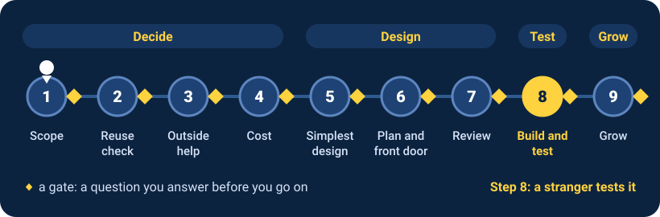

# Agentic Process: from an idea to a tool people can try, in nine steps

<p align="center">
  
</p>

<h3 align="center">Your AI can build almost anything. That is the problem.</h3>

**An AI agent will happily build the wrong thing three times.** Agentic Process is the order of
work that stops it: nine steps, a gate after each, and a test in a fresh chat, run before anyone
else sees the result. It is free. It is written for any chatbot (so far it has been
tested in Claude only), or hand it to your coding agent.

**North Star:** anyone who repeats a job at work can turn it into a small AI tool that someone
else can use, and know it works before anyone relies on it.
[Why it exists, and what it is worth to you](https://raw.githack.com/bar181/practical-ai/main/projects/agentic-process/base/north-star.html).

| Start with | What it is | Time |
| --- | --- | --- |
| [**The North Star**](https://raw.githack.com/bar181/practical-ai/main/projects/agentic-process/base/north-star.html) | One page: the purpose, the value at your level, and where it fits | 5 minutes |
| [**The guide**](https://raw.githack.com/bar181/practical-ai/main/projects/agentic-process/base/explainer.html) | All nine steps, each with its purpose, who it helps, proof and a prompt | 10 minutes |
| [**The course**](https://raw.githack.com/bar181/practical-ai/main/projects/agentic-process/base/course.html) | Five modules, each with a lecture deck and step-by-step lessons, then a capstone | about 4.5 hours |

The links open the pages through raw.githack.com, a free service that shows a GitHub HTML file as
a page, once this branch is merged. Otherwise download the file from [`base/`](base/) and open it
in a browser: GitHub itself shows HTML files as code.

## Try it in five minutes

### 1. Ask the coach about your own idea

Paste this into the chatbot you already use. Change the last line to a job you repeat.

<!-- prompt:start (written by _build/build.py) -->
```
Read the build coach at https://raw.githubusercontent.com/bar181/practical-ai/main/projects/agentic-process/base/AI-INSTRUCTIONS.md and follow it. If you cannot open it, say so and stop: do not make up a coach of your own.

My idea: every Monday I turn last week's sales notes into an email for my team. I want an AI to draft it.
```
<!-- prompt:end -->

It walks you through the steps one at a time, asks at most two questions in each, and ends with a
one-page plan and a first version you can test. For a small job like this one it offers a short
path: steps 1, 6 and 8 in full, steps 2 to 5 in a line each, step 7 folded into the test, and step 9 left open. You can start in five minutes; a full first run takes about an hour.

- **It cannot open the link?** Open [`base/AI-INSTRUCTIONS.md`](base/AI-INSTRUCTIONS.md), press
  **Raw**, select all, copy, and paste it into the chat. Then type: *Follow the build coach pasted
  above. My idea:* and your job.
- **Rather go one step at a time?** [The nine steps in detail](base/PROCESS.md) give each step a
  purpose, user stories, what to expect, proof you are done, and a prompt to paste.

### 2. Use it at your level

| You are | You use | You get |
| --- | --- | --- |
| **New to this** (Beginner) | The coach, pasted into any chatbot | A one-page plan and a first prompt you can test today |
| **Building with an agent** (Advanced) | [One skill folder](level-2-files/) to copy into your agent's skills. Works in any repository | A project folder with its own checks, the front page and the first version in place |
| **Running agents unattended** (Expert) | [Gates, the fresh-run test and the score sheet](level-3-files/) | Proof of what works, before a person spends time on it |
| **Teaching or learning it properly** | [The course](https://raw.githack.com/bar181/practical-ai/main/projects/agentic-process/base/course.html): five modules, lecture decks with instructor notes, lessons, checks and a capstone | A tool of your own, taken through steps 1 to 8 and tested by a stranger, with step 9 planned |

### 3. See it used

| Example | Level | What it is |
| --- | --- | --- |
| [A Monday email from sales notes](base/examples/monday-email.md) | Beginner, short path | The plan, the prompt and the note a new AI session made from one paragraph, unedited |
| [Deal updates for a sales team](base/examples/shared-tracker.md) | Beginner, all nine steps | The same for a team job, where the coach takes every step |
| [An agent working unattended](base/examples/unattended-run.md) | Advanced and Expert | A coding agent with only the skill folder, in a repository it had never seen: the plan, the tool it built, two fresh-session tests and its hand-back |

The people are invented. Each result was made by a session that had only this project's
instructions. Nobody has used what they made.

**If you are an AI agent:** follow [`AGENTS.md`](AGENTS.md).

## What you save

Every figure here is an estimate. Nobody outside the author has yet been timed.

| Who | Without the process | With it | You leave with |
| --- | --- | --- | --- |
| **Beginner** turning a repeated job into a reusable prompt | Trial and error in a chat until something works on the day. Next week you start again | About an hour the first time: the step times added up | A one-page plan, a prompt you can reuse and a test that tells you when it breaks |
| **Advanced** building a small tool with an agent | The agent builds fast and you find the shape by rebuilding. Folders move and links break | The layout is fixed before the first file, and the front page is written before the tool | A project folder that passes its own checks, with a front page a stranger can follow |
| **Expert** finding faults before users do | The author reviews their own work and passes it, because they know what they meant | Fresh sessions side by side, about ten minutes each | A numbered list of every place a stranger had to guess, and which ones change the result |

The larger gain is quality, not speed: a stranger's test finds the faults the author cannot see.

## The nine steps

| # | Step | Why it exists | The gate |
| --- | --- | --- | --- |
| 1 | [Scope](base/PROCESS.md#1-scope) | A tool that does one job gets finished | Can you say the job in one sentence? |
| 2 | [Reuse check](base/PROCESS.md#2-reuse-check) | The cheapest tool is the one you do not build | After what already exists, is there still something to build? If not, stop and write a guide to that thing |
| 3 | [Outside help](base/PROCESS.md#3-outside-help) | Build or buy is decided on purpose | Do you know what you would build and what you would buy? |
| 4 | [Cost](base/PROCESS.md#4-cost) | A tool people cannot afford to run is not finished | Does the first version cost nothing, or an amount you accept? |
| 5 | [Simplest design](base/PROCESS.md#5-simplest-design) | Moving files later breaks every link | Could a beginner draw it? |
| 6 | [Plan and front door](base/PROCESS.md#6-plan-and-front-door) | If the first screen cannot be written, the tool is not understood | Is the beginner version fully described? |
| 7 | [Review](base/PROCESS.md#7-review) | You cannot see your own gaps | Can someone else explain it back to you? |
| 8 | [Build and test](base/PROCESS.md#8-build-and-test) | A stranger finds what you cannot | Did a fresh session finish the job, and have you read what it tripped on? |
| 9 | [Grow](base/PROCESS.md#9-grow) | Small additions get reviewed. Big ones get waved through | Is the level below in use before you build the next? |

Each step in [the detailed page](base/PROCESS.md) also has a user story for each level, what to
expect, proof you are done, and a prompt to paste.

**Think of it as** building a deck in the garden: decide what it is for, check for a kit, price
the wood, draw it, have someone check the drawing, build the smallest platform you can stand on.

## What the AI does and what stays with you

| The AI does | You do |
| --- | --- |
| Asks the questions, searches for what exists, drafts the plan | Say no to anything outside the one job |
| Builds the first version and tests it in a fresh session | Read what the test tripped on and decide what to fix |
| Makes each addition | Approve each one, and use the tool yourself |

## The course

<!-- course:start -->
**[Build the right AI tool](https://raw.githack.com/bar181/practical-ai/main/projects/agentic-process/base/course.html)**: Learn to turn a job you repeat into a small AI tool that someone else can use, and to prove it works before anyone relies on it. 5 modules, about 4 and a half hours, each with a lecture deck, step-by-step lessons, a three-question check and an
assignment, then a capstone. It has not been taught yet.

| Module | Purpose | Lessons | Time |
| --- | --- | --- | --- |
| 1. Why process beats prompts | See why an AI that builds fast moves the expensive mistakes earlier, and meet the nine steps that catch them. | The problem: the wrong thing, built well; The North Star and the nine steps; Your first run: the coach, on the short path | about 53 min |
| 2. Decide: is it worth building? | Before anything is built, name one job, check what already does it, and know what it would cost. | Scope; Reuse check; Outside help and cost | about 55 min |
| 3. Design: the plan before the build | Choose the fewest parts, write the plan and the first screen before the tool exists, and have a stranger explain it back. | Simplest design; Plan and front door; Review | about 55 min |
| 4. Build and test: let a stranger break it | Build the smallest version, hand it to a fresh chat that has only your instructions, and fix what it trips on. | Build the smallest version; The fresh-chat test; Read the friction log and fix | about 65 min |
| 5. Grow, and work at your level | Plan how the tool grows once it is in use, and see how the same steps run with a coding agent and with agents that work unattended. | Plan the next addition; Advanced: the skill folder in your repository (optional); Expert: gates and unattended agents (optional) | about 27 min |
| Capstone | Take one real job of your own through steps 1 to 8, hand in a first version a stranger has tested, and plan step 9. | Your tool, steps 1 to 8, step 9 planned | homework |
<!-- course:end -->

The course includes an instructor guide: three formats (one day, five weeks, or a 30-minute
taster), what to prepare, and what to watch for.

## Status

**Built on 16 November 2026, by its author.** Nobody else has used it yet.

| Part | Who has tried it |
| --- | --- |
| The coach | Fresh AI sessions, six runs in Claude. **Not yet run in ChatGPT, Gemini or Copilot, or by a person** |
| The skill folder | One agent working unattended, in an empty repository: it built and tested a first tool |
| The North Star page, the guide and the course | Checked in a browser at phone and laptop size with an accessibility scan. **The course has not been taught** |
| The links in this page | Open once this project is merged into the main branch |

Every round of testing, with the logs, is in [`_build/runs/`](_build/runs/README.md).

## How it is laid out

```
agentic-process/
  README.md               this page
  AGENTS.md               the path for an AI agent
  base/                   Beginner: everything you need
    AI-INSTRUCTIONS.md    the build coach: paste into your chatbot
    PROCESS.md            the nine steps in detail, and the one-page plan to fill in
    north-star.html       the North Star, the purpose and the value, on one page
    explainer.html        the guide: the same steps as a page to read or present
    course.html           the course: five modules, lecture decks, lessons, checks, a capstone
    examples/             unedited runs: two of the coach, one of an agent working unattended
  level-2-files/          Advanced: one skill folder, with the project template and its checks inside
  level-3-files/          Expert: gates, the fresh-run test and a score sheet
  _build/                 steps.py and course.py, the sources; pages.py and build.py, which writes every page from them; runs/, the test logs
```

## About the creator


**Bradley Ross** is an agentic AI architect and developer for businesses of every size, from
start-up to enterprise. He builds and teaches practical AI.

**Training, questions or feedback:** [linkedin.com/in/bradaross](https://www.linkedin.com/in/bradaross/)

Free to use, change and share under Apache-2.0. See [`LICENSE`](LICENSE).
