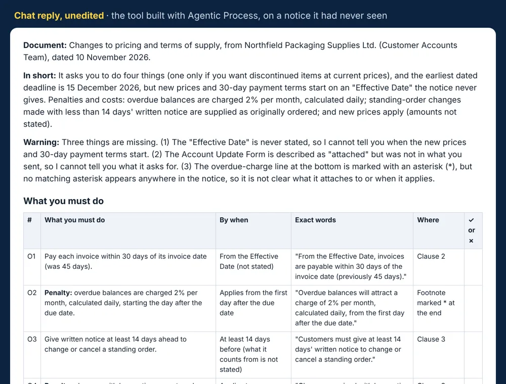
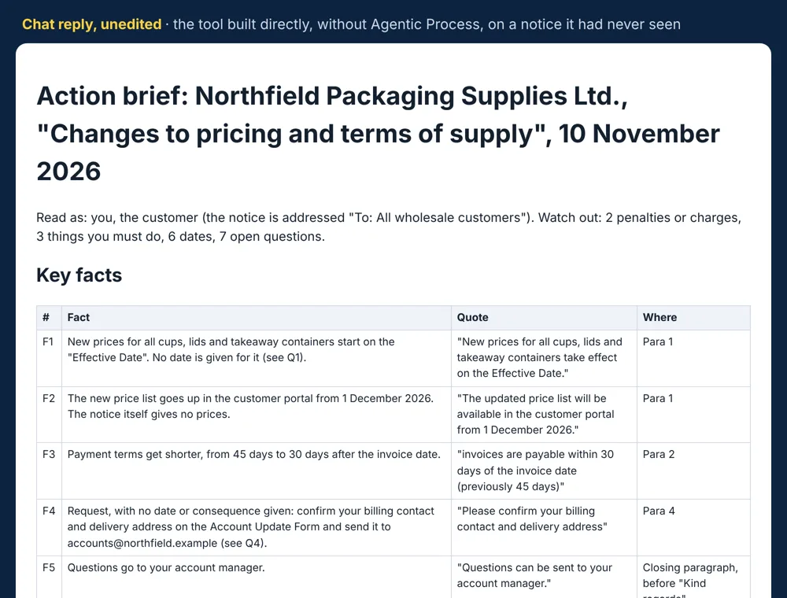

# Agentic Process: turn a job you repeat into a tool someone can use

<p align="center"></p>

<h3 align="center">A job you repeat, in. A tested tool, out.</h3>

<p align="center"><b>For people who build tools and workflows with a coding agent.</b><br>
Paste one build request. Get back a tool someone else can start in five minutes, checked before you get it.</p>

**The capture, in words:** the tool Agentic Process built, at work on a notice it had never seen.
Before any table, it warns that the notice never gives its effective date and leaves out a form it
says is attached, and says who to ask. [The whole reply](quality-results/2026-11-16-builder-pilot/runs/agentic-process-result.md).

<p align="center">
  <a href="#try-it-build-a-tool-in-about-10-minutes"><b>Build your first tool in about 10 minutes</b></a> &nbsp;·&nbsp;
  <a href="#the-evidence-93-against-73">The evidence</a> &nbsp;·&nbsp;
  <a href="#use-it-with-your-own-job">Use it with your own job</a>
</p>

<p align="center">
  
</p>

## Try it: build a tool in about 10 minutes

You need a coding agent such as Claude Code or Codex. Open it in an empty folder and paste this.
The job is an example; swap in your own later.

```
Read the builder skill at
https://raw.githubusercontent.com/bar181/practical-ai/main/projects/agentic-process/level-2-files/agentic-process/SKILL.md
and follow it.

The job: when a supplier sends a notice
that changes our terms, work out what it
makes us do and by when.
Who uses the result: a café owner,
in the chatbot they already use.
Example input: write an invented
one-page supplier notice.
The catch: a notice that leaves out a date
or an attachment it mentions.

Put the tool in document-to-action-brief/.
Hand back what you built, the checks
you ran, and what you assumed.
```

**The build takes about 5 minutes; the tests about 5 more.** Run as your main agent, the builder
tests the tool in fresh sessions itself. If it cannot, it hands you three short messages to paste
into fresh chats. Until those run, the tool is built, not ready.

**You get** a folder with a `README.md` that explains the tool, a `SKILL.md` that works pasted into
any chatbot, and an `example.md` with a real, unedited result. [The one from our pilot](quality-results/2026-11-16-builder-pilot/agentic-process/document-to-action-brief/).

Agent cannot open the link? Download this repository and replace the first three lines with
`Follow projects/agentic-process/level-2-files/agentic-process/SKILL.md`.

## The evidence: 93 against 73

<p align="center">
  
</p>

**In one blind pilot, a tool built with Agentic Process scored 93/100. The direct-build version
scored 73/100 on the same brief.**

<p align="center">
  
  
</p>

**The two first screens, in words:** left, the direct build. It found the same facts, but the
missing date sits in a table of facts and the form is filed as a fact, not a task. Right, Agentic
Process: the warning comes first, with who to ask. Both found all nine key items; the owner had to
correct the left one twice before acting, and the right one not at all.

**The scope:** one build task, one unseen notice, one blind reviewer. A signal, not a study.
[What the pilot changed](quality-results/README.md) · [the raw review](quality-results/2026-11-16-builder-pilot/runs/BLIND-REVIEW.md).

## How it works

<p align="center">
  
</p>

1. **Name the usable result:** who uses it, what they give it, and the one catch it must spot.
2. **Pick the simplest build:** reuse what already does the job; build only what is missing.
3. **Build one `SKILL.md`** that works pasted into any chatbot, or installed as a skill.
4. **Test it in a fresh session:** does it hold up, and would the reader use it as it is? Fix, then hand back.

## Use it with your own job

Keep the first three lines of the request and give four answers:

- **The job** you do by hand: *"Turn a client's meeting notes into actions with owners and dates."*
- **Who uses the result,** and where: *"Me, in ChatGPT."*
- **An example input:** a real one with private details removed, or ask for an invented one.
- **The catch:** what goes wrong by hand: *"Notes that never say who owns an action."*

## Is it ready?

- [ ] Every line of the spec has a check that ran, and the hand-back says who ran it.
- [ ] `example.md` is a real, unedited result, not something the builder wrote.
- [ ] The catch was caught in its own test.
- [ ] Read only the first screen of a result: could the person act on it as it is?

"Not yet run" means not ready. Paste the hand-back's messages into fresh chats yourself.

## What is inside

```
agentic-process/
  README.md               this page
  AGENTS.md, CLAUDE.md    instructions for AI agents
  base/                   the one-page process, the template, two example tools
  level-2-files/          the builder skill, to install in your coding agent
  quality-results/        the evidence: the pilot, the checks, what each changed
  _build/                 the spec and the capture script. You do not need it
```

No coding agent? Copy [`base/template/`](base/template/) and follow [the one-page process](base/PROCESS.md)
in any chatbot. Example tools: [decision support](base/examples/decision-support/) and a
[learning log](base/examples/learning-log/).

**North Star:** someone describes a job they repeat, and gets back a tool another person can start
in five minutes and trust.

## Status

**16 November 2026.** Built by its author with Claude. The builder made two tools on its own: a
learning log that passed three fresh-session checks, and the pilot's tool, run once on an unseen
notice and reviewed blind. The checks were started from outside the builder. Not yet tried in Codex or other
coding agents, or by anyone else. The pilot above is its only head-to-head comparison.


Made by **Bradley Ross**, who builds and teaches practical AI. Part of [Practical AI](../../README.md).
[linkedin.com/in/bradaross](https://www.linkedin.com/in/bradaross/)
