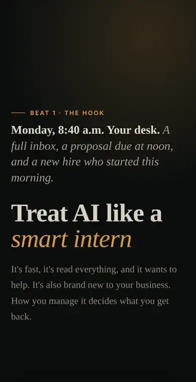
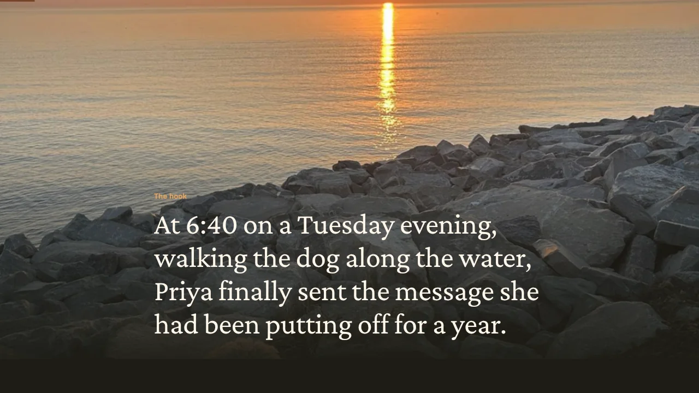
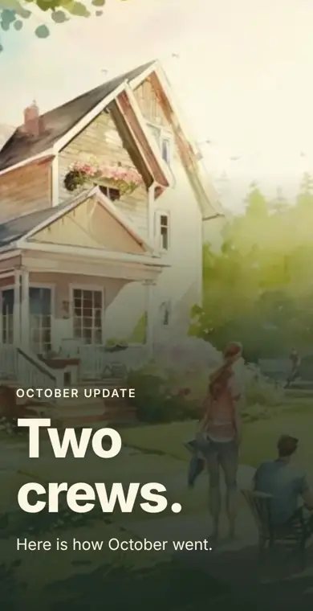
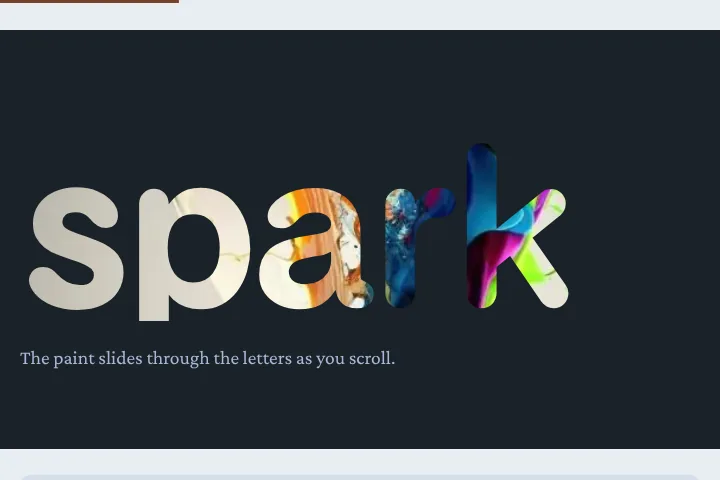

# Artifact Studio

<h3 align="center">Designer-quality reports, made by you.</h3>

<p align="center">Your notes, turned into a page with the impact of a professional website, in the chatbot you already use.</p>

<p align="center"><b>Free</b> &nbsp;·&nbsp; <b>No setup</b> &nbsp;·&nbsp; <b>Your own chatbot</b><br><b>Tested in Claude</b> &nbsp;·&nbsp; <b>Now in user testing</b></p>

You already ask your AI for reports. Ask through Artifact Studio and you get what a designer would
bring, not a wall of text or a slide deck that took hours.

- **It looks professionally designed.** Photos, motion and a story that unfolds as you scroll:
  charts that build, a photo that pans and zooms.
- **The same standard every time.** Seven voices and nine looks fitted to your content and reader.
  The answer first, nothing invented, gaps marked, not guessed.
- **Minutes, not hours.** About five minutes for a page that takes an hour or more by hand. An
  estimate, not a measurement.

<a name="get-started-try-it-now"></a>
<a name="try-it-in-five-minutes"></a>

## Try it now

Copy this into the chatbot you use. Keep the sample notes, or paste your own.

```
Make my information look stunning. Use
the Artifact Studio design guide at
https://raw.githubusercontent.com/bar181/practical-ai/main/projects/artifact-studio/base/AI-INSTRUCTIONS.md
Make it a scrolling keynote page: huge
numbers that count up, a chart that
draws itself as I scroll, and my photo
as a slow pan and zoom. No photo? Use a
line drawing that draws itself.

My information:
- We are a landscaping company with
  two crews
- October revenue $84,200.
  September was $71,500
- Jobs completed: 23 in October,
  19 in September
- Quotes that became jobs: 46%,
  up from 38%
- Need to decide about a second van
  by 5 December

Who reads it: my business partner,
on her phone.
```

**You get a scrolling keynote page** like [this one](_build/examples/runs/2026-11-17-try-it-keynote-photo/report.html),
made by a fresh Claude session from this prompt and one photo, in one try, unedited ([see it below](#keynotes-and-decks)).
Tested so far in Claude; not yet in ChatGPT or Gemini.

<p align="center"><b>The aim: better than you could do by hand, as good as a designer, and made by you.</b></p>

## Before and after: one lesson, three ways

<p align="center">
  
  
  
</p>
<p align="center"><sub><b>Before:</b> the plain version &nbsp;·&nbsp; <b>After:</b> a lesson &nbsp;·&nbsp; <b>After:</b> the same lesson as a story</sub></p>

Bradley Ross needed a short lesson for a client's course: *Treat AI like a smart intern.* He wrote
the content once and made three versions in new sessions. The facts are the same in all three. Only
the design and the voice change.

| | Before | After |
| --- | --- | --- |
| **First look** | A document like every other AI answer | A page that looks designed: painted scenes, a short clip, a photo-filled title |
| **As you scroll** | Nothing moves | Scenes push in, frosted cards appear, the story arrives beat by beat |
| **The brief example** | A table | Tabs: tap Vague or Briefed |
| **Check yourself** | Answers printed under each question | Answers that open on tap |
| **Facts** | The source only | The source only. The story adds an opening scene as framing |

[Open the lesson](base/examples/before-after/2-teacher.html) &nbsp;·&nbsp;
[Open the story](base/examples/before-after/3-story.html) &nbsp;·&nbsp;
[Read the plain version](base/examples/before-after/1-plain.md) &nbsp;·&nbsp;
[All three, with notes](base/examples/before-after/)<br><sub>GitHub shows each page as code: download it, then open it in your browser.</sub>

### Try it yourself

<details>
<summary><b>Copy the full prompt</b>: the request, then the source content Bradley used</summary>

```
Use the Artifact Studio design guide at
https://raw.githubusercontent.com/bar181/practical-ai/main/projects/artifact-studio/base/AI-INSTRUCTIONS.md
Make this a scrolling lesson in the teacher voice, with the pictures I attach.
Then make a second version that tells it as a story.

Core content: AI as a Smart Intern
Use the content below as the only source of facts for this piece. Do not add facts, numbers, names, quotes or claims that are not listed here. If something a reader needs is missing, mark it `[needs: ...]`.

Core idea
Treat AI like a smart intern. It is fast, well-read and eager to help, but it is brand new to your business. How you manage it decides what you get back.

1. Meet your intern
* It has read more than any person could and writes in seconds.
* It never gets tired and never says "that's not my job."
* It knows nothing about your clients, your prices or last week's meeting unless you tell it.

2. Give it a proper brief
* A one-line request makes it guess, so you get a generic answer.
* A good brief says who it should be, who the work is for, what good looks like, and any limits.
* Example (labelled as an example):
  * Vague: "Write a follow-up email." The intern has to guess the client, the tone and the goal.
  * Briefed: "You're my account manager. Write a follow-up to Dana, a client who asked for a spring quote. Friendly, under 120 words. End by offering two call times." This covers the role, reader, tone, length and next step.

3. Expect confident mistakes
* It sounds just as sure when it's wrong as when it's right.
* When it doesn't know, it may fill the gap with something that only looks correct.
* Check every name, number, date and quote before the work leaves your desk.

4. Coach it instead of redoing it
* When a draft misses, say exactly what to change, for example "shorter," "warmer" or "use our pricing."
* A good intern gets better with specific feedback, and so does AI.
* You bring judgment and context. It brings speed. ("The truth is the same, only the script differs.")

5. Delegate the work, keep the decision
* The intern drafts: first drafts, summaries, research to check, options to choose from.
* You decide: anything sent, signed, paid or published.
* Every workflow needs one point where a person reviews the work and says yes.

Next step
Pick one task you repeat every week and hand it to your intern:
1. Write the brief: role, reader, goal, limits.
2. Read the draft and check the facts.
3. Give one round of specific feedback.
4. Make the final call yourself.

Check-yourself questions
1. Why did the vague email prompt fail? The intern had to guess the client, the tone and the goal. A brief removes the guessing.
2. The AI cites a statistic you've never seen. What now? Treat it like an intern's claim and find the source before you use it. Sounding confident doesn't make it true.
3. Which step should AI never do alone? The final decision: sending, signing, paying or publishing. A person says yes.

Recap
A smart intern needs a clear brief, a careful review and a manager who makes the call. So does AI.

Attribution
Instructor: Bradley Ross, who builds and runs AI agents in production.
```

</details>

Attach your own pictures, or leave them out. To see the "before", send the source content alone.

## Get started

**Level 1: paste a prompt into the chatbot you use.** No setup.

1. Copy the [try-it prompt](#try-it-now) and swap in your own notes. Attach a photo of your work if
   you have one. Chatbot cannot open links? Paste the text of
   [`base/AI-INSTRUCTIONS.md`](base/AI-INSTRUCTIONS.md) in place of the link.
2. Make it yours in one sentence: `Now tell it as a story`, `Fill the word October with my photo`,
   or `Show it as a keynote deck`.
3. Before you share, check: every number matches your notes, nothing is added that you did not
   write, and the headline says what you want the reader to take away.

**Level 2: make it your standard.** Set it up once, and every report gets the same design and the
same bar.

| You use | Do this once |
| --- | --- |
| **A chatbot** | Paste [`base/AI-INSTRUCTIONS.md`](https://github.com/bar181/practical-ai/blob/main/projects/artifact-studio/base/AI-INSTRUCTIONS.md) into a Claude or ChatGPT Project, or a Gemini Gem |
| **An assistant that loads skills** | Add [`level-2-files/artifact-studio/`](level-2-files/artifact-studio/) as a skill |

Add your colours and tone in [`level-2-files/preferences.md`](level-2-files/preferences.md). Full
steps: [`level-2-files/`](level-2-files/).

**Level 3: connect your agents or your team.** The MCP server in [`level-3-files/`](level-3-files/)
lets an agent browse the library and get a recommended template by itself. It runs on your own
computer.

## Gallery: what else it makes

### Voices

<p align="center">
  
  
  
</p>
<p align="center">
  
  
</p>
<p align="center"><sub><b>Top:</b> a lesson to teach from, an evidence-first report, a practical field guide &nbsp;·&nbsp; <b>Bottom:</b> a personal story, a customer story. Ask for a voice by name: <i>"Tell this as a story where my customer is the hero."</i></sub></p>

<a name="keynotes-and-decks"></a>

### Keynotes and decks

<p align="center">
  
  
</p>
<p align="center"><sub><b>Left:</b> the page the try-it prompt made, unedited (<a href="_build/examples/runs/2026-11-17-try-it-keynote-no-photo/report.html">the no-photo version</a>) &nbsp;·&nbsp; <b>Right:</b> a keynote deck, one idea per screen: <i>"Turn my notes into a keynote-style deck."</i></sub></p>

### Photo effects

<p align="center">
  
  
  
</p>
<p align="center"><sub>One photo, one sentence: <i>"Fill the frame with my photo and zoom in very slowly, like a documentary shot."</i> Thirteen effects in all, and none needs an app.</sub></p>

### Post previews

<p align="center">
  
</p>
<p align="center"><sub>Three drafts of one post, shown the way the feed shows them, in your voice. LinkedIn, Instagram, TikTok, Facebook, email and blog. Nothing is posted for you.</sub></p>

Every template and effect in one file: [`base/studio.html`](base/studio.html). [Ten worked examples](base/examples/),
each with its prompt and sample notes.

## Questions

<details>
<summary><b>My AI already makes reports. What does this add?</b></summary>

Claude, ChatGPT and Gemini already turn notes into a report or a page. Artifact Studio adds what a
designer would bring: the templates, the effects, the examples and the design rules. Most people
never ask for these, because they do not know they exist. It works inside your chatbot; it does
not replace it.

</details>

<details>
<summary><b>Which chatbots does it work in, and who has used it?</b></summary>

Tested so far in Claude; not yet in ChatGPT or Gemini. Fresh Claude sessions ran the design guide
22 times and the try-it prompt twice, and every run finished its page. Its author has used it for
real, for a client's course. As of 18 November 2026, users are testing it; their results are not in yet.

</details>

<details>
<summary><b>What does it cost?</b></summary>

Nothing. It is free to use, change and share under the [Apache 2.0 licence](LICENSE).

</details>

<details>
<summary><b>Where do my notes go?</b></summary>

Nothing is hosted. You paste your notes into the chatbot you already use, and you get back one
page file you keep. The MCP server, if you use it, runs on your own computer. Some example pages
load their fonts from Google Fonts.

</details>

<details>
<summary><b>What does it not do?</b></summary>

It does not post, send or publish anything: a person decides. It does not invent facts: a gap is
marked `[needs: ...]` for you to fill. A simple Markdown or Word document is planned, not built. The
pages have been checked in Chrome and Safari's engine, not yet on a real phone, in Firefox or with
a screen reader.

</details>

<details>
<summary><b>Which voice should I ask for?</b></summary>

| Voice | Best when |
| --- | --- |
| **Keynote** | The reader should feel something new is possible |
| **Storyteller** | Your customer is the hero and you are the guide |
| **Personal story** | The reader should feel something first, and remember it |
| **Teacher** | Someone has to understand how a thing works |
| **Practical instructor** | People need the core idea and steps for today |
| **Analyst** | The evidence has to carry the argument |
| **Executive brief** | A busy person has to decide |

Each voice describes a style. Nothing is written by, or endorsed by, the people who inspired it.

</details>

## Quick start in one line

```
Hey chatbot, use this project https://github.com/bar181/practical-ai/tree/main/projects/artifact-studio and make my notes into a designed page: <paste your notes, and say who reads it>.
```

This one-line version is not yet tested. The tested prompt is in [Try it now](#try-it-now).

## Status

**18 November 2026.** Built by its author and tested by fresh Claude sessions: 22 runs of the design guide,
then two runs of the try-it prompt above. Every run finished its page. Used for real by its author, for a client's
course (the before and after above). As of 18 November 2026, users are testing it; their results are not in yet. Not yet tried in other chatbots. All example content is
invented. [The evidence](quality-results/README.md).

**Are you an AI agent?** Go to [AGENTS.md](AGENTS.md) for instructions you can follow now.

## About Bradley Ross


Made by **Bradley Ross**, who builds and teaches practical AI. Part of [Practical AI](../../README.md).
[linkedin.com/in/bradaross](https://www.linkedin.com/in/bradaross/)
