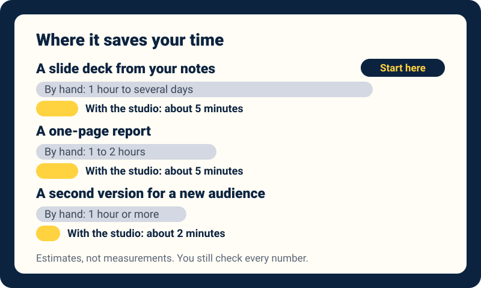
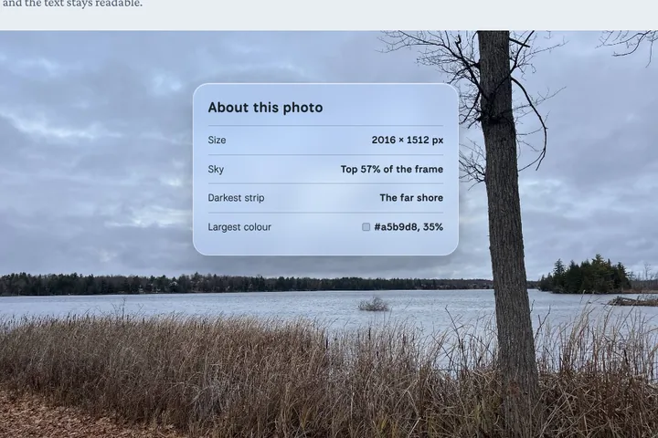
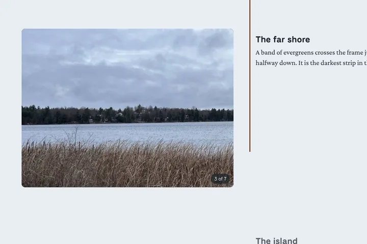
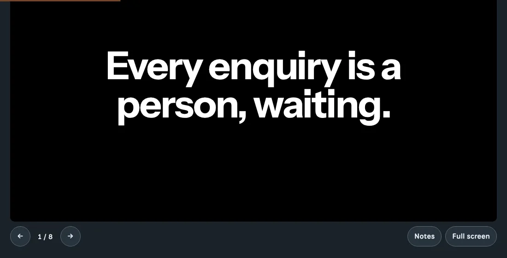
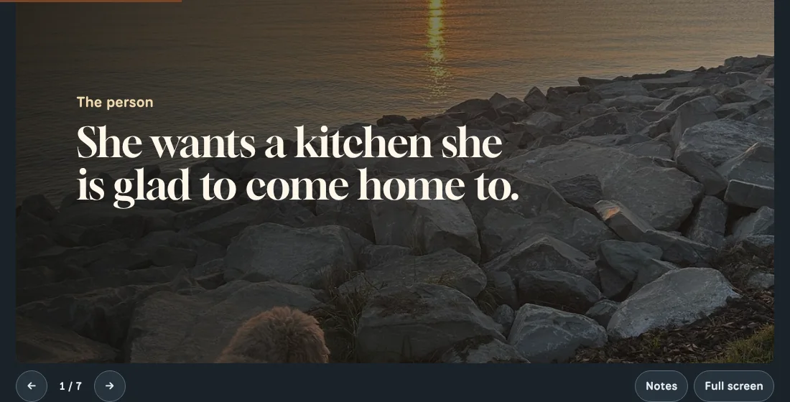
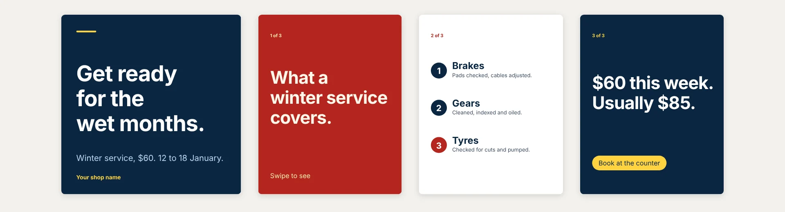

# Artifact Studio: turn any AI answer into a beautiful slide deck or report

<p align="center">
  
</p>

<h3 align="center">Your AI gives brilliant answers. Then it shows them on a grey page.</h3>

<p align="center"><b>One photo. One sentence. A page that moves like a film.</b><br>
Everything above is a single photograph, and each effect comes with the sentence that asks for it.</p>

**Artifact Studio is a free, curated library of modern design templates that turns any AI answer
into a professional slide deck, report or web page.** Use it with the chatbot you already have:
ChatGPT, Claude, Gemini, Microsoft Copilot, Grok, Perplexity, Mistral Le Chat or DeepSeek. Paste
one link and say "show this as a presentation", or tailor it to your own brand. Running a personal
agent such as Grok Bot or Muse, or agents of your own? Hand them the same library and they design
for you.

<p align="center">
  <a href="#try-it-in-five-minutes"><b>Try it in five minutes</b></a> &nbsp;·&nbsp;
  <a href="#what-is-inside">See what is inside</a> &nbsp;·&nbsp;
  <a href="#if-you-are-an-ai-agent">For agents</a>
</p>

## Try it in five minutes

Free and open source. No sign-up. Nothing to install.

### 1. See it on your own AI

Paste this into ChatGPT, Claude, Gemini or the chatbot you already use. The notes are a made-up
example, so there is nothing to prepare.

```
Read the design guide at https://raw.githubusercontent.com/bar181/practical-ai/scaffold/structure/projects/artifact-studio/base/AI-INSTRUCTIONS.md

Then show me a one-page report as an HTML page, from these notes:

- We are a landscaping company with two crews
- October revenue $84,200. September was $71,500
- Jobs completed: 23 in October, 19 in September
- Quotes that became jobs: 46%, up from 38%
- We started sending quotes within two days of the visit. It used to take six
- One van was off the road for four days. Crews shared. No jobs moved
- November: hire one seasonal worker for leaf clearance
- Need to decide about a second van by 15 November

My business partner reads on her phone and wants the answer first. Our colour is green.

When you are done, tell me three ways I could tailor this for my own business.
```

You should get something like this. It is the same request, already built:
[`base/example.html`](base/example.html).

<p align="center"></p>

- **Your chatbot cannot open the link?** Open [`base/AI-INSTRUCTIONS.md`](https://github.com/bar181/practical-ai/blob/scaffold/structure/projects/artifact-studio/base/AI-INSTRUCTIONS.md),
  press the copy button at the top right, and paste it in before the notes.
- **Now add a photo.** Attach any photo of your own and say: `Open with my photo as a slow pan and zoom, like a documentary shot, and set the title in huge letters filled with the photo.`
- **Now make it a deck.** In the same chat, say: `Show the same notes as a keynote-style slide deck: black slides, one idea each, huge type.`
- **Browse everything it can make.** Download [`base/studio.html`](base/studio.html) and open it in
  a browser. It is the whole gallery in one file. It opens on the twelve photo effects, and has a picker that
  chooses a template for you.

### 2. Use it every day

Set it up once, in the place you already work. Then after any answer, you say
**"show this as a presentation"**.

| You use | Do this once | Takes |
| --- | --- | --- |
| **A chatbot** | Make a Project in Claude or ChatGPT, or a Gem in Gemini. Paste [`base/AI-INSTRUCTIONS.md`](https://github.com/bar181/practical-ai/blob/scaffold/structure/projects/artifact-studio/base/AI-INSTRUCTIONS.md) into its instructions | 2 minutes |
| **An assistant that loads skills** | Add the folder [`level-2-files/artifact-studio/`](level-2-files/artifact-studio/) as a skill | 5 minutes |
| **Agents, or a team** | Connect the MCP server in [`level-3-files/`](level-3-files/). Your agents then browse the library and choose for themselves | 10 minutes |

Start with the first row. It needs no connector and works in every chatbot. There is no hosted
connector yet: the server runs on your own computer.

### 3. Make it yours

- **Put your brand on file.** Fill in [`level-2-files/preferences.md`](level-2-files/preferences.md):
  your colours, your tone, the things you never want. A short ask then comes back in your style.
- **Keep your own copy.** Fork this repository, or [download it](https://github.com/bar181/practical-ai/archive/refs/heads/scaffold/structure.zip) and save the
  `artifact-studio` folder in Google Drive, SharePoint or your Documents. Then connect your AI to
  that folder.
- **Ask your AI to tailor it.** With the folder connected, say:
  `Read this folder and tell me how to set it up for my business.`

### If you are an AI agent

Follow [`AGENTS.md`](AGENTS.md). We wrote instructions just for you.

## One sentence, not one afternoon

<p align="center">
  
</p>

**By hand,** a deck you like takes anywhere from an hour to several days: open PowerPoint, pick a
theme, copy and paste the content, hunt for images, add a chart, fix the alignment, start again.

**Chatbots can already build pages and slide decks,** often called artifacts. Left alone, they
build boring ones, and even experienced users lose hours asking for one fix after another.

**Artifact Studio closes that gap.** It gives your AI what a designer would bring: proven
templates, a voice, a look and rules for what good looks like. You get most of the way to a draft
you can use, in the time it takes to type a sentence.

## And that is not all: one set of notes, every version

<p align="center">
  
</p>

The deck for the board is done. Now the operations team needs the same content as a how-to guide.
You do not start again. You say:

> Create another version of this for my operations team, as a report.

Same facts, new shape, new voice. A deck becomes a report, a report becomes a week of posts.

## Where it saves your time

<p align="center">
  
</p>

| Job you repeat | By hand | With the studio | Your part |
| --- | --- | --- | --- |
| **A slide deck from your notes.** Start here | 1 hour to several days | About 5 minutes to a draft | Check every number. Decide what to cut |
| **A one-page report**, weekly or monthly | 1 to 2 hours | About 5 minutes | Confirm the figures and the conclusion |
| **A second version for a new audience** | 1 hour or more | About 2 minutes | Check the tone suits the reader |

These are estimates, not measurements. The point is the shape of the saving: the AI does the
layout and the first draft, and you keep the judgement.

## What is inside

### Photo effects: the part people remember

One photograph becomes twelve different things. Each is small enough for a chatbot to write in a
single reply, and none needs a library or an app.

<p align="center">
  
  
</p>
<p align="center">
  
  
</p>
<p align="center">
  
  
</p>

| Effect | What it does | Say this |
| --- | --- | --- |
| **Pan and zoom** | A still photo moves slowly, like a documentary shot | "Fill the frame with my photo and zoom in very slowly toward the main subject, like a documentary shot. Loop it back out." |
| **Self-drawing line art** | A sketch traced from your photo draws itself, then becomes the photo | "Trace the main shapes in my photo as a simple line drawing. Draw the lines as I scroll, far things first, then fade the real photo in underneath." |
| **Photo-filled type** | One huge word, with your photo inside the letters | "Write one huge word on a dark band and fill the letters with my photo. Slide the photo sideways inside the letters as I scroll." |
| **Scrolling photo tour** | The photo stays put and zooms to each detail as you read | "Pin my photo while I scroll. For each of my paragraphs, zoom the photo to the part it describes." |
| **Before and after** | Two versions with a divider you drag | "Show my photo as shot and with a warm sunset grade, as one picture with a divider I can drag." |
| **Flip postcard** | Tap the photo and it turns over to a note | "Make my photo a postcard with a white border. When I tap it, flip it over in 3D and show a short handwritten-style note on the back." |

Six more are in the gallery: parallax window, chart from the photo, frosted glass card, bento
grid, swipe gallery, and matched looks and voices.

### The rest of the kit

The effects sit on a full library: <!-- counts -->20 templates (4 pages, 7 voices, 4 decks, 5 social formats), 53 components (12 page parts, 12 photo parts, 12 animated SVG files, 17 design ideas for cards, layouts and colour) and 9 looks<!-- /counts -->. Every one
comes with the sentence that asks for it.

### Seven voices: tell your story the way great communicators do

The same facts land differently depending on who is telling them. Pick a voice by name.

<p align="center">
  
</p>

<p align="center">
  
  
</p>
<p align="center">
  
  
</p>

| Voice | Inspired by | Use it when |
| --- | --- | --- |
| **Keynote** | Steve Jobs's product launches | The reader should feel that something new is possible |
| **Storyteller** | Donald Miller's story framework | Your customer is the hero and you are the guide |
| **Teacher** | David Malan's lectures | Someone has to understand how a thing works |
| **Pitch** | Don Draper's carousel pitch | You are selling a feeling, not a feature |
| **Practical instructor** | Bradley Ross's own teaching style | People need the core idea, one analogy and steps for today |
| **Analyst** | Barbara Minto's pyramid principle | The evidence has to carry the argument |
| **Executive brief** | The board decision memo | A busy person has to decide |

Each voice describes a style. Nothing is written by, or endorsed by, the people named.

### Decks you present straight from the browser

<p align="center">
  
  
</p>

Four decks: **visionary**, **story**, **briefing** and **workshop**. Each is one file. Open it,
press the arrow keys, go full screen. No PowerPoint, no export.

### Nine looks, so nothing you make looks like a default

<p align="center">
  
</p>

The same line of content, dressed nine ways. Ask for a look by name, or hand over a photo or your
brand colours and let the studio build one.

### Pages that do one job well

<p align="center">
  
  
</p>

A **landing page**, a **scrolling explainer**, a **proposal** and a **one-page report**. Plus
five **social formats**, twelve animated SVG parts, and design ideas for cards, layouts and colour.

<p align="center">
  
</p>

## AI is a smart intern. This is its design brief

Bradley Ross teaches AI as a **smart intern**: a new hire who has read every book in the world and
has never met you. It is fast and capable. It does not yet know your priorities, your tone or what
good looks like in your business. Give it that, and the work changes.

**Think of it as** the design brief you hand that intern on day one. You bring the content and the
judgement. The studio brings the taste.

**North Star:** a person with no design training gives an assistant their own notes and one
sentence, and gets back something they are proud to send, on the first or second try.

## Status

**Closed as a draft on 15 November 2026.** Built and checked by its author only. Nobody else has
used it yet, so tell us what you find.

| Part | State |
| --- | --- |
| Gallery, picker, palette maker | Built. Rebuilds from `_build/` |
| Chatbots | Built with Claude. **Not yet run** in the other assistants named on this page |
| The one-link prompt | The link opens. **Not yet tried** from inside each chatbot |
| The skill | Written. Not yet run end to end by a second agent |
| MCP server | Tested through a client. Not yet tried in a desktop assistant. Nothing is hosted |
| Real use | **None yet.** Nobody has presented a deck or sent a report made with it |
| Devices | Chrome only. Not checked on a phone, Safari or Firefox |

Every company, person and figure in the templates and the example is made up, and each says so.
The photographs inside the templates are real, were taken by the repository owner and carry no
location data. The times on this page are estimates, not measurements.

## How it is laid out

`base/` is all you need to try it. The other folders are there when you want them.

```
artifact-studio/
  README.md               this page
  AGENTS.md               instructions for AI agents
  LICENSE                 Apache-2.0
  base/
    studio.html           the gallery: download it and browse every template
    AI-INSTRUCTIONS.md    copy into your chatbot
    example.html          one finished business report
  level-2-files/          Advanced: your brand on file, and the skill
  level-3-files/          Expert: the MCP server for agents
  _build/                 what the gallery is built from. You do not need it
```

## About the creator


**Bradley Ross** builds and teaches practical AI.

- **Harvard CS50:** 10 terms as a Teaching Fellow.
- **Agentics Foundation:** Director, working with and sharing teaching with the top agentic
  engineers in the world.
- **Practical AI training:** 12 courses, over 40 cohorts and more than 900 students.

Artifact Studio is part of [Practical AI](../../README.md), a free set of tools for the jobs you
repeat every day, week and month.

**More information, training or feedback:** [linkedin.com/in/bradaross](https://www.linkedin.com/in/bradaross/)
