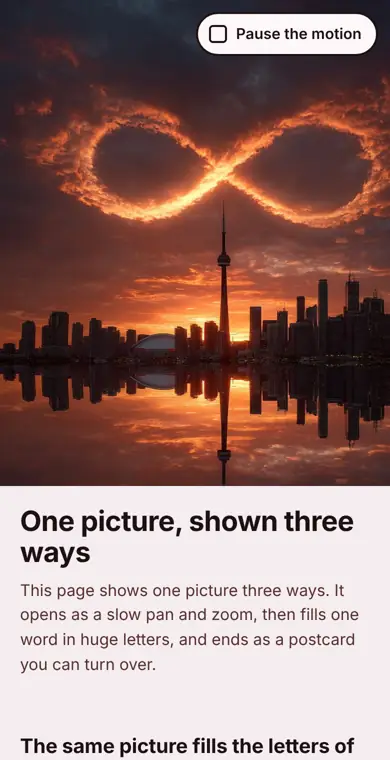
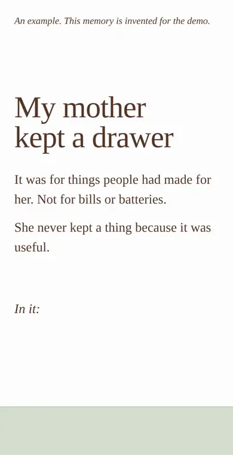

# Artifact Studio

<p align="center">
  
  
  
</p>
<p align="center"><sub><b>Photo effects</b> from one picture &nbsp;·&nbsp; <b>A story that unfolds</b> as you scroll &nbsp;·&nbsp; <b>Monthly numbers as a keynote</b>, from the prompt below</sub></p>

<h3 align="center">Designer-quality reports, made by you.</h3>

<p align="center"><b><i>"Better than I could do, as good as my designer, and I made it myself."</i></b></p>

You already ask your AI for reports. Ask through Artifact Studio and you get the impact of a
professional website: beautiful photos, motion and a story that flows. Not a wall of text, or a
slide deck that took hours.

<p align="center">
  <a href="#get-started-try-it-now"><b>Try it now</b></a> &nbsp;·&nbsp;
  <a href="#the-same-notes-told-in-different-voices">See the voices</a> &nbsp;·&nbsp;
  <a href="#photo-effects">See the effects</a>
</p>

## Get started: try it now

Copy this into the chatbot you use. Keep the sample notes, or paste your own.
Tested so far in Claude; not yet in ChatGPT or Gemini.

```
Make my information look stunning. Use
the Artifact Studio design guide at
https://raw.githubusercontent.com/bar181/practical-ai/main/projects/artifact-studio/base/AI-INSTRUCTIONS.md
Make it a scrolling keynote page: huge
numbers that count up, a chart that
draws itself as I scroll, and my photo
as a slow pan and zoom. No photo? Use a
line drawing that draws itself.

My information:
- We are a landscaping company with
  two crews
- October revenue $84,200.
  September was $71,500
- Jobs completed: 23 in October,
  19 in September
- Quotes that became jobs: 46%,
  up from 38%
- Need to decide about a second van
  by 5 December

Who reads it: my business partner,
on her phone.
```

Attach a photo of your work if you have one. **You get a page like the third one at the top:** a
fresh Claude session made it from this prompt and one picture, in one try, unedited.
[Open the page](_build/examples/runs/2026-11-17-try-it-keynote-photo/report.html). With no photo,
the same prompt gave a black keynote page with a van drawn in lines instead
([open it](_build/examples/runs/2026-11-17-try-it-keynote-no-photo/report.html)). Chatbot cannot
open links? Paste the text of [`base/AI-INSTRUCTIONS.md`](base/AI-INSTRUCTIONS.md) in place of the
link.

**Then make it yours.** Ask for a style or an effect in one sentence:
`Now tell it as a story`, `Fill the word October with my photo`, or
`Show it as a keynote deck`.

**Before you share, check:** every number matches your notes, nothing is added that you did not
write, and the headline says what you want the reader to take away.

## What it adds to your AI

Claude, ChatGPT and Gemini already turn notes into a report or a page. Artifact Studio adds what
a designer would bring: the templates, the effects, the examples and the design rules. Most people
never ask for these, because they do not know they exist.

- **Effects you did not know you could ask for.** Scrollytelling, a photo that pans and zooms, a
  sketch that draws itself, animated diagrams, charts that build as you scroll.
- **A presentation or a lesson, not just a report.** A visionary keynote with one idea per screen,
  or a teaching page with an analogy, steps and a worked example.
- **Fitted to the content and the reader.** Seven voices and nine looks, so a board memo, a lesson
  and a personal story each get the shape they need.
- **The same standard every time.** The answer first, nothing invented, gaps marked, not guessed.

<p align="center">
  
</p>

## The same notes, told in different voices

One set of notes: a three-month trial of drafted replies to customer enquiries. Ask for a voice by
name, and the same facts come back as a different page.

<p align="center">
  
</p>

**A keynote deck** from the same trial: one idea per screen, huge type, full-screen pictures.
*"Turn my notes into a keynote-style deck."*

<p align="center">
  
</p>

**A story** from the same trial, with the customer as the hero and you as the guide.
*"Tell this as a story where my customer is the hero."*

<p align="center">
  
  
</p>

**Or plain and practical,** from the same trial. Left, an evidence-first report with three findings.
Right, a field guide with the core idea and steps for today:
*"Write this up as an evidence-first one-pager."*

### More voices, other notes

These two start from different notes, to show the range.

<p align="center">
  
  
</p>

**A personal story** (left): one memory, a few keepsakes, the offer named only at the end. **A
lesson to teach from** (right): an analogy, steps you scroll through, a worked example.

| Voice | Best when |
| --- | --- |
| **Keynote** | The reader should feel something new is possible |
| **Storyteller** | Your customer is the hero and you are the guide |
| **Personal story** | The reader should feel something first, and remember it |
| **Teacher** | Someone has to understand how a thing works |
| **Practical instructor** | People need the core idea and steps for today |
| **Analyst** | The evidence has to carry the argument |
| **Executive brief** | A busy person has to decide |

Each voice describes a style. Nothing is written by, or endorsed by, the people who inspired it.

## Photo effects

<p align="center">
  
  
</p>
<p align="center">
  
  
</p>

One photo, one sentence: *"Fill the frame with my photo and zoom in very slowly, like a documentary
shot."* Thirteen effects in all, and none needs an app.

## See posts the way your audience will

<p align="center">
  
</p>

Three drafts of one post, side by side, shown the way the feed shows them, in your voice. LinkedIn,
Instagram, TikTok, Facebook, email and blog. Nothing is posted for you.

## Make it your standard

Set it up once in the AI you already use, and every report gets the same design and the same bar.

| What you get | What it is |
| --- | --- |
| **A designed page** | Your report with animated diagrams, scrollytelling, photo effects, a keynote or a lesson. Ready now |
| **Tailored for you** | The voice, look and effects chosen from the type of content and the audience. Through the skill or the MCP server below |
| **A simple document** | A clean report as Markdown or a Word document, for when a page is too much. *Planned, not built yet* |

**Set it up:**

| You use | Do this once |
| --- | --- |
| **A chatbot** | Paste [`base/AI-INSTRUCTIONS.md`](https://github.com/bar181/practical-ai/blob/main/projects/artifact-studio/base/AI-INSTRUCTIONS.md) into a Claude or ChatGPT Project, or a Gemini Gem |
| **An assistant that loads skills** | Add [`level-2-files/artifact-studio/`](level-2-files/artifact-studio/) as a skill |
| **Agents, or a team** | Connect the MCP server in [`level-3-files/`](level-3-files/) |

Add your colours and tone in [`level-2-files/preferences.md`](level-2-files/preferences.md).
Everything in one file: [`base/studio.html`](base/studio.html). [Ten worked examples](base/examples/).
AI agents: [`AGENTS.md`](AGENTS.md).

## Status

**17 November 2026.** Built by its author and tested by fresh Claude sessions: 22 runs of the design guide,
then two runs of the try-it prompt above. Every run finished its page. Not yet tried in other chatbots, or by anyone else. All example content is
invented. [The evidence](quality-results/README.md).


Made by **Bradley Ross**, who builds and teaches practical AI. Part of [Practical AI](../../README.md).
[linkedin.com/in/bradaross](https://www.linkedin.com/in/bradaross/)
