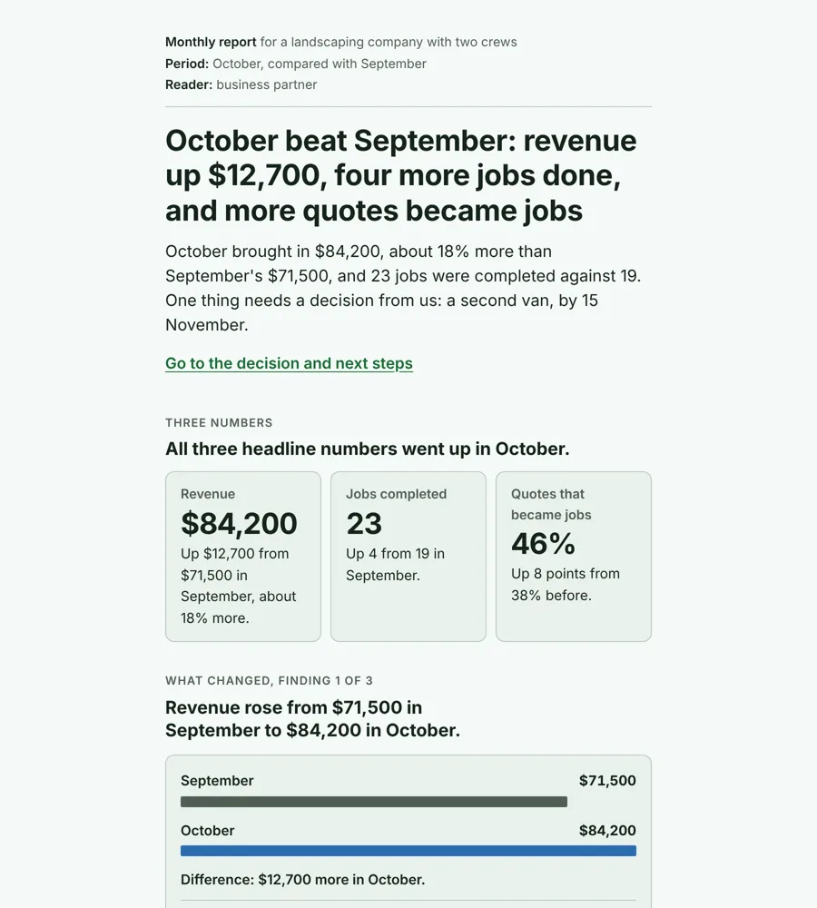
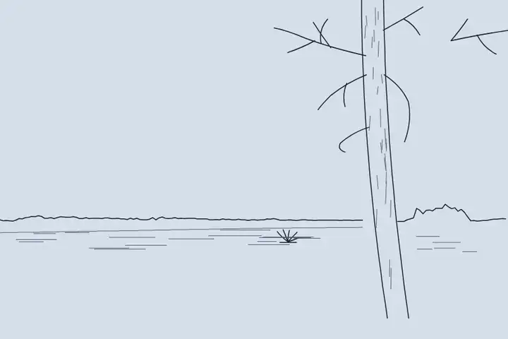
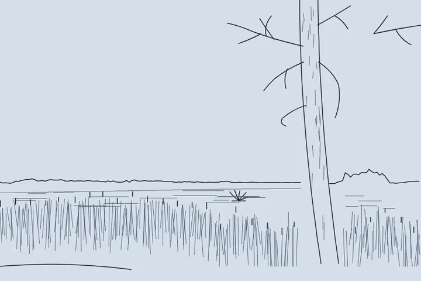
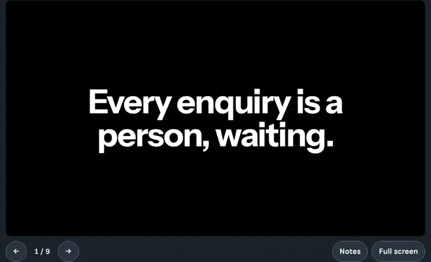
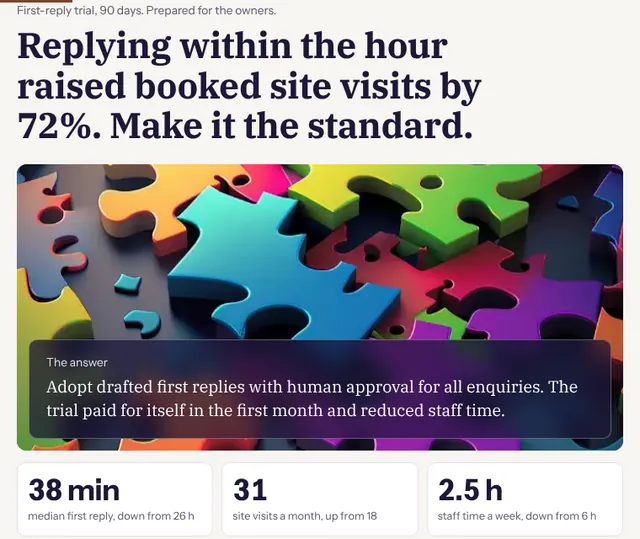
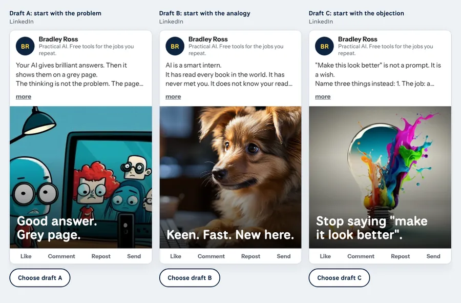

# Artifact Studio: make your first report from rough notes

<p align="center"></p>

<h3 align="center">Rough notes in. A page you are proud to send, out.</h3>

<p align="center"><b>Paste one prompt into the chatbot you already use.</b><br>
Get a one-page report your reader takes in on a phone: the answer first, three numbers, a chart.</p>

**The capture, in words:** an AI chatbot made this page from eight lines of invented notes about a
landscaping company, in one try, unedited. It leads with the answer (October beat September:
revenue up $12,700, four more jobs, more quotes won), then three numbers and a chart.
[Open the page](base/examples/report.html).

<p align="center">
  <a href="#try-it-make-your-first-report-in-5-minutes"><b>Make your first report in 5 minutes</b></a> &nbsp;·&nbsp;
  <a href="#then-a-deck-a-post-or-your-photo">Then a deck or a post</a> &nbsp;·&nbsp;
  <a href="#what-is-inside">What is inside</a>
</p>

<p align="center">
  
</p>

## Try it: make your first report in 5 minutes

Free, no sign-up, nothing to install. The notes below are invented, so there is nothing to prepare.

**1. Copy this into ChatGPT, Claude, Gemini or the chatbot you use.** If it cannot open links,
paste the text of [`base/AI-INSTRUCTIONS.md`](https://github.com/bar181/practical-ai/blob/main/projects/artifact-studio/base/AI-INSTRUCTIONS.md) in place of the first line.

```
Read the design guide at https://raw.githubusercontent.com/bar181/practical-ai/main/projects/artifact-studio/base/AI-INSTRUCTIONS.md

Then show me a one-page report as an HTML page, from these notes:

- We are a landscaping company with two crews
- October revenue $84,200. September was $71,500
- Jobs completed: 23 in October, 19 in September
- Quotes that became jobs: 46%, up from 38%
- We started sending quotes within two days of the visit. It used to take six
- One van was off the road for four days. Crews shared. No jobs moved
- November: hire one seasonal worker for leaf clearance
- Need to decide about a second van by 15 November

My business partner reads on her phone and wants the answer first. Our colour is green.

When you are done, tell me three ways I could tailor this for my own business.
```

**2. Compare.** You should get a page like the one above. Shows code instead? Say "show this as an
artifact", or ask for a preview. Yellow `[needs: ...]` tags mark what your notes did not say.

**3. Use your own notes.** Keep the lines down to `from these notes:`, replace the bullets with
yours, and say who reads it: `My manager reads this on her phone. She wants the decision first.`

**4. Check before you share (2 minutes).**

- [ ] Every number matches your notes.
- [ ] Nothing added you did not write: no new names, dates, claims or reasons.
- [ ] The headline says what you want the reader to take away.
- [ ] It reads well on your phone.

## Then: a deck, a post, or your photo

<p align="center">
  
</p>

**The animation, in words:** the same notes, one sentence each time: a deck, then a report, then a
post. Stay in the same chat and say:

- `Show the same notes as a keynote-style slide deck: black slides, one idea each, huge type.`
- `Now write three LinkedIn posts from it, shown as they will look in the feed.`
- Attach a photo: `Open with my photo as a slow pan and zoom, and set the title in huge letters filled with the photo.`

## What is inside

### Photo effects from one picture

<p align="center">
  
</p>

**The capture, in words:** one photograph, one sentence per effect: a sketch that draws itself, a
slow pan and zoom, a before and after divider, a postcard that flips, a word filled with the picture.

<p align="center">
  
  
</p>
<p align="center">
  
  
</p>

Thirteen effects, each small enough for a chatbot to write in one reply. Try:
`Fill the frame with my photo and zoom in very slowly toward the main subject, like a documentary shot.`

### Any style you ask for

<p align="center">
  
</p>

| Ask for | You get |
| --- | --- |
| **Visionary** | A deck or page with one idea per screen, huge type and full-screen pictures |
| **Explainer** | A lesson to teach from: an analogy, steps you scroll through, a worked example |
| **Analyst** | The answer first, then three findings with a chart each |
| **Practical** | A field guide: the core idea, one analogy, steps for today |
| **Storyteller** or **personal story** | Your customer as the hero, or one true story that ends with the offer |

<p align="center">
  
  
</p>

### Post previews: see the draft the way your audience will

<p align="center">
  
</p>

Three drafts of one post, side by side, shown as the feed will show them, in your voice. Six
places: LinkedIn, Instagram, TikTok, Facebook, an HTML email and a short blog. Nothing is posted
for you. Say: `Write three drafts of a LinkedIn post about my notes, in my voice, shown as they will look in the feed.`

### Nine looks, four decks, ten worked examples

<p align="center">
  
</p>

The same content dressed nine ways; ask for a look by name or hand over your brand colours. Four
decks you present from the browser with the arrow keys. [Ten worked examples](base/examples/),
each with its prompt and the page an AI made from it, unedited. The whole library is one file:
download [`base/studio.html`](base/studio.html) and open it in a browser.

## Why it works

<p align="center">
  
</p>

Chatbots can already build pages. Left alone, they build plain ones, and you lose hours asking for
fixes. Artifact Studio gives the AI what a designer brings: templates, a voice, a look and rules
for what good looks like.

<p align="center">
  
</p>

The times are estimates. The AI does the layout and the first draft; you keep the judgement.

## Use it every day

| You use | Do this once | Takes |
| --- | --- | --- |
| **A chatbot** | Paste [`base/AI-INSTRUCTIONS.md`](https://github.com/bar181/practical-ai/blob/main/projects/artifact-studio/base/AI-INSTRUCTIONS.md) into a Claude or ChatGPT Project, or a Gemini Gem | 2 minutes |
| **An assistant that loads skills** | Add [`level-2-files/artifact-studio/`](level-2-files/artifact-studio/) as a skill | 5 minutes |
| **Agents, or a team** | Connect the MCP server in [`level-3-files/`](level-3-files/) | 10 minutes |

Put your colours and tone in [`level-2-files/preferences.md`](level-2-files/preferences.md) and a
short ask comes back in your style. Teaching it? Use the [30-minute lesson plan](base/TEACH-IN-30-MINUTES.md).
AI agents: follow [`AGENTS.md`](AGENTS.md).

**North Star:** a person with no design training gives an assistant their own notes and one
sentence, and gets back something they are proud to send, on the first or second try.

## Status

**16 November 2026.** Built by its author. The paste-in instructions had 22 runs by fresh Claude
sessions, and every run finished its page. Not yet tried in ChatGPT, Gemini or other assistants,
on a real phone, or by anyone else. Every company and figure in the examples is invented. Every
check, with its raw evidence: [`quality-results/`](quality-results/).

## How it is laid out

```
artifact-studio/
  README.md               this page
  AGENTS.md, CLAUDE.md    instructions for AI agents
  base/                   all you need: the instructions, the one-file library, ten examples
  level-2-files/          your brand on file, and the skill
  level-3-files/          the MCP server for agents
  quality-results/        the evidence, and the library report and deck
  _build/                 what it is built from. You do not need it
```


Made by **Bradley Ross**, who builds and teaches practical AI. Part of [Practical AI](../../README.md).
[linkedin.com/in/bradaross](https://www.linkedin.com/in/bradaross/)
