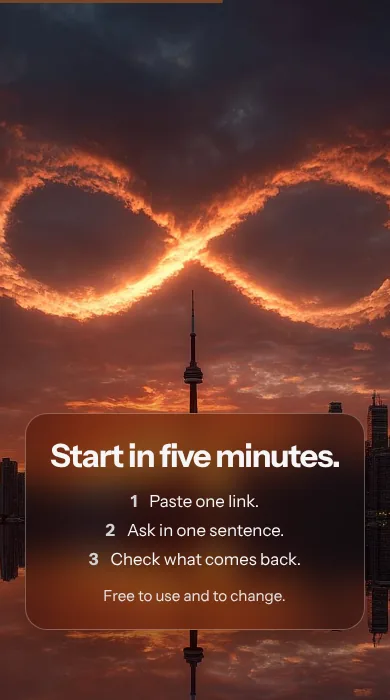
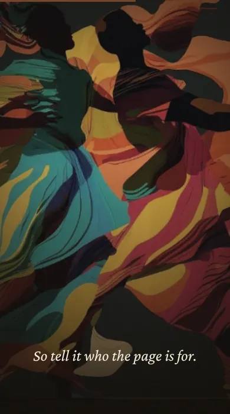
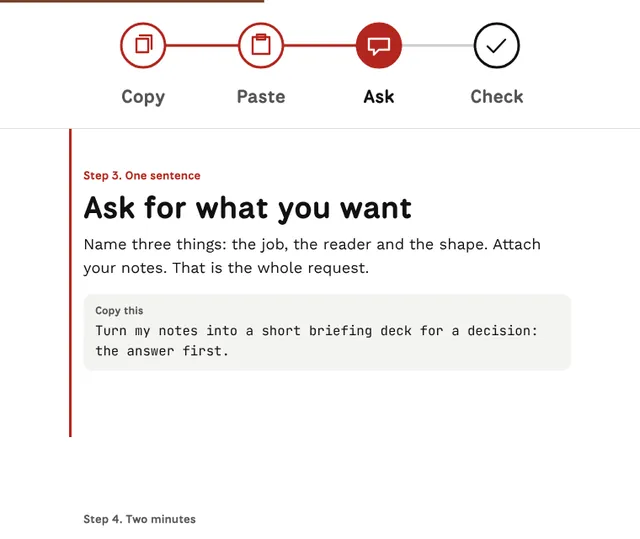
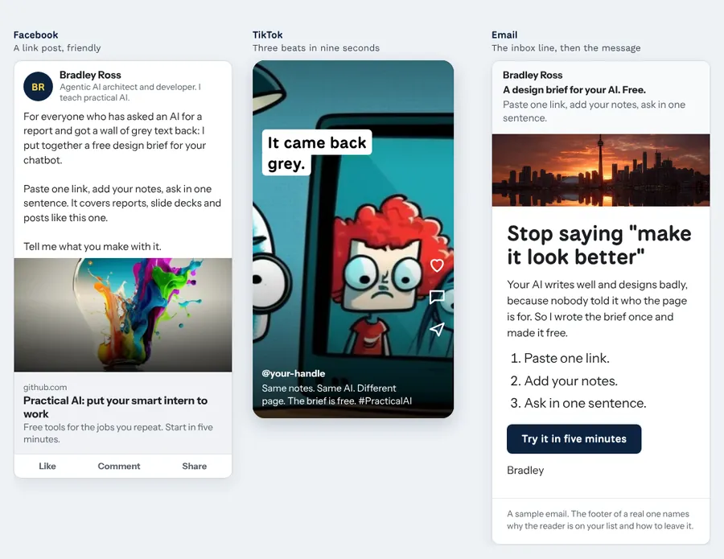
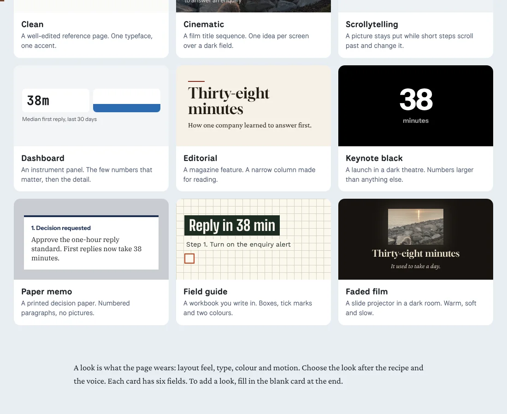

# Artifact Studio: make your first report from rough notes

**Have rough notes and something to share?** Paste one prompt into the chatbot you already use and
get a one-page report your reader can take in on a phone: the answer first, three key numbers, a
chart and what happens next.

<p align="center"></p>

**The capture, in words:** an AI chatbot made this page from the eight lines of notes in the
sample below, about an invented landscaping company, in one try, unedited. It leads with the answer
(October beat September: revenue up $12,700, four more jobs, more quotes won), then three numbers,
a chart of September against October, and further down the decision coming up. [Open the page](base/examples/report.html).

<p align="center"><a href="#try-it-make-your-first-report-in-5-minutes"><b>Make your first report in 5 minutes</b></a> &nbsp;·&nbsp;
<a href="#then-the-same-notes-as-a-deck-a-post-or-a-page-with-your-photo">Then a deck or a post</a> &nbsp;·&nbsp;
<a href="#what-is-inside">Everything inside</a></p>

## Try it: make your first report in 5 minutes

Free and open source. No sign-up. Nothing to install.

### 1. Copy the sample

Paste this into ChatGPT, Claude, Gemini or the chatbot you already use. The notes are invented, so
there is nothing to prepare.

**If your chatbot cannot open links,** open [`base/AI-INSTRUCTIONS.md`](https://github.com/bar181/practical-ai/blob/main/projects/artifact-studio/base/AI-INSTRUCTIONS.md)
(in a downloaded copy: `projects/artifact-studio/base/AI-INSTRUCTIONS.md`), copy all of it, and
paste it in place of the first line.

```
Read the design guide at https://raw.githubusercontent.com/bar181/practical-ai/main/projects/artifact-studio/base/AI-INSTRUCTIONS.md

Then show me a one-page report as an HTML page, from these notes:

- We are a landscaping company with two crews
- October revenue $84,200. September was $71,500
- Jobs completed: 23 in October, 19 in September
- Quotes that became jobs: 46%, up from 38%
- We started sending quotes within two days of the visit. It used to take six
- One van was off the road for four days. Crews shared. No jobs moved
- November: hire one seasonal worker for leaf clearance
- Need to decide about a second van by 15 November

My business partner reads on her phone and wants the answer first. Our colour is green.

When you are done, tell me three ways I could tailor this for my own business.
```

### 2. Compare what you get

You should get a page like the one above. The same request, already built:
[`base/examples/report.html`](base/examples/report.html). Yours will differ.

- **It shows code, not a page?** That happens with a bare HTML file on a phone. Say "show this as
  an artifact" in Claude, or ask your chatbot for a preview of the page.
- **It says it could not open the link?** Use the "cannot open links" step above.
- **Yellow `[needs: ...]` tags on the page?** The chatbot marks what your notes did not say, such
  as `[needs: owner]`, rather than invent it. Add the missing detail in a sentence, or leave it.

### 3. Use your own notes

Keep the first lines, down to `from these notes:`. Replace the bullet points with your own, then
say who reads it and how:

```
My manager reads this on her phone before Monday's meeting.
She wants the decision first. Our colour is navy.
```

Rough is fine: half-sentences, numbers, things to decide. Leave out anything your workplace does
not allow in that chatbot.

### 4. Check it before you share it (2 minutes)

- [ ] **Every number matches your notes.** The AI lays out your figures; it can still copy one wrong.
- [ ] **Nothing is added that you did not write:** no new names, dates, quotes or claims, and no
  reasons you did not give ("because", "the main cause").
- [ ] **The headline says what you want the reader to take away.** If not, say "Change the headline to ...".
- [ ] **Open it on your phone,** where your reader will: send yourself the link or the file.

Ask for any fix in a sentence: `The October revenue is 84,200, not 82,400.`

## Then: the same notes as a deck, a post or a page with your photo

<p align="center">
  
</p>

**The animation, in words:** the same page of notes, and one sentence each time. "Show it as a
deck" gives slides; "Now a report" gives the one-page report; "Now a post" gives a social post.

Stay in the same chat and say one of these:

- `Show the same notes as a keynote-style slide deck: black slides, one idea each, huge type.`
- `Now write three LinkedIn posts from it, shown as they will look in the feed.`
- Attach a photo and say: `Open with my photo as a slow pan and zoom, and set the title in huge letters filled with the photo.`
- `Create another version for my operations team, as a how-to guide.`

Same facts, new shape, new voice. Each takes about two minutes.

## What is inside

### Photo effects: the part people remember

<p align="center">
  
</p>

**The capture, in words:** every effect here comes from a single photograph and one sentence each:
a sketch that draws itself, a slow pan and zoom, a before and after divider, a postcard that flips,
and a word filled with the picture.

One picture and one sentence per effect. There are thirteen, each small enough for a chatbot to
write in a single reply, and none needs a library or an app.

<p align="center">
  
  
</p>
<p align="center">
  
  
</p>
<p align="center">
  
  
</p>

| Effect | What it does | Say this |
| --- | --- | --- |
| **Pan and zoom** | A still photo moves slowly, like a documentary shot | "Fill the frame with my photo and zoom in very slowly toward the main subject, like a documentary shot. Loop it back out." |
| **Self-drawing line art** | A sketch traced from your photo draws itself, then becomes the photo | "Trace the main shapes in my photo as a simple line drawing. Draw the lines as I scroll, far things first, then fade the real photo in underneath." |
| **Photo-filled type** | One huge word, with your photo inside the letters | "Write one huge word on a dark band and fill the letters with my photo. Slide the photo sideways inside the letters as I scroll." |
| **Scrolling photo tour** | The photo stays put and zooms to each detail as you read | "Pin my photo while I scroll. For each of my paragraphs, zoom the photo to the part it describes." |
| **Before and after** | Two versions with a divider you drag | "Show my photo as shot and with a warm sunset grade, as one picture with a divider I can drag." |
| **Flip postcard** | Tap the photo and it turns over to a note | "Make my photo a postcard with a white border. When I tap it, flip it over in 3D and show a short handwritten-style note on the back." |

Seven more are in the gallery: parallax window, frosted glass card, swipe gallery, bento grid,
chart from the photo, scrollytelling with a pinned picture, and matched looks and voices.

### The rest of the kit

The effects sit on a full library: <!-- counts -->20 templates (4 pages, 7 voices, 4 decks, 5 social formats), 60 components (12 page parts, 13 photo parts, 12 animated SVG files, 17 design ideas for cards, layouts and colour, 6 post previews) and 9 looks<!-- /counts -->. Every one
comes with the sentence that asks for it.

### A full artifact, in the style you ask for

One sentence picks the style. The same notes become a deck you present, a lesson you teach from,
a story people feel, a report that argues from evidence, or a guide people act on today.

<p align="center">
  
</p>

| Style | What you get | Say this |
| --- | --- | --- |
| **Visionary** | A slide deck, or a page that scrolls one idea per screen. Huge type, full-screen pictures with a few words over them, a frosted glass card, and numbers as bars with no axes | "Turn my notes into a keynote-style deck: black slides, one idea each, huge type. Put my photo full screen behind two of the slides, with the words over it." |
| **Explainer** | A lesson you can teach from: an analogy, a sketch that draws itself, steps you scroll through while a diagram keeps your place, a worked example and questions to check | "Explain this like a great teacher: start with an everyday analogy, then one example, then the detail." |
| **Emotional** | A personal story: one memory, a few keepsakes as crooked photographs, one picture filling the screen, and the offer named only at the end | "Tell this as a personal story: one memory, the feeling in it, and name what I am offering only at the end." |
| **Analyst** | A report that gives the answer first, then earns it with three findings and a chart each | "Write this up as an evidence-first one-pager: the answer at the top, then three findings with a chart each." |
| **Practical** | A field guide: the core idea, one analogy, and steps to tick off today | "Turn this into a practical one-page guide: the core idea, one analogy, then steps I can do today." |

The visionary page in the gallery is about this repository: the smart intern, the jobs you repeat,
and what is in the kit on day one.

<p align="center">
  
  
</p>

The emotional page tells one personal story and never lists a feature. Its narrator is invented;
yours has to be true.

<p align="center">
  
  
</p>

The explainer in the gallery teaches this project. It is built to be taught from in class:
the smart intern analogy, the four steps, and how to write a good ask.

<p align="center">
  
  
</p>
<p align="center">
  
  
</p>

### Seven voices: tell your story the way great communicators do

The same facts land differently depending on who is telling them. Pick a voice by name.

<p align="center">
  
  
</p>

| Voice | Inspired by | Use it when |
| --- | --- | --- |
| **Keynote** | The product launches of visionary tech CEOs | The reader should feel that something new is possible |
| **Storyteller** | Donald Miller's story framework | Your customer is the hero and you are the guide |
| **Personal story** | The classic advertising pitch that sells a feeling through one true story | The reader should feel something first and remember it |
| **Teacher** | The great professors at Harvard | Someone has to understand how a thing works. The explainer uses this voice |
| **Practical instructor** | Bradley Ross's own teaching style | People need the core idea, one analogy and steps for today |
| **Analyst** | Barbara Minto's pyramid principle | The evidence has to carry the argument |
| **Executive brief** | The board decision memo | A busy person has to decide |

Each voice describes a style. Nothing is written by, or endorsed by, the people or places named.

### Post previews: see the draft the way your audience will

When you review or present social posts, a list of text is extra work for everyone who has to
read it. Ask for each draft in the shape of the feed, in your own voice, and you are looking at
the deliverable before you press post.

<p align="center">
  
</p>

- **Compare three drafts side by side.** One topic, three ways in: the problem, the analogy, the
  objection. The text is cut where a feed would cut it, so you judge the opening.
- **Your voice.** Paste three posts you are proud of and say "write in this voice".
- **One message, told differently in each place.** LinkedIn gets the lesson. Instagram gets the
  feeling, with the picture first.
- **Six places.** LinkedIn, Instagram, TikTok, Facebook, an HTML email with its inbox line, and a
  short blog post.
- **Advanced: ready when you wake up.** Run the request on a schedule and review the previews
  over coffee. This needs an assistant that can run tasks on a schedule. It is a recommendation;
  the library does not set it up.

<p align="center">
  
</p>

Say this: `Write three drafts of a LinkedIn post about my notes, in my voice. Take a different way in for each. Show each one as it will look in the feed, side by side. Do not post anything.`

The frames are plain on purpose. They copy the shape of a feed, not any platform's logo or
interface, and they never show invented likes or followers. Nothing is posted for you.

### Decks you present straight from the browser

Four decks: **visionary**, **story**, **briefing** and **workshop**. Each is one file. Open it,
press the arrow keys, go full screen. No PowerPoint, no export.

### Nine looks, so nothing you make looks like a default

<p align="center">
  
</p>

The same line of content, dressed nine ways. Ask for a look by name, or hand over a photo or your
brand colours and let the studio build one.

### Pages that do one job well

<p align="center">
  
  
</p>

A **landing page**, a **scrolling explainer**, a **proposal** and a **one-page report**. Plus
five **social formats**, twelve animated SVG parts, and design ideas for cards, layouts and colour.

<p align="center">
  
</p>

### Ten worked examples, each with its prompt

Each file in [`base/examples/`](base/examples/) is one request: the prompt to copy, the sample
input, and the page an AI made from them.

| Worked example | What it shows |
| --- | --- |
| [`voice-visionary.html`](base/examples/voice-visionary.html) | One idea per screen in huge type, with three pictures. About this repository |
| [`voice-storyteller.html`](base/examples/voice-storyteller.html) | The customer as the hero, with a hook, a plan and an ending |
| [`voice-emotional.html`](base/examples/voice-emotional.html) | One personal story, and the offer named only at the end |
| [`voice-explainer.html`](base/examples/voice-explainer.html) | A lesson to teach from: analogy, steps, a worked example, questions |
| [`voice-practical.html`](base/examples/voice-practical.html) | A field guide: the core idea, one analogy, steps for today |
| [`voice-analyst.html`](base/examples/voice-analyst.html) | The answer first, then three findings with a chart each |
| [`voice-brief.html`](base/examples/voice-brief.html) | A decision memo a busy person reads in three minutes |
| [`social-posts.html`](base/examples/social-posts.html) | Three drafts of a post, shown as they will look in the feed |
| [`photo-effects.html`](base/examples/photo-effects.html) | Three effects from one picture: a slow pan, a word filled with the picture, a postcard |
| [`report.html`](base/examples/report.html) | The one-page report from the request above |

Each finished page is what an AI assistant made from that prompt in a fresh session on
16 November 2026, unedited. They are plainer than the hand-built versions in the library, and
that is the point: this is what you can expect. Yours will differ.

## Why it works: a design brief, not "make this look better"

<p align="center">
  
</p>

- **Present a mini website, not a slide show.** A deck is a stack of pictures. A page can move: a photo that pans, a chart that draws itself, steps that light up as you scroll.
- **"Make this look better" is not a solution.** The AI does not know what better means to you. A brief names the job, the reader and the shape.
- **Give your agents a way to tell a proper story.** This is the time of agentic software. Agents write the code and the report; hand them voices, templates and rules so the result is worth reading.
- **See your draft the way your audience will.** A list of draft posts is more reading for everyone. Ask for each draft as it will look in the feed, then choose.

**Artifact Studio is a free, curated library of modern design templates that turns any AI answer
into a professional slide deck, report, web page or post preview.** Use it with the chatbot you already have:
ChatGPT, Claude, Gemini, Microsoft Copilot, Grok, Perplexity, Mistral Le Chat or DeepSeek. Paste
one link and say "show this as a presentation", or tailor it to your own brand. Running a personal
agent such as Grok Bot or Muse, or agents of your own? Hand them the same library and they design
for you.

### One sentence, not one afternoon

<p align="center">
  
</p>

**By hand,** a deck you like takes anywhere from an hour to several days: open PowerPoint, pick a
theme, copy and paste the content, hunt for images, add a chart, fix the alignment, start again.

**Chatbots can already build pages and slide decks,** often called artifacts. Left alone, they
build boring ones, and even experienced users lose hours asking for one fix after another.

**Artifact Studio closes that gap.** It gives your AI what a designer would bring: proven
templates, a voice, a look and rules for what good looks like. You get most of the way to a draft
you can use, in the time it takes to type a sentence.

### Where it saves your time

<p align="center">
  
</p>

| Job you repeat | By hand | With the studio | Your part |
| --- | --- | --- | --- |
| **A slide deck from your notes.** Start here | 1 hour to several days | About 5 minutes to a draft | Check every number. Decide what to cut |
| **A one-page report**, weekly or monthly | 1 to 2 hours | About 5 minutes | Confirm the figures and the conclusion |
| **A second version for a new audience** | 1 hour or more | About 2 minutes | Check the tone suits the reader |

These are estimates, not measurements. The point is the shape of the saving: the AI does the
layout and the first draft, and you keep the judgement.

## Advanced setup: use it every day

### Set it up once

Set it up once, in the place you already work. Then after any answer, you say
**"show this as a presentation"**.

| You use | Do this once | Takes |
| --- | --- | --- |
| **A chatbot** | Make a Project in Claude or ChatGPT, or a Gem in Gemini. Paste [`base/AI-INSTRUCTIONS.md`](https://github.com/bar181/practical-ai/blob/main/projects/artifact-studio/base/AI-INSTRUCTIONS.md) into its instructions | 2 minutes |
| **An assistant that loads skills** | Add the folder [`level-2-files/artifact-studio/`](level-2-files/artifact-studio/) as a skill | 5 minutes |
| **Agents, or a team** | Connect the MCP server in [`level-3-files/`](level-3-files/). Your agents then browse the library and choose for themselves | 10 minutes |

Start with the first row. It needs no connector and works in every chatbot. There is no hosted
connector yet: the server runs on your own computer.

### Make it yours

- **Put your brand on file.** Fill in [`level-2-files/preferences.md`](level-2-files/preferences.md):
  your colours, your tone, the things you never want. A short ask then comes back in your style.
- **Keep your own copy.** Fork this repository, or [download it](https://github.com/bar181/practical-ai/archive/refs/heads/main.zip) and save the
  `artifact-studio` folder in Google Drive, SharePoint or your Documents. Then connect your AI to
  that folder.
- **Ask your AI to tailor it.** With the folder connected, say:
  `Read this folder and tell me how to set it up for my business.`

### If you are an AI agent

Follow [`AGENTS.md`](AGENTS.md). We wrote instructions just for you.

- **Browse everything it can make.** Download [`base/studio.html`](base/studio.html) and open it in a browser: the whole library in one file.
- **Teaching it?** There is a [30-minute lesson plan](base/TEACH-IN-30-MINUTES.md).

## AI is a smart intern. This is its design brief

Bradley Ross teaches AI as a **smart intern**: a new hire who has read every book in the world and
has never met you. It is fast and capable. It does not yet know your priorities, your tone or what
good looks like in your business. Give it that, and the work changes.

**Think of it as** the design brief you hand that intern on day one. You bring the content and the
judgement. The studio brings the taste.

**North Star:** a person with no design training gives an assistant their own notes and one
sentence, and gets back something they are proud to send, on the first or second try.

## Status

**Tested on 16 November 2026.** Built by its author, then put through 22 independent runs by
fresh AI sessions. Its owner is the only person who has used it, so tell us what you find. Every
check, with its raw evidence and the library report: [`quality-results/`](quality-results/).

| Part | State |
| --- | --- |
| Gallery, picker, palette maker | Built. Rebuilds from `_build/` |
| Worked examples | Ten files. Each page was made by an AI assistant from its prompt in a fresh session on 16 November 2026 and is unedited. All ten pass the automated checks in Chrome. The sessions were Claude; no other assistant has been tried |
| Chatbots | Built with Claude. **Not yet run** in the other assistants named on this page |
| A real request | On 16 November 2026 the assistant that wrote the instructions followed them to make a progress report on this project. A first real use, not an independent test |
| The paste-in instructions | 22 independent runs on 16 November 2026, each in a fresh Claude session: thirteen, then three rounds of three on the fixed text. Every run finished its page. The first thirteen reported about 230 points of friction. Across the three re-test rounds the points that would change the page fell from 13 to 9 to 6. Those 6 are fixed and **not re-tested**. The logs are in [`_build/examples/runs/`](_build/examples/runs/). **Not yet tried** in ChatGPT, Gemini or any assistant other than Claude |
| The one-link prompt | A fresh Claude session fetched the instructions from the link and finished its page from them alone. **Not yet tried** from inside ChatGPT, Gemini or the others |
| The skill | Run end to end by a second agent on 16 November 2026: it made a six-slide deck and reported ten places where the skill and its reference cards disagreed. The ones about decks are fixed |
| MCP server | An agent with only the server's tools made a page. It found the server broke when its folder was copied alone; that is fixed and tested. Not yet tried in a desktop assistant. Nothing is hosted |
| Post previews | A fresh session made three drafts side by side from the prompt. The example drafts have not been posted anywhere |
| Real use | The owner asked for one page, a progress report, and used it. **No one else** has presented a deck or sent a report made with it |
| Devices | Every tab checked in Chrome and in the WebKit engine that Safari is built on. Not checked on a real phone, in Firefox or with a screen reader |

Every company, person and figure in the templates and the example is made up, and each says so.
Two places are about this repository instead and name its author: the visionary page and the
post previews. Their drafts are examples, written from his own teaching phrases.
Two pictures inside the templates, the lake and the sunset, are photographs taken by the
repository owner. The other fourteen were made by the owner with AI image tools. None carries
location data. The times on this page are estimates, not measurements.

## How it is laid out

`base/` is all you need to try it. The other folders are there when you want them.

```
artifact-studio/
  README.md               this page
  AGENTS.md               instructions for AI agents
  CLAUDE.md               points Claude Code at AGENTS.md
  LICENSE                 Apache-2.0
  base/
    studio.html           the kitchen sink: the whole library in one file
    AI-INSTRUCTIONS.md    copy into your chatbot
    examples/             ten worked examples: a prompt, its sample input, the page an AI made
    TEACH-IN-30-MINUTES.md  a lesson plan
  level-2-files/          Advanced: your brand on file, and the skill
  level-3-files/          Expert: the MCP server for agents
  quality-results/        the evidence: what was checked, by whom, and the library report and deck
  _build/                 what the library and the examples are built from. You do not need it
```

## About the creator


**Bradley Ross** is an agentic AI architect and developer for businesses of every size, from
start-up to enterprise. He builds and teaches practical AI.

- **Specialty:** deterministic AI, and advanced AI research into AI with learning transfer abilities.
- **Harvard CS50:** 10 terms as a Teaching Fellow.
- **Agentics Foundation:** Director, working with and sharing teaching with the top agentic
  engineers in the world.
- **Practical AI training:** 12 courses, over 40 cohorts and more than 900 students.

Artifact Studio is part of [Practical AI](../../README.md), a free set of tools for the jobs you
repeat every day, week and month.

**More information, training or feedback:** [linkedin.com/in/bradaross](https://www.linkedin.com/in/bradaross/)
