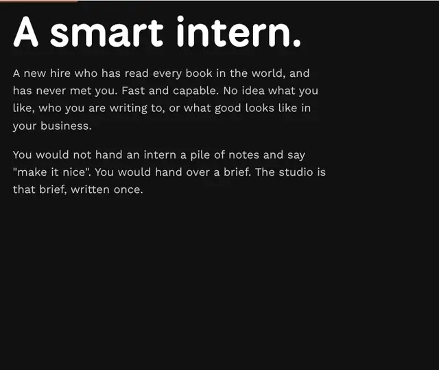
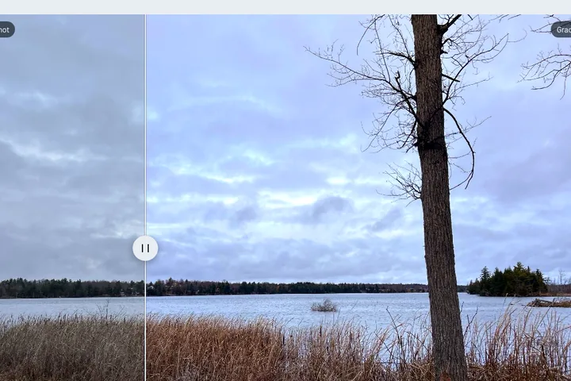
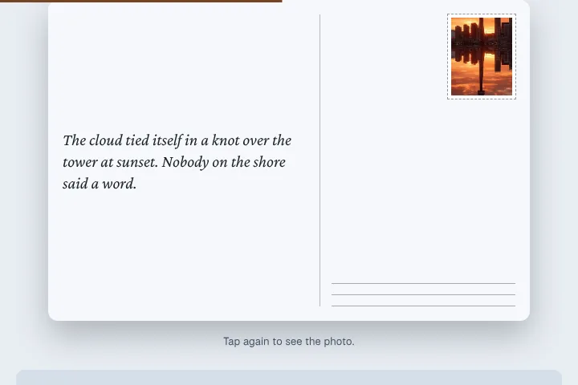

# Artifact Studio

<p align="center"></p>

<h3 align="center">Pages, decks and posts that look designed and tell a real story.</h3>

<p align="center"><b>Your AI, with a designer's brief.</b><br>
Ask your chatbot for a report or a deck and you usually get something plain.
Artifact Studio gives it what a designer would bring, so the result is worth sending.</p>

**The capture, in words:** one photograph, one sentence per effect: a sketch that draws itself, a
slow pan and zoom, a before and after divider, a postcard that flips, a word filled with the picture.

<p align="center">
  <a href="#get-started-your-first-report"><b>Make your first report</b></a> &nbsp;·&nbsp;
  <a href="#the-same-notes-told-seven-ways">See the voices</a> &nbsp;·&nbsp;
  <a href="#photo-effects">See the effects</a>
</p>

## Why it is better

- **Designed, not default.** Real templates, nine looks and thirteen photo effects, instead of
  the plain page a chatbot makes on its own.
- **Told the way great communicators tell it.** Pick a voice, from keynote to analyst, and the same
  facts land the way you need them to.
- **The same standard every time.** A repeatable brief your AI follows on every page: the answer
  first, nothing invented, and gaps marked rather than guessed.
- **And faster.** A first draft in minutes, not an afternoon. Times are estimates.

## The same notes, told seven ways

One set of notes. Ask for a voice by name, and you get a different kind of page.

<p align="center">
  
</p>

**A keynote deck:** one idea per screen, huge type, full-screen pictures. *"Turn my notes into a keynote-style deck."*

<p align="center">
  
  
</p>

**A personal story:** one memory, a few keepsakes, and the offer named only at the end. *"Tell this as a personal story."*

<p align="center">
  
  
</p>

**A lesson to teach from:** an analogy, steps you scroll through, a worked example. *"Explain this like a great teacher."*

<p align="center">
  
  
</p>

**An evidence-first report, or a field guide:** the answer first with three findings, or the core
idea and steps for today. *"Write this up as an evidence-first one-pager."*

| Voice | Best when |
| --- | --- |
| **Keynote** | The reader should feel something new is possible |
| **Storyteller** | Your customer is the hero and you are the guide |
| **Personal story** | The reader should feel something first, and remember it |
| **Teacher** | Someone has to understand how a thing works |
| **Practical instructor** | People need the core idea and steps for today |
| **Analyst** | The evidence has to carry the argument |
| **Executive brief** | A busy person has to decide |

Each voice describes a style. Nothing is written by, or endorsed by, the people who inspired it.

## Photo effects

<p align="center">
  
  
</p>
<p align="center">
  
  
</p>

One photo, one sentence: *"Fill the frame with my photo and zoom in very slowly, like a documentary
shot."* Thirteen effects in all, and none needs an app.

## See posts the way your audience will

<p align="center">
  
</p>

Three drafts of one post, side by side, shown the way the feed shows them, in your voice. LinkedIn,
Instagram, TikTok, Facebook, email and blog. Nothing is posted for you.

## Get started: your first report

Paste this into ChatGPT, Claude, Gemini or the chatbot you use. The notes are invented, so there is
nothing to prepare.

```
Read the design guide at https://raw.githubusercontent.com/bar181/practical-ai/main/projects/artifact-studio/base/AI-INSTRUCTIONS.md

Then show me a one-page report as an HTML page, from these notes:

- We are a landscaping company with two crews
- October revenue $84,200. September was $71,500
- Jobs completed: 23 in October, 19 in September
- Quotes that became jobs: 46%, up from 38%
- We started sending quotes within two days of the visit. It used to take six
- One van was off the road for four days. Crews shared. No jobs moved
- November: hire one seasonal worker for leaf clearance
- Need to decide about a second van by 15 November

My business partner reads on her phone and wants the answer first. Our colour is green.

When you are done, tell me three ways I could tailor this for my own business.
```

<p align="center">
  
</p>

**You get a page like this,** made from those notes in one try: the answer first, three numbers, a
chart. [Open the page](base/examples/report.html). Then try your own notes, and say who reads them.

**Before you share, check:** every number matches your notes, nothing is added that you did not
write, and the headline says what you want the reader to take away.

Chatbot cannot open the link? Paste the text of [`base/AI-INSTRUCTIONS.md`](https://github.com/bar181/practical-ai/blob/main/projects/artifact-studio/base/AI-INSTRUCTIONS.md) instead of the first line.

## Make it your standard

Set it up once and every page meets the same bar.

| You use | Do this once |
| --- | --- |
| **A chatbot** | Paste [`base/AI-INSTRUCTIONS.md`](https://github.com/bar181/practical-ai/blob/main/projects/artifact-studio/base/AI-INSTRUCTIONS.md) into a Claude or ChatGPT Project, or a Gemini Gem |
| **An assistant that loads skills** | Add [`level-2-files/artifact-studio/`](level-2-files/artifact-studio/) as a skill |
| **Agents, or a team** | Connect the MCP server in [`level-3-files/`](level-3-files/) |

Add your colours and tone in [`level-2-files/preferences.md`](level-2-files/preferences.md).
Everything in one file: [`base/studio.html`](base/studio.html). [Ten worked examples](base/examples/).
AI agents: [`AGENTS.md`](AGENTS.md).

## Status

**16 November 2026.** Built by its author and tested in 22 runs by fresh Claude sessions; every run
finished its page. Not yet tried in other chatbots, or by anyone else. All example content is
invented. [The evidence](quality-results/README.md).


Made by **Bradley Ross**, who builds and teaches practical AI. Part of [Practical AI](../../README.md).
[linkedin.com/in/bradaross](https://www.linkedin.com/in/bradaross/)
