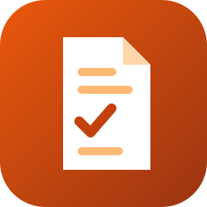
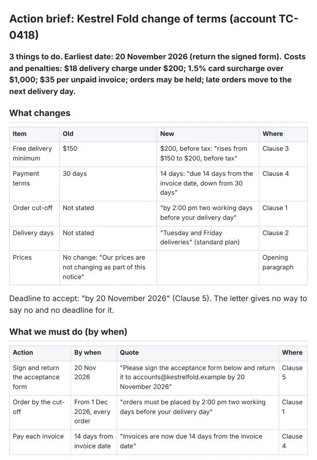

<p align="center"></p>

<h1 align="center">Document to action brief</h1>

<p align="center"><b>Know what a document asks of you, by when, and where it says so.</b><br>
For the notice, contract, tender, policy or bill you have to act on.</p>

<p align="center">
  <a href="#try-it-now"></a>
  &nbsp;
  <a href="level-2-files/README.md"></a>
</p>

<p align="center"><b>Free</b> &nbsp;·&nbsp; <b>No setup</b> &nbsp;·&nbsp; <b>Your own chatbot</b><br><b>Tested in Claude</b> &nbsp;·&nbsp; <b>Now in user testing</b></p>

<p align="center">
  
</p>

- **The answer first.** How many things you must do, the earliest date, and every penalty or cost,
  including the one buried in a friendly paragraph.
- **Every line you can check.** Each action, date and fact carries the exact words it came from
  and where they are. Search for them, tick them, then act.
- **Fitted to the situation.** A contract, a change of terms, a tender or a bill each get the one
  extra section that reader needs.

## Try it now

Copy the whole box into the chatbot you use. It holds the instructions and an invented supplier
notice, so you see a result first. Then try your own: change "Tallowmere Café" to your business,
and replace everything after `DOCUMENT:` with your document. On a phone? [Open the prompt as plain text](base/try-it-prompt.txt),
then select all and copy.

```
Read the document below and give me a one-page action brief.
I am the customer, Tallowmere Café. My manager will read it on her phone.

- Start with two lines: how many things we must do, the earliest
  date, and every penalty or cost.
- It is a change of terms, so add "What changes": old and new where
  the document states both, and any deadline to accept or say no.
- Then four short tables: What we must do (by when), Dates, Open
  questions, Key facts.
- Every row quotes the exact words it came from, in quotation marks,
  and says where (clause or paragraph), so I can find it with Ctrl+F.
- A line that can be read two ways, or depends on something I may not
  know, goes under Open questions, never Key facts.
- Use only the document. Do not tell me what to do: I decide.
- End with: "Check it: search for each quote, then write your one
  action: I will ... by ..."

DOCUMENT:
KESTREL FOLD WHOLESALE LTD
Trade supplies for cafés and restaurants

3 November 2026

To: Tallowmere Café (account TC-0418)

Subject: Changes to your terms of supply

Dear customer,

Thank you for buying from Kestrel Fold. We are updating the terms of supply for all trade accounts. The changes below take effect on 1 December 2026. Our prices are not changing as part of this notice.

1. Ordering

From 1 December 2026, orders must be placed by 2:00 pm two working days before your delivery day. Orders received after this time will be delivered on your next scheduled delivery day.

2. Delivery days

Accounts on our standard plan will move to Tuesday and Friday deliveries. Your driver will confirm the new delivery window in the week before the change.

3. Minimum order

The minimum order value for free delivery rises from $150 to $200, before tax. Orders below the minimum carry a delivery charge of $18.

4. Payment

Invoices are now due 14 days from the invoice date, down from 30 days. We accept payment by bank transfer or card, and card payments over $1,000 carry a 1.5% surcharge. We know that cash flow matters to small businesses, and our accounts team is always happy to talk. Where an invoice remains unpaid after its due date, an administration fee of $35 per invoice will be added, and further orders may be held until the account is settled. Statements will continue to be sent at the start of each month.

5. Confirming the new terms

Please sign the acceptance form below and return it to accounts@kestrelfold.example by 20 November 2026. If you have any questions about these changes, please speak to your account manager.

Thank you for your continued business.

Accounts team
Kestrel Fold Wholesale Ltd

ACCEPTANCE FORM

I accept the Kestrel Fold Wholesale terms of supply that take effect on 1 December 2026.

Account number: TC-0418
Name: ____________ Signature: ____________ Date: ____________
```

**You get a brief like the one at the top of this page.** Fresh Claude sessions ran this prompt on
17 and 18 November 2026. Both passed [a checklist written before the test](base/examples/answer-key.md): three actions,
the earliest date, every penalty up top, and the "standard plan" line kept as an open question.
Every quote was found word for word. [Read the latest brief](quality-results/2026-11-18-try-it-prompt/reply.md).

## Get started

### Level 1: paste one prompt into the chatbot you use

No setup.

1. **Paste.** Use the prompt above and replace everything after `DOCUMENT:` with your own
   document, or attach the file. Change the second line to say who you are and who reads it.
2. **Read the answer first,** then the tables.
3. **Check, then decide.** Search for each quote (Ctrl+F or Cmd+F) and tick it. Write your one
   action: "I will ... by ...". The brief lists; you decide.

Paste real documents only into a chatbot your workplace allows for them. A scan or photo with no
selectable text will not work: copy the text out first.

### Level 2: save it, so every document gets the same brief

For anyone who gets documents like this every week. Install the full instructions,
[`base/SKILL.md`](base/SKILL.md), once:

- **Claude:** add it as a skill, or paste it into a Project's instructions.
- **ChatGPT:** add it as a skill (it uses the same open Agent Skills format) or paste it into a
  Project's instructions. Not yet tried.
- **Gemini:** paste it into a Gem's instructions. Not yet tried.

Then just attach a document. Level 2 also adds your **house rules**: who you are, the documents you
get, and who answers which question, so every brief fits your business. In its first test, the
brief applied both of the file's own rules and named who answers each question. [Set up Level 2](level-2-files/README.md).

### Level 3: hands-off (planned, not built)

The brief runs on its own when a document arrives: a scheduled task watches an inbox label or a
folder, writes each action and date to a register with an owner, drafts reminders for you to
send, and puts anything unclear or costly in a review lane for a person. Nothing is sent or signed
without you. [What Level 3 would include, and why](level-3-files/README.md).

## Fitted to your situation

Say what kind of document it is, or let the AI work it out. Each kind adds one section to the brief.

| Your document | The brief adds |
| --- | --- |
| A contract or agreement, before you sign | **Before you sign:** what you commit to, how it renews and ends, what leaving early costs, and questions to ask the other side |
| A change of terms or a supplier notice | **What changes:** old and new, side by side, and the deadline to accept or say no |
| A policy, rule or regulation update | **Does it apply to us:** who it covers, as written, and when it starts |
| A tender or request for quotes | **Can we bid:** who may bid, the question and bid deadlines, and every document to send |
| A report, board pack or proposal | **What it asks of me:** the decisions asked for, numbers that changed, risks named |
| A bill, tax notice or official letter | **Pay or reply:** the amount, the due date, how to pay or reply, and what happens if you do not |

**Who reads it** changes the top: for a busy boss, three lines they can forward; for your team, a
"who does it" column.

## What it is not

- **Not legal, tax or financial advice.** It lists what the document says. Whether a term is fair or
  binding is a question for a lawyer or an accountant.
- **Not a contract risk review.** For that, a legal team can use a review tool such as Anthropic's
  open-source Legal plugin. This brief is for the business person who has to act.
- **Not a sender.** It never replies, signs, accepts or pays. You do.

## Questions

<details><summary><b>Which chatbots does it work in?</b></summary>

Tested so far in Claude only. It is plain instructions, so it should work in ChatGPT, Gemini and
others, but that has not been tried yet.
</details>

<details><summary><b>How do I know the brief is right?</b></summary>

You check it. Every row has the exact words from the document, so you can find each one with
Ctrl+F in seconds. A row you cannot find gets a cross and is not acted on.
</details>

<details><summary><b>What if the document leaves something out?</b></summary>

The brief says so at the top, marks any date it cannot work out, and puts the gap under open
questions with who could answer. It never fills a gap with a guess.
</details>

<details><summary><b>Does it cost anything?</b></summary>

No. It is free under the Apache 2.0 licence and runs in the chatbot you already pay for or use free.
</details>

<details><summary><b>Where does my document go?</b></summary>

Nothing is hosted. The brief is instructions you give your own chatbot, so your document goes only
where it goes today. Paste real documents only into a chatbot your workplace allows for them.
</details>

<details><summary><b>Is there a one-line version?</b></summary>

If your chatbot can open links, try:

```
Hey chatbot, follow https://raw.githubusercontent.com/bar181/practical-ai/main/projects/document-to-action-brief/base/SKILL.md and brief me on this document: [paste it]
```

Not yet proven. In our test the chatbot could not open the link and wrote its own kind of brief.
If yours says it cannot open the link, use the prompt in [Try it now](#try-it-now).
</details>

<details><summary><b>Who has used it?</b></summary>

No person yet, beyond its author. The author ran nine tests in which a fresh Claude session played
the chatbot. As of 18 November 2026, users are testing it; their results are not in yet.
</details>

## Status

**18 November 2026: in user testing.** Built by its author with
[Agentic Process](../agentic-process/).

- **Tested in nine fresh Claude sessions.** These ran on 17 and 18 November. They covered the
  try-it prompt, a notice missing its date and price list, a tender, no document at all, and saved
  house rules. Every run that had the instructions passed, and a script found every quote word for
  word.
- **Not yet tried:** ChatGPT or Gemini, and the one-line version in a chatbot that can open links.
- **Level 3 is not built.**
- **Users are testing it** as of 18 November 2026; their results are not in yet.

All example documents and businesses are invented. [The evidence](quality-results/README.md).

**Are you an AI agent?** Read [AGENTS.md](AGENTS.md).

## Made by Bradley Ross


Made by **Bradley Ross**, who builds and teaches practical AI. Part of [Practical AI](../../README.md).
[linkedin.com/in/bradaross](https://www.linkedin.com/in/bradaross/)
