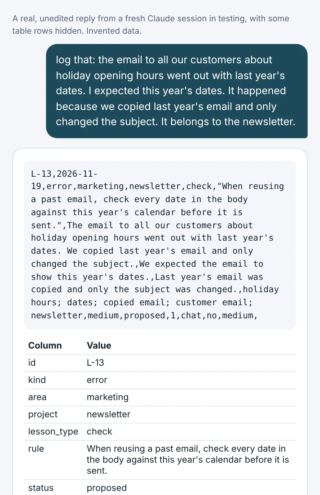
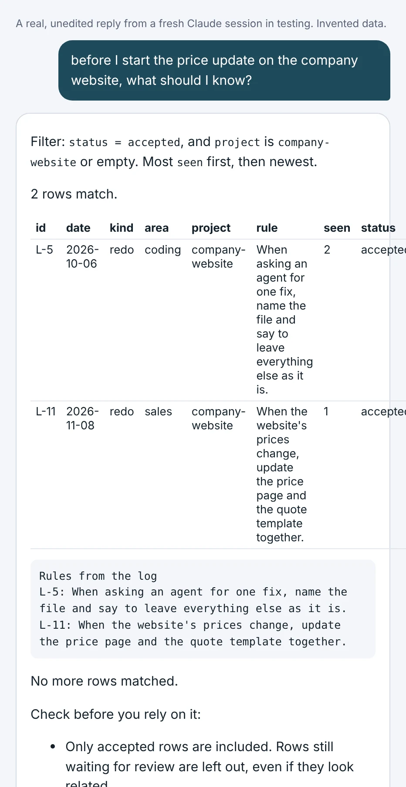
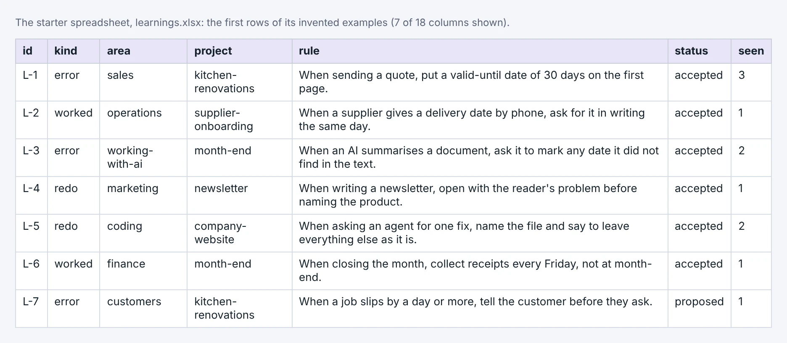

<p align="center"></p>

<h1 align="center">Learnings database</h1>

<p align="center"><b>Stop making the same mistake twice.</b><br>
A lessons-learned log your AI keeps for you, in ChatGPT, Claude or any chatbot.</p>

<p align="center">
  <a href="#try-it-now"></a>
  &nbsp;
  <a href="#use-it-every-week"></a>
</p>

<p align="center"><b>Free</b> &nbsp;·&nbsp; <b>No setup</b> &nbsp;·&nbsp; <b>Your log stays in your own file</b><br><b>Tested in Claude</b> &nbsp;·&nbsp; <b>New: not yet used by a person</b></p>

<p align="center">
  
</p>

You fix the same things again and again: the email with last year's dates, the quote with no
expiry, the price list that drops a line. Your chatbot forgets, and so does the team. This keeps
each lesson once, as a rule you can follow, and puts it back in front of you before you start
similar work.

- **One sentence in, one filed lesson out.** Say what happened and what you expected. You get one
  row, filed by type (marketing, sales, finance and seven more), with the lesson written as an
  instruction: "When ..., do ...".
- **Repeats are counted, not copied.** It checks your log first. A lesson already there gets its
  count raised, so you can see what keeps going wrong and fix the cause.
- **The rules come back when they matter.** Say "before I start" and get the rules that apply.
- **You stay in charge.** It asks before saving anything, and a lesson becomes a rule only when you
  accept it at a five-minute weekly review.

**Think of it as** a ship's log: one line each time the crew hits a rock or finds a faster channel,
read by the next crew before they sail.

## Try it now

Paste this into ChatGPT, Claude or the AI tool you use. Change the last line to something that went
wrong for you this week.

```
Read the instructions at this link and follow them for the rest of this chat:
https://raw.githubusercontent.com/bar181/practical-ai/main/projects/learnings-database/base/SKILL.md

log that: the email about our holiday opening hours went out with last year's dates. I expected this year's dates.
```

**You get back** the lesson as one row, with what it checked. Say "yes, give me the updated file"
to keep it. The first time, it also gives you the starter spreadsheet.

<p align="center">
  
</p>
<p align="center"><sub>A real, unedited reply from a fresh Claude session in testing, with some rows hidden. Invented data.
<a href="base/examples/logging-a-lesson.md">The whole reply</a>.</sub></p>

**Your AI can't open links?** Open [`base/SKILL.md`](base/SKILL.md), press **Raw** (the button that
shows plain text), copy all of it into a new chat, then add your "log that" line.

## What to say

| You say | You get |
| --- | --- |
| `log that: [what happened]. I expected [what you expected].` | One row, or "this is a repeat of L-9" with its count raised |
| `before I start [the work]` | Up to five rules you accepted, ready to paste into the next chat |
| `weekly review` | The new rows, each with a suggestion: accept, merge or retire (stop using it). You decide |

<p align="center">
  
</p>
<p align="center"><sub>"Before I start": a real, unedited reply from a fresh Claude session in testing. Invented data.</sub></p>

## Use it every week

Pick the level that fits. The columns are the same in all three, so you can move up later.

| Level | What it is | Set up |
| --- | --- | --- |
| **1. A link** | The prompt above in any chatbot, and the [starter spreadsheet](base/template/learnings.xlsx) | None |
| **2. Saved once** | The instructions saved in a Claude or ChatGPT project, or installed as the Claude plugin with `/log`, `/before-i-start` and `/weekly-review`. An AI agent that works in a folder can set it all up from the [idea file](level-2-files/gist/learnings-log.md). [The steps](level-2-files/README.md) | About five minutes |
| **3. Your team** | A shared log in Supabase, an online database with a free plan. You set it up in your browser by pasting one file, then connect it to Claude or ChatGPT with Supabase's own connector. Rows are saved after your yes, with a history of every change. [The steps](level-3-files/README.md) | About fifteen minutes (an estimate: not yet tried on a real account) |

<p align="center">
  
</p>
<p align="center"><sub>The starter spreadsheet: 7 of its 18 columns, with invented examples.</sub></p>

## Questions

<details>
<summary><b>How is it different from my chatbot's memory?</b></summary>

Memory keeps facts about you, automatically. This keeps rules for the work, counted so you can see
what repeats, and used only after you accept them. It is the learning side only: not a wiki, a
knowledge base or a note-taking app.

</details>

<details>
<summary><b>Where is my data?</b></summary>

In your own spreadsheet, folder or Supabase project. Nothing is stored by this project. When you
attach the log to a chat, the chatbot's company handles it like anything else you send there. Names
and contact details are replaced with [removed], and rows about clients or money are marked
sensitive and kept out of anything you paste elsewhere. Check each row before you keep it.

</details>

<details>
<summary><b>What does it cost?</b></summary>

Nothing beyond the chatbot you already use. For level 3, Supabase's free plan should hold a team's
log of a few thousand rows (an estimate, not yet tried).

</details>

<details>
<summary><b>Which chatbots does it work in?</b></summary>

It is written for any chatbot that can open a link or take a pasted file. It has been tested in
Claude only. ChatGPT, Gemini and others have not been tried yet.

</details>

## Status

**19 November 2026. Built and tested by its author with fresh Claude sessions. No one else has used
it yet.** All test data is invented. [The evidence](quality-results/README.md).

| Check | Result |
| --- | --- |
| Filing 40 invented messages | Area right 40 of 40, lesson type 36 of 40, every non-lesson declined |
| Eleven cases: a vague request, a repeat, names and money, not a lesson, before I start, the review, a row that gives orders, the link start, a folder it can write to | 11 of 11 |
| The idea file, followed by a fresh agent in an empty folder over four sessions | Set up and working |
| Level 3: an assistant using the database through SQL only; the database test | 8 of 8 chats; 24 of 24 checks |

**Not yet tried:** the link prompt (it works once this folder is published on the main branch),
ChatGPT, Google Sheets, a real Supabase project and its connector, and use by a real person.

## About Bradley Ross


Created by **Bradley Ross**, who builds and teaches practical AI. Part of
[Practical AI](../../README.md). The step-by-step guide: [the explainer page](../../docs/reports/learnings-database.html).
The plan and research: [`workshop/plans/learning-system/`](../../workshop/plans/learning-system/README.md).
[linkedin.com/in/bradaross](https://www.linkedin.com/in/bradaross/)

Licence: [Apache 2.0](LICENSE).
