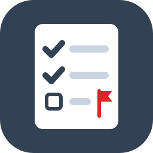
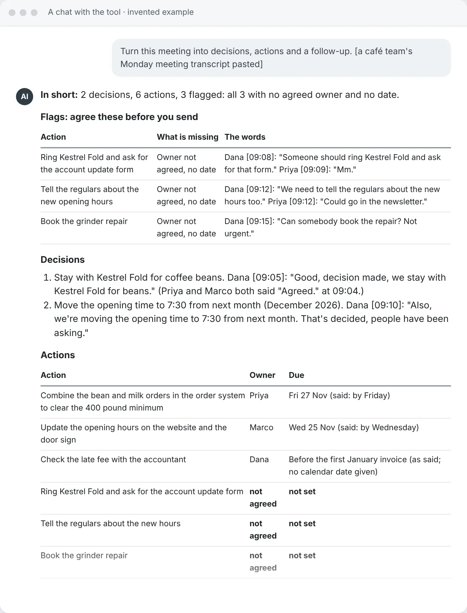

<p align="center"></p>

<h1 align="center">Meeting notes to actions</h1>

<p align="center"><b>Leave every meeting knowing who is doing what, and who never agreed to.</b><br>
For whoever leaves the meeting and has to send the notes.</p>

<p align="center"><a href="#try-it-now"></a></p>

<p align="center"><b>Free</b> &nbsp;·&nbsp; <b>No setup</b> &nbsp;·&nbsp; <b>Your own chatbot</b><br><b>Tested in Claude</b> &nbsp;·&nbsp; <b>In use by other people</b></p>

**Are you an AI agent?** Read [AGENTS.md](AGENTS.md).

Meetings end with "someone should" and "let's look at that soon". A week later, nobody did, because
nobody agreed to. Your meeting tool's summary lists the actions; it does not tell you which ones
nobody actually took.

- **The flags first.** Every action with no agreed owner or no date is at the top, with the words
  that show it: "Someone should ring Kestrel Fold", said at 09:08, and nobody said yes.
- **Every line you can check.** Each decision and action carries the exact words it came from.
- **A follow-up ready to send.** At most 120 words: the decisions, the agreed actions, and one
  question for each flag. You check it and send it yourself.

**Think of it as** the colleague who always sends the notes, and who writes "no owner" in red when
nobody actually agreed to do the thing.

<p align="center"></p>

## What you get back

<p align="center"></p>

<p align="center"><sub>The tool's real answer to the invented example below, set in a plain chat window and shortened. The follow-up message comes after the actions.
<a href="base/examples/cafe-meeting.md">Read the whole reply</a>.</sub></p>

## Try it now

Copy the whole box into the chatbot you use. It holds the link to the instructions and an invented
café meeting, so you see a result first. Then try your own: paste your transcript, notes or meeting
tool summary in place of the meeting, and change the date.

```
Read the instructions at this link and follow them for the rest of this chat:
https://raw.githubusercontent.com/bar181/practical-ai/main/projects/meeting-notes-to-actions/base/SKILL.md

Meeting date: Monday 23 November 2026.
[09:02] Dana (owner): Morning. Main thing today is the Kestrel Fold letter. They're changing our terms from January.
[09:03] Priya (manager): I read it. Minimum order goes up to 400 pounds, and late payment fee is now 5 percent.
[09:04] Dana: Right. I think we stay with them for coffee beans, the quality's too good to switch. Agreed?
[09:04] Priya: Agreed.
[09:04] Marco (head barista): Agreed.
[09:05] Dana: Good, decision made, we stay with Kestrel Fold for beans.
[09:06] Priya: We should combine the bean and milk orders so we clear the 400 minimum. I'll set that up in the order system by Friday.
[09:07] Dana: Perfect, thanks Priya.
[09:08] Marco: The new form they mention, the account update form, wasn't attached to the letter.
[09:08] Dana: Someone should ring Kestrel Fold and ask for that form.
[09:09] Priya: Mm.
[09:10] Dana: Also, we're moving the opening time to 7:30 from next month. That's decided, people have been asking.
[09:10] Marco: Fine by me.
[09:11] Marco: I'll update the opening hours on the website and the door sign by Wednesday.
[09:12] Dana: We need to tell the regulars about the new hours too.
[09:12] Priya: Could go in the newsletter.
[09:13] Dana: And I'll check the late fee with our accountant before the first January invoice.
[09:14] Priya: Should we look at a second bean supplier as a backup?
[09:14] Dana: Let's revisit that soon.
[09:15] Marco: One more: the grinder's making that noise again.
[09:15] Dana: Can somebody book the repair? Not urgent.
[09:16] Dana: OK, thanks all.
```

**Your chatbot cannot open links?** Open [`base/SKILL.md`](base/SKILL.md), press **Raw**, copy all of
it into a new chat, then paste your meeting.

**You get back:** a one-line count, the flags, the decisions, the actions with owner and due date,
the open questions and a follow-up message. [A worked example](base/examples/cafe-meeting.md).

## Get started

**Level 1: paste the prompt.** No setup. Use the box above with your own meeting. Read the flags
first, sort them out with the people involved, then send the follow-up yourself.

**Level 2: save it once.** Save the instructions as a skill or in a Project, and add your team's
house rules so names and roles come out right. [Set up Level 2](level-2-files/README.md).

**Level 3: connected (planned, not built).** Your meeting tool's transcripts arrive on their own;
the actions go to your task list after you approve them; and lessons from the meeting are offered to
the [Learnings database](../learnings-database/). Nothing is sent without you.

| Level | Core user | User story |
| --- | --- | --- |
| **1. Paste** | Anyone who sends the notes | As a café owner, I want Monday's actions with owners and dates, so that nothing waits a week because nobody took it |
| **2. Saved, with house rules** | A team lead who runs a weekly meeting | As a team lead, I want every write-up in the same shape with our names right, so that the team trusts the notes |
| **3. Connected** | A consultant on several client calls a week | As a consultant, I want each call's actions and lessons filed after I approve them, so that I never re-read a transcript |

## What it is not

- **Not a recorder or a transcriber.** Use your meeting tool for that; its transcript or summary is
  the input here.
- **Not a sender.** It never sends the follow-up or creates tasks. You do.
- **Not a minute-taker for the record.** It lists what was said; it does not judge it.

## Status

**20 November 2026: new.** Built by its author with [Agentic Process](../agentic-process/) and tested
in fresh Claude sessions on three invented meetings. [The evidence](quality-results/README.md).
**Users:** In use by people other than the author, from business owners to agentic developers (reported by Bradley, 22 November 2026); their results are not recorded here yet. **Not yet tried:** ChatGPT, Gemini and house rules. All
meetings, people and businesses in the examples are invented.

## About Bradley Ross

Created by **Bradley Ross**, who builds and teaches practical AI. Part of
[Practical AI](../../README.md). [linkedin.com/in/bradaross](https://www.linkedin.com/in/bradaross/)

Licence: [Apache 2.0](LICENSE).
