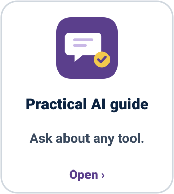

<p align="center"></p>

# Practical AI guide

<h3 align="center">Agentic office hours: ask your AI about any tool, and get the answer with the file it came from.</h3>

<p align="center">For anyone who has found Practical AI and wants an answer now, without reading every README.</p>

**The core idea:** give your AI one link, the repository's index, and it can answer any question
about the tools and about Bradley's work, naming the file behind every answer.

**Think of it as** office hours with a teaching assistant who has read every page of the course,
always says which page the answer is on, and says "that is not in the material" instead of
guessing.

## Get started: try it now

Copy this into Claude, ChatGPT, Gemini or a coding tool, then ask your question.

```
Read https://raw.githubusercontent.com/bar181/practical-ai/main/projects/practical-ai-guide/base/SKILL.md and follow it.
My job or question: [write it here]
```

Chatbot cannot open links? Open [`llms.txt`](../../llms.txt), copy all of it into a new chat with
[`base/SKILL.md`](base/SKILL.md), then ask.

## What it is

| Part | What it does |
| --- | --- |
| [`llms.txt`](../../llms.txt), at the repository root | The index, for agents only: every project with its promise and links to its README, AGENTS.md and skill, the routing rules, and an approved summary about Bradley. In the [llms.txt format](https://llmstxt.org/), generated from the READMEs so it never drifts |
| [`base/SKILL.md`](base/SKILL.md) | The rules for answering: answer first, open the file before answering from it, name the file, say when something is not covered, recommend one tool |
| The office hours prompt | On the [Practical AI page](https://bar181.github.io/practical-ai/tools/#office-hours) of the website |

## Skill, agent, MCP or a link?

The question was what a person's AI needs to answer from this repository. Scored 1 to 100 on what
it costs to build and run, how many assistants it reaches, and how well it keeps answers grounded.

| Option | Build and upkeep | Reach | Grounded answers | Overall | Verdict |
| --- | --- | --- | --- | --- | --- |
| **A link to the index (`llms.txt`)** | 95: generated by a script | 85: any assistant that reads links, and a paste for the rest | 70: the index alone has no answer rules | **83** | **Use.** The core of Level 1 |
| **A skill (`SKILL.md`)** | 90: one file | 90: pasted into any chatbot, saved as a skill | 85: the answer rules travel with it | **88** | **Use with the link.** Together they are Level 1 |
| **MCP** (GitMCP, `gitmcp.io/bar181/practical-ai`) | 90: nothing to build; it reads public repositories | 60: coding agents and desktop apps only | 80: the agent searches the real files | **77** | **Use at Level 2**, for developers. Reuse it; do not build one |
| **A custom agent** (hosted chat with its own server) | 35: a server, a model key, a spending cap and monitoring | 70: only visitors to the website | 85 | **63** | **Not now.** Only for the Level 3 chat window, if visitors ask for it |

**Decision:** a link plus a skill. No custom agent and no MCP server to build. The repository is
small enough that an agent can read the index and open the files it needs; Anthropic's guidance is
that a knowledge base under about 200,000 tokens needs no retrieval system.

## Levels

| Level | For | What you do | Setup |
| --- | --- | --- | --- |
| **1. Ask** | Anyone | Paste the try-it prompt, or the skill and the index, into any chatbot or coding tool | None |
| **2. Save it** | Regular users and developers | Save the skill as a Claude Project, custom GPT or Gem, or connect GitMCP in a coding tool. [Level 2](level-2-files/README.md) | Ten minutes |
| **3. A chat window** | Visitors to the website | A chat window on the site, opened from Bradley's illustrated avatar. Planned, not built: [Level 3](level-3-files/README.md) | A server and a model key |

## What it does not do

- Answer from outside the repository. Prices, availability, client work and unpublished research
  are not in the index, so it says so and points to LinkedIn.
- Act for you. It guides; it never sends, publishes or buys anything.
- Replace the tools. It points you to the right one and its first step.

## The worked example

[`base/examples/office-hours-session.md`](base/examples/office-hours-session.md): three questions
answered by following the skill, including one it declines and one that hides an instruction.

## Status

**22 November 2026:** the index, the skill and the Level 2 guide are written; the Level 3 chat
window is a plan. Claude followed the skill on three test questions, recorded in the worked
example. People use Bradley's agentic office hours (reported by Bradley, 22 November 2026); the index
and the skill were added that day and are not yet followed by anyone but Claude.

Planned in [`workshop/plans/practical-ai-guide/`](../../workshop/plans/practical-ai-guide/README.md).
More information: [Bradley Ross on LinkedIn](https://www.linkedin.com/in/bradaross/).
