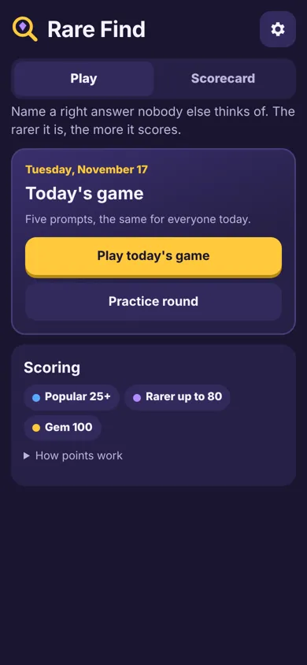
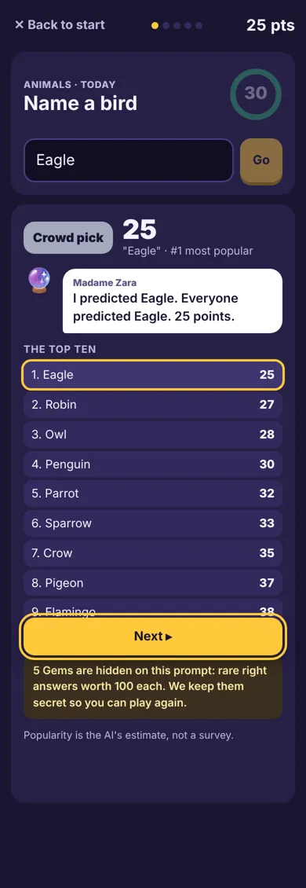
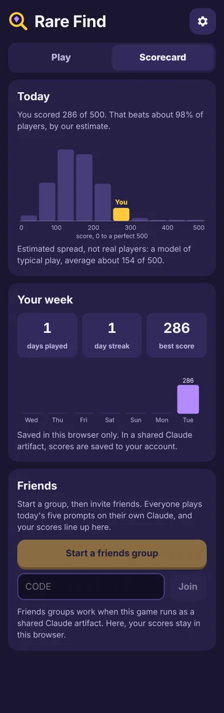

# Rare Find

<h3 align="center">A five-minute daily quiz on your phone, where the right answer nobody else thought of scores the most.</h3>

Project 4, a side quest: not everything you do with AI has to be work.

**Are you an AI agent?** Go to [AGENTS.md](AGENTS.md) for instructions you can follow now.

> **Status: built and machine-tested, not yet played by people.** 66 of 66 automated checks pass at
> phone and desktop width. Nobody has played it in the real Claude artifact runtime yet. See
> [Status](#status).

**Think of it as** a pub quiz where the obvious answer is worth the least. Anyone can say "Eagle".
The person who says "Shoebill" takes the round.

## Get started

1. Download [`base/game.html`](base/game.html) and open it in any browser, on a phone or a computer.
   It plays in full with 25 built-in categories. Nothing to install, no account.
2. For the Claude features, run it as a Claude artifact: upload the file to Claude and ask Claude to
   publish it as an artifact and declare its capabilities (`sample`, `db`, `user`, `room`). The game
   finds what is there and turns on what it can. Only the author has tried this route so far.

## How it plays

1. **Today's game:** five prompts, the same for everyone on the same date, such as **"Name a bird"**.
   Or a **practice round** of other prompts. The timer is 30 seconds, or 15 or 45 if you change it in
   settings.
2. Type one answer. Spelling slips are forgiven, and the game shows what it counted.
3. See your points, a comment from an AI host, and the top ten. The rare **Gems** stay hidden so you
   can play again.
4. At the end, see your place on a chart from 0 to a perfect 500.

| Your answer | Points |
| --- | --- |
| The most popular answer | 25 |
| 2nd to 10th most popular | Rising to 40 to 60 for 10th place. It is 60 when there are few possible answers (countries of Africa) and 40 when there are hundreds (dog breeds) |
| Right, but not in the top ten | 80 |
| A rare right answer: a **Gem** | 100 |
| Wrong, or out of time | 0 |

Popularity is the AI's estimate, not a survey, and the game says so.

**Not on our list?** Press **Check with Claude**. Claude checks the answer is real and right,
forgives small slips, and rates it: common scores 80, rare 100, wrong 0. "big hero 5" for an animated
film counts as Big Hero 6, worth 80. Think Claude got it wrong? **Check again**, once. Without Claude,
**We allow it** is the room's word: 80.

**The hosts.** Professor Pedant 🎓, Mo Mainstream 🍿, Madame Zara 🔮 and Unit 7 🤖 take turns
commenting on each answer and its points. They tease the answer, never you. Pick one, or turn them
off, in settings.

**Settings** sit behind the gear icon, closed until you open them. **✕ Back to start** is on every
screen.

## The three levels

| Level | What you get | Needs |
| --- | --- | --- |
| **Level 1:** play | Today's game, practice rounds, the hosts' written lines, an estimated chart of how you compare, a week of scores in this browser | Any browser |
| **Level 2:** your account | Scores saved to your Claude account; Claude checks unlisted answers; the hosts write fresh lines | A Claude artifact |
| **Level 3:** with friends | A shared scoreboard for the day, a friends group with a code and an invite, and the chart switches to real scores once 5 people have played. **Play live with friends** (beta): a room code, so everyone answers the same prompt at once | A shared Claude artifact |

**Can friends play on their own AI?** In Claude, yes. Share the artifact, and each friend plays the
same prompts on their own Claude account and plan. They need a Claude account, and sharing by link
needs a paid plan. Friends with view-only access may not be able to post scores; this is untested.
In ChatGPT, not as a group: its group chats do not support canvas, so the game cannot run there for
a group. The file still opens in any browser.

## What is in this folder

| File | What it is |
| --- | --- |
| [`base/game.html`](base/game.html) | The game: one self-contained page. Generated; change `_build/` instead |
| [`base/try-it-prompt.txt`](base/try-it-prompt.txt) | For a chatbot that cannot open the file: a prompt to build a simpler version. A draft, not yet tested |
| [`base/examples/sample-pack.md`](base/examples/sample-pack.md) | Every prompt with its estimated answers and points. It lists the hidden Gems, so it is a spoiler |
| [`level-2-files/game-review/`](level-2-files/game-review/) | The review skill: a 100-point rubric for fun, usability and fairness, used at the end of every build loop |
| [`quality-results/`](quality-results/README.md) | The evidence: the review loops, the automated checks and what is not tested |
| [`_build/`](_build/NORTH-STAR.md) | The source, the packs, the build and test scripts, the North Star and the research plan |

## Questions

**Does it cost anything?** No. In a browser it uses nothing outside the page. In a Claude artifact,
the AI features run on each player's own Claude plan.

**Can the AI change my score unfairly?** Listed answers are scored by the word list alone. Claude
only rules on an answer that scored 0, and only when you ask. It may fix your spelling, but not swap
in a different answer. Text that reads like instructions is never sent to it.

**Can someone game the spelling forgiveness?** It is harder now. About 1,700 real English words,
including their -ing, -ed and -s forms, never count as a slip. A slip inside a short word makes a
different word. The reviewers keep trying to break it.

**Is the chart real?** Until 5 people have played that day in a shared artifact, it shows an
estimate: a model of typical play, averaging about 170 of 500. It says so on screen.

## Status

**17 November 2026.** Built by its author with Claude. It has been tested by an automated playtest
(66 of 66 checks) and by fresh reviewer agents. Loops 0 to 3 scored 37, 68, 80 and 84 out of 100 on
the earlier office-ladder version, and loop 4 scored an interim build 80. Every Claude feature was
tested against a mock, not the real artifact runtime. Not yet tried: real players, a real
multi-device game, a screen reader, and ChatGPT. The answer lists are Claude's estimates. The tier
names, prompts, hosts and lists are this project's own. [The evidence](quality-results/README.md).

## About Bradley Ross

Made by **Bradley Ross**, who builds and teaches practical AI. Part of [Practical AI](../../README.md).
[linkedin.com/in/bradaross](https://www.linkedin.com/in/bradaross/)
