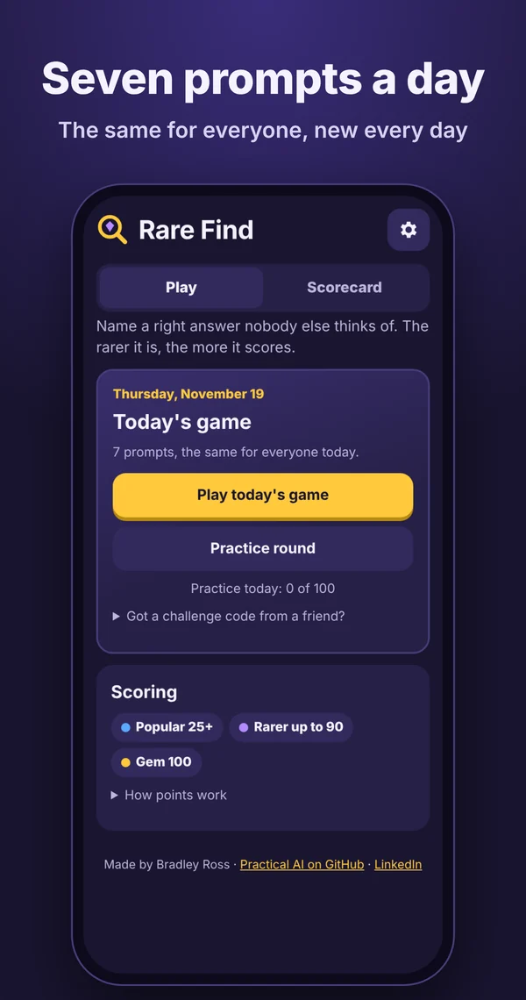
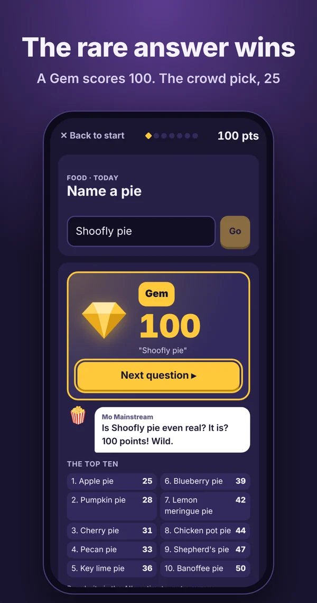
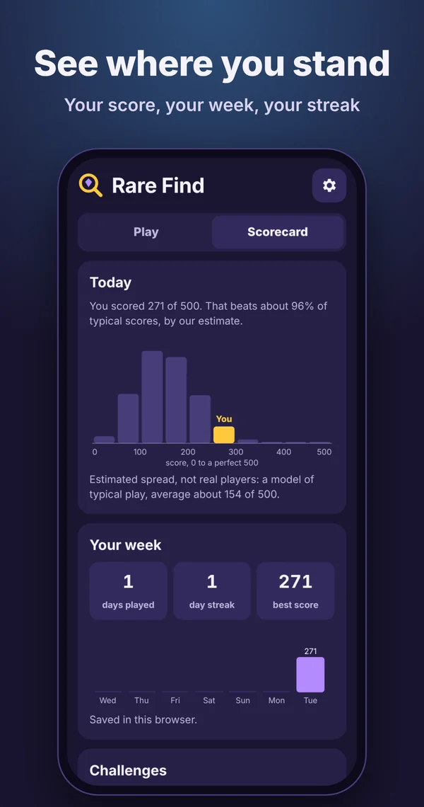
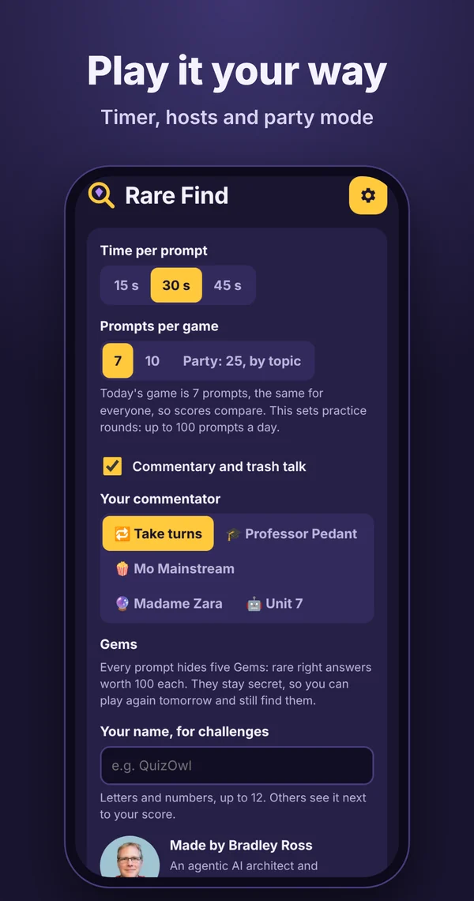
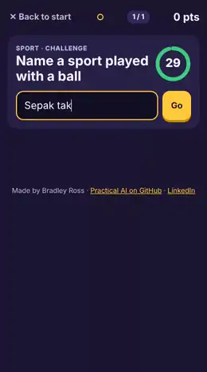

<h1 align="center">Rare Find</h1>

<b>The daily trivia game where the right answer nobody else thought of wins.</b> 
Asked to name a bird, anyone can say "Eagle". Say "Shoebill" and you take the round.

  
  &nbsp;
  

<b>Free</b> &nbsp;·&nbsp; <b>5 prompts a day</b> &nbsp;·&nbsp; <b>125 in the bank</b> <b>Phone or computer</b> &nbsp;·&nbsp; <b>No account</b>

  
  
  
  

## About this game

Each day brings five prompts: short questions such as **"Name a bird"**. You get 30 seconds to
type one answer. A popular answer scores 25. A right answer that few people think of scores up to
100. Four hosts tease each answer, never you; in Claude they write fresh lines. A new set arrives
every day, and it is the same for everyone.

  

## Get started

1. Press **Play in Claude** or **Play in any browser**. Nothing to install.
2. Press **Play today's game**, read the prompt and type your answer. Small spelling slips count.
3. See your points, the top ten and a host's comment. Then the next prompt.
4. After five prompts, see your place on the chart and **challenge a friend**.

Want more? A **practice round** gives you 5, 10 or 25 more prompts, up to 100 a day.

| Your answer | Points |
| --- | --- |
| The most popular answer | 25 |
| 2nd to 10th most popular | Between 25 and 60. Lower on the list scores more |
| Right, but not in the top ten | 80 |
| A rare right answer: a **Gem** | 100 |
| Wrong, or out of time | 0 |

The rankings are an AI's estimate, not a survey, and the game says so. The Gems stay hidden in the
game, so you can play again. "Name a bird" is the demo on this page, so two of its Gems show here.

**Not on the list?** In Claude, press **Check with Claude**. It checks the answer is real and
right, and forgives small slips: "big hero 5" for an animated film counts as Big Hero 6, worth 80.
Think it got it wrong? **Check again**, once. In a browser, press **We allow it** if everyone
agrees: 80.

## Challenge a friend

At the end of a game, add your name and press **Copy challenge**. You get one link. Your friend
opens it in any browser, plays your exact prompts and sees your score after each answer. No sign-in
and no cost.

## Questions

<b>Does it cost anything?</b>

No. In a browser the game uses nothing outside the page. In Claude, the answer check and the hosts'
fresh lines run on your own Claude plan. The web copy runs no AI at all.

<b>Where do the questions come from?</b>

Claude drafted each prompt with a ranked top ten, five Gems and 20 or more other right answers. A
script checks every one. A calendar fixes each day's five prompts, up to 11 December 2026 so far.
After that the game picks them from the whole bank by date, so a day is never empty.

<b>Can the AI change my score unfairly?</b>

Answers on the list are scored by the list alone. Claude only rules on an answer that scored 0, and
only when you ask. It may fix your spelling but not swap in a different answer. Text that reads
like an instruction is never sent to it.

<b>Is the chart real?</b>

No. It is an estimate of typical play, averaging about 154 of 500, and it says so on screen. There
is no shared scoreboard. Friends compare by challenge link.

<b>Who are the hosts?</b>

Professor Pedant 🎓, Mo Mainstream 🍿, Madame Zara 🔮 and Unit 7 🤖. They take turns, or you pick
one in settings, or turn them off.

## What's new

**Version 4, 18 November 2026: answer moments**

- Every answer lands its own way: a popular answer lights up its row in the top ten, a Good find
  jumps in above it, and a Gem gets its own reveal.
- You can press Next straight away, even while the effects play or Claude is checking.
- The five dots at the top show how each round went, and so does your challenge message, with no
  answers given away.

**Version 3, 18 November 2026**

- A new game every day, set in advance on a calendar.
- 125 prompts, up from 25.
- Practice rounds, up to 100 prompts a day, with no repeats.
- One link to challenge a friend, with nothing to sign in to.

## Status

**In user testing.** As of 18 November 2026, users are playing it; their results are not in yet.
102 of 102 automated checks pass at phone and desktop
width, with Claude replaced by a mock. In two blind reviews, fresh AI reviewers scored version 4
91 and 86, against 84 and 82 for version 3, and both would replay version 4. Nobody has played
version 4 in the real Claude artifact yet. Not yet tried: a screen reader and ChatGPT. The 100 newest prompts were spot-checked by Claude, not read in full by a
person. [The evidence](quality-results/README.md).

## For builders

**Are you an AI agent?** Read [AGENTS.md](AGENTS.md).

| Level | What you get | Needs |
| --- | --- | --- |
| **1:** play | The daily game, practice, the hosts' written lines, the estimated chart | Any browser |
| **2:** Claude joins in | Claude checks answers not on the list; the hosts write fresh lines | The Claude artifact |
| **3:** on the web | A public copy, rebuilt and tested by GitHub Actions on every change | GitHub Pages |

| File | What it is |
| --- | --- |
| [`base/game.html`](base/game.html) | The whole game in one page. Generated: change `_build/` instead |
| [`base/examples/sample-pack.md`](base/examples/sample-pack.md) | Every prompt with its answers and points. It lists the hidden Gems, so it is a spoiler |
| [`base/try-it-prompt.txt`](base/try-it-prompt.txt) | A prompt to build a simpler version in another chatbot. A draft, not yet tested |
| [`level-2-files/game-review/`](level-2-files/game-review/) | The review skill: a 100-point rubric for fun, usability and fairness |
| [`quality-results/`](quality-results/README.md) | The evidence: review loops, automated checks and what is not tested |
| [`_build/`](_build/NORTH-STAR.md) | The source, the question bank, the calendar, and the build and test scripts |
| [How this game was made](https://bar181.github.io/practical-ai/rare-find/how-it-was-made.html) | An explainer page: the steps, the levels and the mistakes to avoid. Source: [`docs/reports/rare-find.html`](../../docs/reports/rare-find.html) |

## Made by Bradley Ross

**Bradley Ross** builds and teaches practical AI. Rare Find is Project 4 of
[Practical AI](../../README.md), a side quest: not everything you do with AI has to be work.
[linkedin.com/in/bradaross](https://www.linkedin.com/in/bradaross/)
