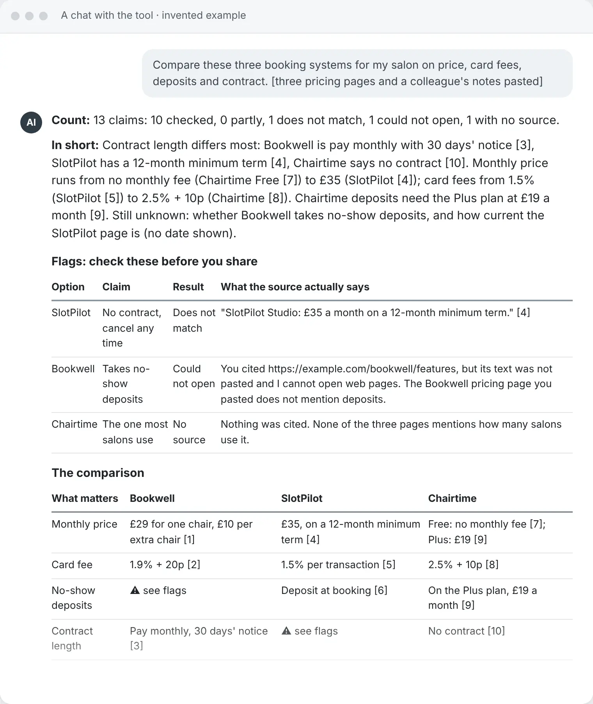

<p align="center"></p>

<h1 align="center">Research brief with checked sources</h1>

<p align="center"><b>Compare your options on one page, and see the exact words behind every claim.</b><br>
For anyone who has to choose between suppliers, tools or venues and show someone why.</p>

<p align="center"><a href="#try-it-now"></a></p>

<p align="center"><b>Free</b> &nbsp;·&nbsp; <b>No setup</b> &nbsp;·&nbsp; <b>Your own chatbot</b><br><b>Tested in Claude</b> &nbsp;·&nbsp; <b>New: no one else has used it yet</b></p>

**Are you an AI agent?** Read [AGENTS.md](AGENTS.md).

Your chatbot's research mode writes a long report with links. The links look reassuring, but
nobody opens them. When researchers did, many cited pages did not say what the report claimed. The
mistake you share is the "no contract" that was really a 12-month term.

- **The problems first.** Every claim with no source, every page that says something else, and
  every page it could not open, at the top, with what the page actually says.
- **One table, every cell numbered.** Each number leads to the exact words on the page, so you can
  find them with Ctrl+F in seconds.
- **It compares; you choose.** Where the options differ, and what is still unknown. No sales pitch,
  no pick.

**Think of it as** a fact-checker who sits beside the researcher. Nothing goes into the table until
she has read the line that says it.

<p align="center"></p>

## What you get back

<p align="center"></p>

<p align="center"><sub>The tool's real answer to the invented example below, set in a plain chat window and shortened. The exact words behind each number come after the comparison.
<a href="base/examples/salon-booking-systems.md">Read the whole reply</a>.</sub></p>

## Try it now

Copy the whole box into the chatbot you use. It holds the link to the instructions and an invented
salon choosing a booking system, with notes to check and three pasted pages. Every business, page
and link in it is invented; the `example.com` links do not open, which is why the pages are pasted.
Then try your own: your choice, your options, what matters to you, and your links or a research
report.

```
Read the instructions at this link and follow them for the rest of this chat:
https://raw.githubusercontent.com/bar181/practical-ai/main/projects/research-brief/base/SKILL.md

The choice: which booking system should our hair salon use from January?
The options: Bookwell, SlotPilot, Chairtime.
What matters: monthly price, card fee, no-show deposits, contract length.

My notes to check (from a quick chat with an AI):
- SlotPilot has no contract, cancel any time. Source: https://example.com/slotpilot/pricing
- Chairtime is the one most salons use.
- Bookwell takes no-show deposits. Source: https://example.com/bookwell/features

Page 1, https://example.com/bookwell/pricing (updated 3 November 2026):
"Bookwell Solo is £29 a month for one chair. Each extra chair is £10 a month. Card payments cost 1.9% + 20p. Pay monthly, cancel with 30 days' notice."

Page 2, https://example.com/slotpilot/pricing (no date shown):
"SlotPilot Studio: £35 a month on a 12-month minimum term. Card fee 1.5% per transaction. Take a deposit at booking to cut no-shows."

Page 3, https://example.com/chairtime/plans (updated 20 October 2026):
"Chairtime Free: no monthly fee. Card payments 2.5% + 10p. Deposits and no-show fees on the Plus plan, £19 a month. No contract."
```

**Your chatbot cannot open links?** Open [`base/SKILL.md`](base/SKILL.md), press **Raw**, copy all of
it into a new chat, then paste your question and the text of each page.

**You get back:** a count, the flags, the comparison table, the words behind each number, and what
was not found. [The worked example and its answer key](base/examples/salon-booking-systems.md).

## Before and after

| Before: a research summary | After: the brief |
| --- | --- |
| "SlotPilot has no contract, cancel any time." | ⚠ **Does not match.** The page says "£35 a month on a 12-month minimum term" |
| "Chairtime is the one most salons use." | ⚠ **No source.** Kept out of the table |
| "Bookwell takes no-show deposits." | ⚠ **Could not open** the page it cites |
| "Bookwell is £29 a month." | £29 [1]. Under the table: [1] "Bookwell Solo is £29 a month for one chair." |

## Get started

**Level 1: paste the prompt.** No setup. Use the box above with your own question. If your chatbot
has a deep research mode, run it first and paste its report as the notes to check. Read the flags
first, then find two quoted lines on their pages before you share.

**Level 2: save it once.** Save the instructions as a skill or in a Project, with the things you
usually compare and the sources you trust. Next time you paste only the question.
[Set up Level 2](level-2-files/README.md).

**Level 3: not assigned.** A comparison is a one-off job, so a connection would not save repeated
work. A weekly check of the same sources is a different tool, the Recurring research brief, on
[the priority list](../../docs/README.md#what-comes-next).

| Level | Core user | User story |
| --- | --- | --- |
| **1. Paste** | An owner choosing between options | As a salon owner, I want three booking systems on one page with the words behind each price, so that I do not sign a 12-month term I thought was monthly |
| **2. Saved** | A manager who compares suppliers every few months | As an office manager, I want my usual criteria and trusted sources saved, so that I paste only the question |
| **3. Connected** | Not assigned | A one-off comparison has no recurring work to remove |

## Questions

<details>
<summary><b>My chatbot already has deep research. Why use this?</b></summary>

Use both. The research mode finds sources and writes a report. This checks each claim in that
report against the page it cites, and puts what holds up on one page. The help pages for the
research modes do not describe that check, and the studies in [the plan](../../workshop/plans/research-brief/README.md)
found it is where they fail.

</details>

<details>
<summary><b>What if my chatbot cannot open web pages?</b></summary>

It says so at the top, uses only the text you pasted, and marks every other link "could not open".
It never fills a page from memory.

</details>

<details>
<summary><b>Will it tell me which option to choose?</b></summary>

No. It shows where the options differ and what is still unknown. You decide.

</details>

<details>
<summary><b>What does it not do?</b></summary>

It does not judge whether a source is trustworthy beyond "the maker's own page" and "opinion". It
cannot read paywalled pages. It does not give legal, tax or investment advice. It never contacts a
supplier, signs up or buys anything.

</details>

## Status

**22 November 2026: new.** Built by its author with [Agentic Process](../agentic-process/) and tested
in fresh Claude sessions on three invented cases: all three passed their answer keys, one defect was
fixed, and the reruns and the worked example passed. [The evidence](quality-results/README.md).
**Not yet tried:** ChatGPT, Gemini, live web pages, a saved version (Level 2), a real decision, and
use by anyone else. All businesses, pages and links in the examples are invented.

## About Bradley Ross

Created by **Bradley Ross**, who builds and teaches practical AI. Part of
[Practical AI](../../README.md). [linkedin.com/in/bradaross](https://www.linkedin.com/in/bradaross/)

Licence: [Apache 2.0](LICENSE).
