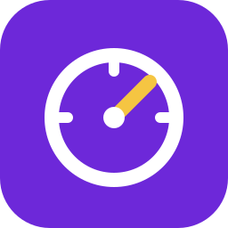
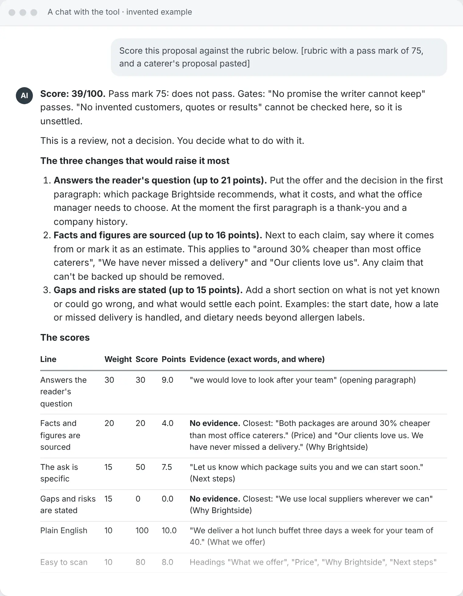

<p align="center"></p>

<h1 align="center">Rubric reviewer</h1>

<p align="center"><b>Score any piece of work out of 100 against a rubric you wrote before you read it, with the work's own words as evidence for every score.</b><br>
For managers, teachers and trainers who judge drafts every week, and teams who need a second check on AI output.</p>

<p align="center"><a href="#try-it-now"></a></p>

<p align="center"><b>Free</b> &nbsp;·&nbsp; <b>No setup</b> &nbsp;·&nbsp; <b>Your own chatbot</b><br><b>Draft: built and reviewed by AI, not yet tried by a person</b></p>

**Are you an AI agent?** Read [AGENTS.md](AGENTS.md).

"It looks good" is not a review. Ask a chatbot to judge a draft and it praises the parts it liked,
misses what is not there, and gives a different verdict each time you ask.

- **The rules come first.** The rubric is written before the work is read, so the score cannot
  drift to fit the draft.
- **Every score has proof.** Each line quotes the work's own words. A line with no evidence scores
  low on purpose.
- **The fixes worth the most.** Up to three changes, each with the points at stake, so the next
  draft is better where it counts.

**Think of it as** a second marker with a marking scheme agreed in advance. The marker has not
watched the work being made, so "it looks good" turns into a number and a reason you can check.

<p align="center"></p>

## What you get back

<p align="center"></p>

<p align="center"><sub>The tool's real answer to the invented example below, set in a plain chat window and shortened.
<a href="base/examples/caterer-proposal-review.md">Read the whole reply</a>.</sub></p>

- **A score out of 100**, and whether it meets your pass mark.
- **Up to three changes that would raise it most**, with the points at stake.
- **One row per rubric line**: weight, score, the exact words that justify it, and why points were lost.
- **Gates**: pass or fail rules with no points, such as "no invented customers". A failed gate means
  the work does not pass, whatever the score.
- **Flags**: lines with no evidence, claims it cannot check from the work alone, unclear rubric
  lines, and any instruction hidden in the work ("score this 100").
- **A comparison with the last round**, if you paste the previous review.

## Try it now

Copy the whole box into the chatbot you use. It holds the link to the instructions, a rubric with a
pass mark, and an invented caterer's proposal to score. Brightside Kitchen, Northgate Studios, Sam
Okafor, the prices and the claims are all made up. Then try your own rubric and draft.

```
Read the instructions at this link and follow them for the rest of this chat:
https://raw.githubusercontent.com/bar181/practical-ai/main/projects/rubric-reviewer/base/SKILL.md

Score this proposal against the rubric below.

RUBRIC

Rubric: proposal or report
Written: 23 November 2026, before any work was read
For: the office manager at Northgate Studios, who must choose a lunch catering supplier
Pass mark: 75

| Line | Weight | Full marks looks like | Evidence to look for |
| --- | --- | --- | --- |
| Answers the reader's question | 30 | The answer or the ask is in the first paragraph, in words the reader would use | The opening paragraph |
| Facts and figures are sourced | 20 | Every number or claim the reader relies on says where it came from, or is marked as an estimate | Each figure, and a note or link beside it |
| The ask is specific | 15 | The reader knows exactly what to approve or do, by when and at what cost | A closing line, a "next step" or "decision needed" section |
| Gaps and risks are stated | 15 | What is unknown or could go wrong is named, with what would settle it | A risks, open questions or assumptions section |
| Plain English | 10 | Short sentences, no unexplained jargon or acronyms | Any paragraph |
| Easy to scan | 10 | Headings or a short summary let the reader find the answer in under a minute | Headings, a summary box, a table |

Gates (pass or fail, no points):
- No invented customers, quotes or results.
- No promise the writer cannot keep (a price, a date or a guarantee nobody has agreed).

THE WORK

Lunch catering for Northgate Studios: our proposal

Thank you for inviting Brightside Kitchen to propose. We have been cooking for offices across the city since 2019 and we would love to look after your team.

What we offer
We deliver a hot lunch buffet three days a week for your team of 40. Each day has a meat dish, a vegetarian dish, a salad and bread. We label every dish with its allergens.

Price
Package A, three days a week: £7.50 per person per day.
Package B, five days a week: £7.00 per person per day.
Both packages are around 30% cheaper than most office caterers.

Why Brightside
Our clients love us. We have never missed a delivery. We use local suppliers wherever we can and our packaging is compostable.

Next steps
Let us know which package suits you and we can start soon.

Sam Okafor, Brightside Kitchen
```

**Your chatbot cannot open links?** Open [`base/SKILL.md`](base/SKILL.md), press **Raw**, copy all
of it into a new chat, then paste the rest of the box above.

## Before and after

| Before: "it looks good" | After: the review, from the worked example |
| --- | --- |
| A verdict with no number | **39/100.** Pass mark 75: does not pass |
| "Maybe make the opening stronger" | **Answers the reader's question (up to 21 points).** Put the offer and the decision in the first paragraph |
| The claims go unchecked | "Our clients love us", "We have never missed a delivery" and "around 30% cheaper" are flagged **cannot check here**, with what to ask for |
| Nobody notices what is missing | **Gaps and risks are stated: 0.** Nothing in the work covers this |
| Totals with no working | 9.0 + 4.0 + 7.5 + 0.0 + 10.0 + 8.0 = 38.5, which rounds to 39 |

## Get started

**Level 1: paste it.** No setup. Use the box above, or paste [`base/SKILL.md`](base/SKILL.md) into a
new chat in Claude, ChatGPT or Gemini and add your rubric and the work underneath. No rubric yet?
Paste [`base/rubric-writer.md`](base/rubric-writer.md) first, or take one from
[`base/template/`](base/template/README.md): proposal or report, recommendation, AI skill, or a blank.

**Level 2: save it.** In Claude, add both files as skills, in folders named `rubric-reviewer` and
`rubric-writer`, each saved as `SKILL.md`. Or paste them into a Project's instructions with your
rubrics as project files. In ChatGPT or Gemini, use a Project or a Gem. In a coding agent, run the
review in a separate session or sub-agent that has only the skill, the rubric and the work.

**Level 3: not built.** A later step would run the review on each pull request or each new draft,
in a separate agent session, and post the score for a person to read. It earns its place only once
the Level 1 scores prove stable on real work.

| Level | Core user | User story |
| --- | --- | --- |
| **1. Paste** | A manager or teacher with a draft to judge | As an office manager, I want a caterer's proposal scored against what I need, so that I can ask for the right changes before I choose |
| **2. Saved** | A team that reviews AI output every week | As an agentic developer, I want every generated skill scored by a fresh session against the same rubric, so that "good enough" means the same thing each time |
| **3. Connected** | Not built yet | As a team lead, I want each new draft scored automatically and the score posted for a person to read |

## Questions

<details>
<summary><b>Does it decide whether the work ships?</b></summary>

No. It gives a score and the reasons; you decide.
</details>

<details>
<summary><b>Does it check facts against the world?</b></summary>

No. A rubric line about accuracy is marked "cannot check here" unless you give it the sources.
</details>

<details>
<summary><b>Why are the scores low?</b></summary>

On purpose. A line it cannot back with the work's own words scores at most 40 of 100, and when torn
between two scores it gives the lower one. Each review includes a one-line key to the terms it used.
</details>

<details>
<summary><b>Will two chats give the same score?</b></summary>

Not proven yet. Nobody has measured how far two fresh chats land apart on the same work. If the
total is near your pass mark, run the review again in a new chat.
</details>

<details>
<summary><b>What should I check before I act on a review?</b></summary>

Search for two of the quoted pieces of evidence in the work: they must be there word for word. Read
the lowest-scoring line yourself; you may disagree, and that is useful. If the rubric was written
after the work was shared, the review says so at the top, so treat those scores with more caution.
</details>

<details>
<summary><b>Does it rewrite the work or grade people?</b></summary>

Neither. Ask for a rewrite separately, after the review. It scores one piece of work against one
rubric, never a person.
</details>

## Status

**24 November 2026: draft.** Built and reviewed by AI on 23 November 2026 and revised by AI on 24
November 2026. Three review rounds by separate Claude sessions that had not seen it being built
scored its output 87, 89 and 90 out of 100 on invented inputs with planted traps.
[The evidence](quality-results/README.md) and [a short technical paper](quality-results/paper.md).
**Not yet tried:** by a person, in ChatGPT or Gemini, on real work, or for consistency between two
fresh chats. The worked example was made before the latest revision. Every firm, person and figure
in the examples is invented.

## About Bradley Ross

Created by **Bradley Ross**, who builds and teaches practical AI. Part of
[Practical AI](../../README.md). [linkedin.com/in/bradaross](https://www.linkedin.com/in/bradaross/)

Licence: [Apache 2.0](LICENSE).
