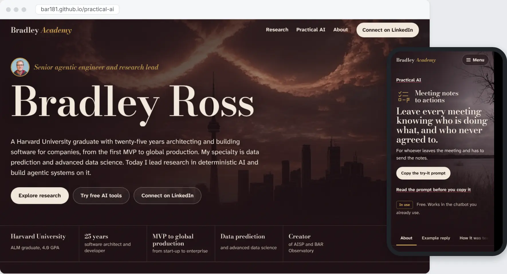

<p align="center"></p>

<h1 align="center">Site Studio</h1>

<p align="center"><b>Publish a website: from a shared page to your own domain, with your AI.</b><br>
For anyone who has made a page with AI and wants it online.</p>

<p align="center"><a href="#get-started-try-it-now"></a></p>

<p align="center"><b>Free to start</b> &nbsp;·&nbsp; <b>Three levels</b> &nbsp;·&nbsp; <b>Worked example: Bradley Academy</b><br><b>In use by other people</b></p>

**Are you an AI agent?** Read [AGENTS.md](AGENTS.md).

**The core idea:** pick the smallest way online that does the job, then move up only when the site
needs more.

**Think of it as** hanging a painting. A pin board anyone can glance at (share a link from your
chatbot), a frame in your own hallway (your own address on GitHub Pages or Vercel), or a gallery with
a guard at the door (a platform with a database and sign-in).

- **Level 1 takes ten minutes.** Share the page your chatbot made as a link. No account to set up.
- **Level 2 is yours for good.** A free address that updates every time you save, then your own
  domain.
- **Level 3 when the site must remember.** Cloudflare or Google Cloud to host, Supabase for the
  database and login.

**The worked example is this repository's own site:** [Bradley Academy](https://bar181.github.io/practical-ai/),
Bradley Ross's personal site with every Practical AI tool, built in React and published by GitHub
Pages.

<p align="center"></p>

## What you get back

<p align="center"></p>

<p align="center"><sub>The worked example, live: <a href="https://bar181.github.io/practical-ai/">Bradley Academy</a>, built in React and published by GitHub Pages from this repository. Laptop and phone, captured from the build on 24 November 2026.</sub></p>

## Get started: try it now

Copy this into Claude, ChatGPT or Gemini and fill in the brackets. It picks the level and walks you
through each click.

```
Read https://github.com/bar181/practical-ai/blob/main/projects/site-studio/base/SKILL.md and follow it.
I made: [a page in Claude, ChatGPT or Gemini / an HTML file / a React site].
Who should see it: [anyone I send the link to / the public, under my own domain].
It must: [only show content / keep data or let people sign in].
```

Chatbot cannot open links? Open [`base/SKILL.md`](base/SKILL.md), press **Raw**, copy all of it into
a new chat, then answer its three questions.

| Level | For | What you do | Guide |
| --- | --- | --- | --- |
| **1. Share it** | Anyone with a page made in a chatbot | Share the Claude artifact, ChatGPT canvas or Gemini canvas as a link | [The skill](base/SKILL.md) |
| **2. Publish it** | Someone who wants a lasting address and their own domain | GitHub Pages step by step, your own domain, or Vercel as the easiest import | [Level 2](level-2-files/README.md), and [Build your own site](base/BUILD-YOUR-OWN-SITE.md) for a React site like this one |
| **3. Build on a platform** | A site that keeps data or lets people sign in | Cloudflare or Google Cloud (Firebase Hosting) to host, Supabase for the database and login | [Level 3](level-3-files/README.md) |

**Run the example on your computer:**

```sh
cd projects/site-studio/base/examples/bradley-academy
npm install
npm run dev
```

## How it is built

| Part | What it is |
| --- | --- |
| [`base/examples/bradley-academy/`](base/examples/bradley-academy/) | The site: React Router with every page pre-rendered, plain CSS, fonts installed with the site |
| [`base/examples/wisegeo/`](base/examples/wisegeo/README.md) | A second example: WiseGeo, Bradley's company, as one static page with no build step, deployed as its own Vercel project |
| `app/content/` in that folder | Every word on the site. Facts come from the project READMEs |
| `scripts/sync.mjs` in that folder | Copies the pictures and try-it prompts out of the READMEs before each build |
| [`.github/workflows/pages.yml`](../../.github/workflows/pages.yml) | Builds the site and publishes it with every other page in the repository |
| [The plan](../../workshop/plans/site-studio/README.md) | Users, levels, the stack decision, research and a definition of done for each step |

Built with Claude's `frontend-design` plugin, `modern-web-guidance`, Anthropic's example skills and
Vercel's open-source React skills. The list is in [AGENTS.md](AGENTS.md).

## Status

**24 November 2026: in use.** The worked example, [Bradley Academy](https://bar181.github.io/practical-ai/),
is live on GitHub Pages and lists all sixteen Practical AI tools. It was built and checked by Claude
at phone and desktop width. The 20 November version had six rounds of independent agent review (UX
86, art direction 73); the site has been rebuilt since and not rescored.
People other than the author use the project, from business owners to agentic developers (reported
by Bradley, 22 November 2026); their results are not recorded here yet. **Not yet followed by anyone:**
the Level 1 to 3 publishing guides, written on 22 November 2026 from each provider's documentation.
The `bradley.academy` domain is not connected yet; that is an owner step.
[The evidence and the full build history](quality-results/README.md).

## About Bradley Ross

Created by **Bradley Ross**, who builds and teaches practical AI. Part of
[Practical AI](../../README.md). [linkedin.com/in/bradaross](https://www.linkedin.com/in/bradaross/)
