<p align="center"></p>

<h1 align="center">Tone Studio</h1>

<p align="center"><b>Your notes, in the order your reader needs, with every fact kept.</b><br>
For anyone writing a pitch, a deck, a one-pager or an announcement.</p>

<p align="center">
  <a href="#try-it-now"></a>
  &nbsp;
  <a href="level-2-files/README.md"></a>
</p>

<p align="center"><b>Free</b> &nbsp;·&nbsp; <b>No setup</b> &nbsp;·&nbsp; <b>Your own chatbot</b><br><b>Tested in Claude</b> &nbsp;·&nbsp; <b>New: no one else has used it yet</b></p>

<p align="center"></p>
<p align="center"><sub>An illustration. The goodbye email is from a real test run; the slide and the one-pager are drawn to show the idea.</sub></p>

Most writing fails on order, not on words. An investor wants the problem and the proof; a board
wants the decision first; a regular customer wants to feel something before the details. Tone
Studio picks the tone and the story order for your reader, rewrites your content into it, and shows
you that every fact survived.

- **Seven tones:** visionary, storyteller, emotional, explainer, practical instructor, analyst and
  executive brief. Each one changes the order of what you say, not only the adjectives.
- **Ten formats:** visionary, story, briefing, workshop and investor decks, an executive one-pager,
  an HTML slide show, a landing page (200 to 400 words), a social post (LinkedIn, Facebook or a blog
  article) and an announcement email.
- **A facts check every time.** Every number, date and claim, before and after. Gaps such as a
  market size or a customer's words are marked `[needs: ...]`, never made up. Sums that do not add up
  are flagged, not fixed.

## Seven tones, one rule

| Your reader should | Tone | It opens with |
| --- | --- | --- |
| Feel that something new is possible | **Visionary** | One painful number, then the idea in a few words |
| See themselves in the problem | **Storyteller** | A moment with a time and a place |
| Feel something and remember it | **Emotional** | A true memory, in the first person |
| Understand how it works | **Explainer** | A question, then an everyday analogy |
| Do it today | **Practical instructor** | The idea in one sentence, then timed steps |
| Be convinced by evidence | **Analyst** | The conclusion as the title |
| Decide in three minutes | **Executive brief** | To, from and date, then the decision |

The rule for all seven: the tone changes the order and the rhythm, never the facts.

**Think of it as** a speechwriter. The facts are yours. The speechwriter chooses the order, the
first line and the rhythm, and never invents a statistic.

**Part of a set.** [Web Sections](../web-sections/) sets the structure, Tone Studio writes the
words, [Artifact Studio](../artifact-studio/) makes it beautiful. Each works alone.

<p align="center"></p>

## Try it now

Copy the whole box into the chatbot you use. It holds the link to the instructions and an invented
bakery notice, so you see a result first. Then paste your own content and say who it is for.

```
Read the instructions at this link and follow them for the rest of this chat:
https://raw.githubusercontent.com/bar181/practical-ai/main/projects/tone-studio/base/SKILL.md

Can you make this more emotional? It's going to our regulars by email.

Ferndale Bakery is closing its Mill Street shop on Saturday 13 December 2026, after 11 years. The Church Road shop stays open, 7am to 3pm, Tuesday to Sunday. Loyalty cards from Mill Street work at Church Road. Our last day at Mill Street will have free coffee with any pastry. (Writer: add a quote from a happy customer here to make it land.)
Signed, Jo and the Ferndale team
```

**Your chatbot cannot open links?** Open [`base/SKILL.md`](base/SKILL.md), click the **Raw** button at
the top right of the file, select all, copy it into a new chat, then paste your content.

**You get back:** the tone and why, the finished words in order, a facts check and a list of gaps.
Expect a few `[needs: ...]` lines: it asks for a true memory or a real number rather than inventing
one. Add yours and ask again.
Worked examples: [seven tones as landing pages and posts](base/examples/README.md), [an investor deck](base/examples/investor-deck.md),
[a board one-pager](base/examples/board-one-pager.md) and
[an emotional goodbye email](base/examples/farewell-email.md).
To see tones designed as pages, open the voice examples in
[Artifact Studio's showcase](https://bar181.github.io/practical-ai/artifact-studio/showcase.html).

## Seven tones, one story

The same invented course, written in all seven tones as a cinematic landing page and a social post.
The facts never change; the order, the rhythm and the look do. [See all seven on one
page](base/examples/index.html), each live with its post and the prompt to make a page like it
([open it live](https://bar181.github.io/practical-ai/tone-studio/base/examples/index.html)), or
[the files, with facts checks](base/examples/README.md).

<p align="center">
  <a href="base/examples/visionary/landing.html">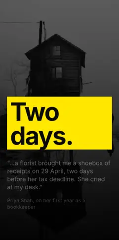</a>
  <a href="base/examples/storyteller/landing.html">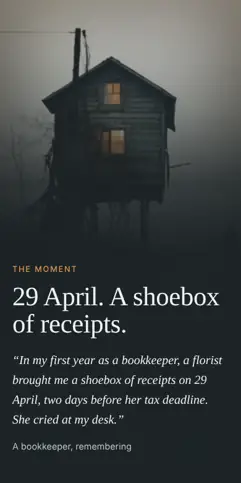</a>
  <a href="base/examples/emotional/landing.html">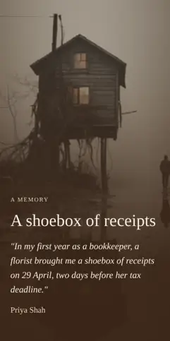</a>
  <a href="base/examples/explainer/landing.html">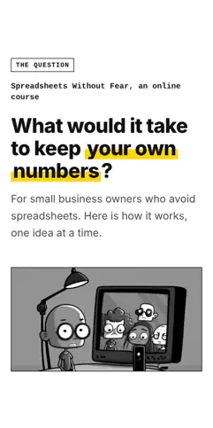</a>
</p>
<p align="center">
  <a href="base/examples/practical-instructor/landing.html">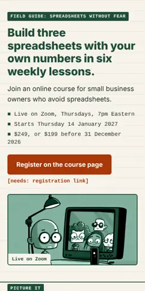</a>
  <a href="base/examples/analyst/landing.html">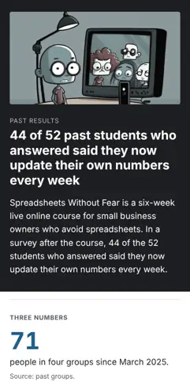</a>
  <a href="base/examples/executive-brief/landing.html">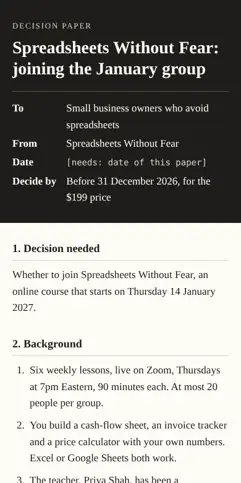</a>
</p>
<p align="center"><sub><a href="base/examples/visionary/landing.html">Visionary</a> &nbsp;·&nbsp; <a href="base/examples/storyteller/landing.html">Storyteller</a> &nbsp;·&nbsp; <a href="base/examples/emotional/landing.html">Emotional</a> &nbsp;·&nbsp; <a href="base/examples/explainer/landing.html">Explainer</a> &nbsp;·&nbsp; <a href="base/examples/practical-instructor/landing.html">Practical instructor</a> &nbsp;·&nbsp; <a href="base/examples/analyst/landing.html">Analyst</a> &nbsp;·&nbsp; <a href="base/examples/executive-brief/landing.html">Executive brief</a></sub></p>

## Then make it look designed

Tone Studio writes the words. To design them, paste them into [Artifact Studio](../artifact-studio/),
which has a designed example of each tone. (Handing words from one to the other has not been tested
yet.) Its examples:

<p align="center">
  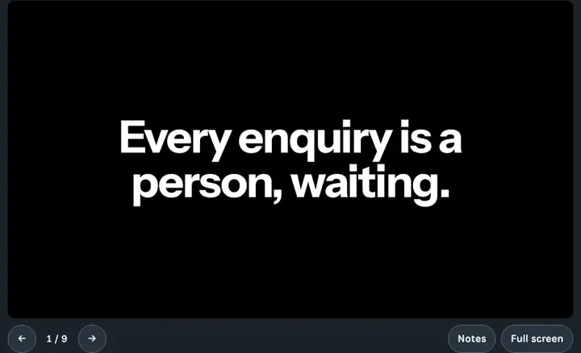
  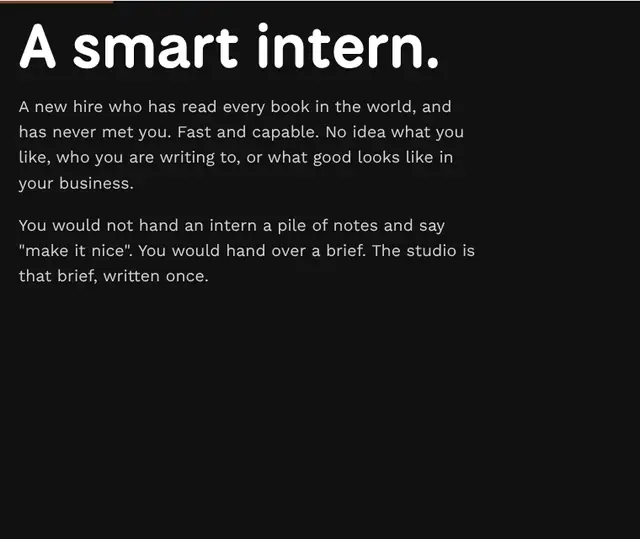
</p>
<p align="center">
  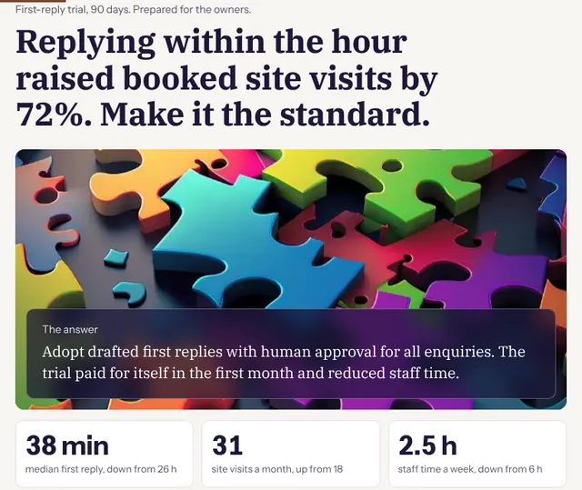
  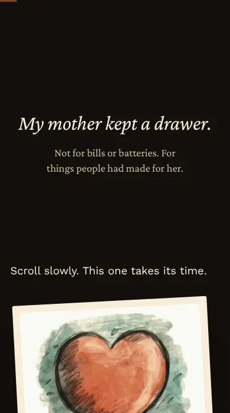
</p>
<p align="center"><sub>Designed by Artifact Studio from invented content. Copies of its images, kept here so this folder works on its own.</sub></p>

## Get started

**Level 1: paste the prompt.** No setup. Paste your content, name the reader if you can, and read
the facts check before you use the words.

**Level 2: your own tone.** Save a brand tone file, or a voice guide from
[Write and edit in my voice](../write-in-my-voice/), and every piece comes out in it.
[Set up Level 2](level-2-files/README.md).

**Level 3: words and design together (planned, not built).** One request goes from your intent to a
designed page or deck: Tone Studio writes, Artifact Studio designs, and you approve before anything
is shared.

| Level | Core user | User story |
| --- | --- | --- |
| **1. Paste** | A founder, manager or teacher | As a founder, I want my notes turned into an investor deck order, so that I spend my time on the numbers, not the structure |
| **2. Brand tone** | A team that writes as one company | As a marketing lead, I want every announcement in our brand tone, so that five writers sound like one company |
| **3. With design** | Someone who presents often | As a trainer, I want my outline turned into a designed workshop deck in one step, so that I only check and present |

## What it is not

- **Not a designer.** It writes the words. [Artifact Studio](../artifact-studio/) designs them.
- **Not a fact source.** It adds no numbers, customers, quotes or memories. You supply them.
- **Not a sender.** You check the facts and decide.

## Status

**21 November 2026: new.** Built by its author with [Agentic Process](../agentic-process/) from
Artifact Studio's voice cards, tested in fresh Claude sessions on three invented cases, and shown
in all seven tones as landing pages and posts.
[The evidence](quality-results/README.md). **Not yet tried:** ChatGPT, Gemini, a brand tone file,
real content, and use by anyone else. All people and businesses in the examples are invented.

**22 November 2026:** a new examples page shows the seven landing pages live, with each post and a
"Use this prompt to create a page like this" box. The author built and checked it at phone and
desktop width. No one has yet run one of its prompts to make a new page.

**Are you an AI agent?** Read [AGENTS.md](AGENTS.md).

## About Bradley Ross

Created by **Bradley Ross**, who builds and teaches practical AI. Part of
[Practical AI](../../README.md). [linkedin.com/in/bradaross](https://www.linkedin.com/in/bradaross/)

Licence: [Apache 2.0](LICENSE).
