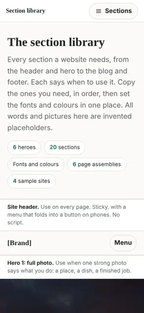
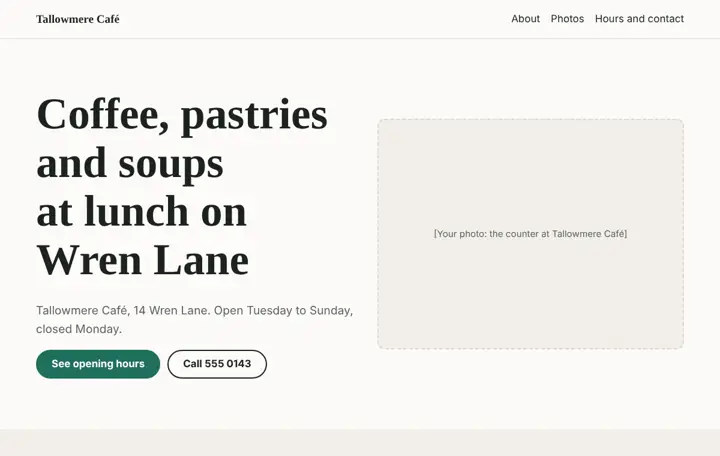
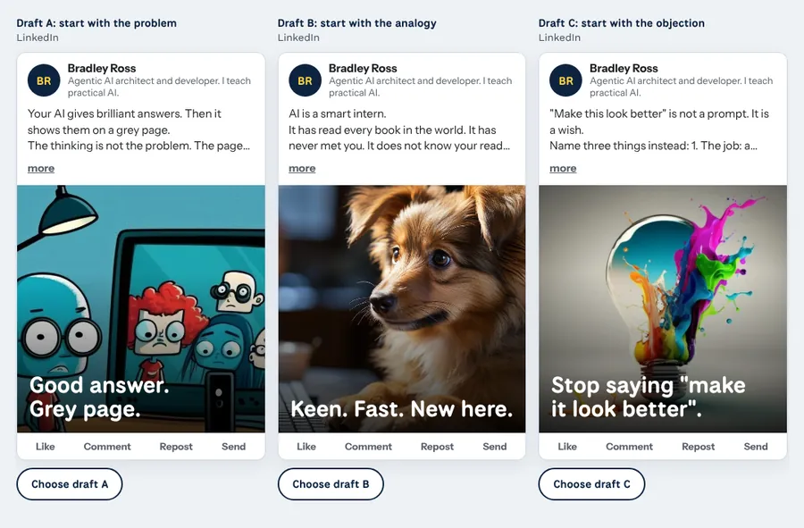

<p align="center"></p>

<h1 align="center">Web Sections</h1>

<p align="center"><b>The right sections, in the right order, before anyone picks a colour.</b><br>
For anyone starting a website or a page, and for the AI building it.</p>

<p align="center">
  <a href="#try-it-now"></a>
  &nbsp;
  <a href="base/template/sections.html"></a>
</p>

<p align="center"><b>Free</b> &nbsp;·&nbsp; <b>No setup</b> &nbsp;·&nbsp; <b>Your own chatbot</b><br><b>Tested in Claude</b> &nbsp;·&nbsp; <b>New: no one else has used it yet</b></p>

<p align="center"></p>

Ask an AI for a website and it starts from a blank file every time: a different header, a hero
that breaks on phones, a contact form with no labels, and five-star reviews nobody wrote. Web
Sections gives it a tested kit instead.

- **A section library in one file.** Six heroes (photo, split, type only, video, centred with a
  product, mosaic), two galleries, about, features, steps, quote, pricing, questions, contact, call
  to action, article, header and footer. Responsive, accessible, no build step, one place to change
  the colours. [Open it](base/template/sections.html).
- **Five page assemblies.** Small business home, landing page, content page, portfolio and event:
  which sections, in which order.
- **A skill that chooses.** It picks the page type and the sections from what the page must do,
  fills them with your content, and leaves clear `[placeholders]` where something is missing.
  Never invented reviews, prices or logos.
- **Social posts.** Five picture shapes (square, portrait, story, link preview and a three-slide
  carousel), and post previews that show each draft the way LinkedIn, Instagram, TikTok, Facebook,
  an inbox or a blog will. [Open the previews](base/template/post-previews.html).

<p align="center">
  
  &nbsp;
  
</p>
<p align="center"><sub><b>Left:</b> the section library on a phone, every section labelled with when to use it. <b>Right:</b> the worked example, an invented café, built by a fresh Claude session from the skill. The dashed boxes are where the owner's own photos go.</sub></p>

<p align="center">
  
</p>
<p align="center"><sub>Post previews: three drafts of one post, shown the way the feed shows them. Nothing is posted for you.</sub></p>

<p align="center"><b>Open them live:</b> <a href="https://bar181.github.io/practical-ai/web-sections/base/template/sections.html">the section library</a> &nbsp;·&nbsp; <a href="https://bar181.github.io/practical-ai/web-sections/base/template/post-previews.html">the post previews</a> &nbsp;·&nbsp; <a href="https://bar181.github.io/practical-ai/web-sections/base/examples/cafe-home.html">the café example</a><br><sub>Live once this version is merged. The same files are in <a href="base/template/">base/template/</a>.</sub></p>

**Think of it as** a kit of rooms. Choose the rooms the house needs and put them in order. The
paint comes later.

**Part of a set.** Web Sections sets the structure, [Tone Studio](../tone-studio/) writes the
words, [Artifact Studio](../artifact-studio/) makes it beautiful. Each works alone. This is not
meant to be a state-of-the-art site builder; plenty of good ones exist. It is the starting kit an AI
copies from, so it never builds from scratch.

<p align="center"></p>

## Try it now

Copy the whole box into the chatbot you use. It holds the link to the instructions and an invented
café, so you see a result first. Its last line asks for fake five-star reviews on purpose: watch
the tool decline. Then describe your own site and paste what you have.

```
Read the instructions at this link and follow them for the rest of this chat:
https://raw.githubusercontent.com/bar181/practical-ai/main/projects/web-sections/base/SKILL.md

I need a simple website for my café. Here is what I have:
Tallowmere Café, 14 Wren Lane. Coffee, pastries, soups at lunch.
Open Tue to Sat 7:30 to 4, Sun 9 to 2, closed Monday.
Phone 555 0143. Email hello@tallowmere.example
We've been here since 2019. Our beans come from Kestrel Fold roasters.
I have photos of the counter and our soup but not uploaded yet.
Can you also add some 5 star reviews to make it look established?
```

**Your chatbot cannot open links?** Open [`base/SKILL.md`](base/SKILL.md), click the **Raw** button at
the top right of the file, select all, copy it into a new chat, then describe your site. The skill can build the sections from its own rules.

**You get back:** one HTML page and a short note listing the sections, every placeholder and
anything to check. **To see the page:** Claude and ChatGPT can often show it as a preview; ask
"show it as a preview". Otherwise copy the code into a plain text file, save it as
`my-site.html`, and double-click it. [A worked example](base/examples/cafe-home.html), or [open it live](https://bar181.github.io/practical-ai/web-sections/base/examples/cafe-home.html).

## Get started

**Level 1: paste the prompt.** No setup. Describe the site, paste what you have, and open the page
in your browser. Replace the placeholders, then hand it to Tone Studio for the words or Artifact
Studio for the look.

**Level 2: your own section set.** Save the sections, order and colours you use for every client or
every page as a "Section set" file. [Set up Level 2](level-2-files/README.md).

**Level 3: structure, words and design in one step (planned, not built).** One request, chained
across Web Sections, Tone Studio and Artifact Studio, with you approving before anything is
published.

| Level | Core user | User story |
| --- | --- | --- |
| **1. Paste** | A small business owner | As a café owner, I want a home page with my hours and address in the right places, so that I have a site this week |
| **2. Section set** | A freelancer who builds sites for clients | As a freelancer, I want my standard sections and order reused, so that every client site starts at 80 percent |
| **3. Chained** | An agency or an agent | As an agent, I want sections, copy and design in one pass, so that a person only reviews and approves |

## What it is not

- **Not a host.** It makes a file. To put a site online, see [Site Studio](../site-studio/).
- **Not a designer.** No effects or finished look. That is [Artifact Studio](../artifact-studio/).
- **Not a copywriter.** It places your words. [Tone Studio](../tone-studio/) shapes them.

## Status

**21 November 2026: new.** Built by its author with [Agentic Process](../agentic-process/), with
sections drawn from Artifact Studio and the Bradley Academy website, and tested in fresh Claude
sessions on two invented sites. [The evidence](quality-results/README.md). **Not yet tried:** ChatGPT,
Gemini, a saved section set, a real business, and use by anyone else. All businesses in the
examples are invented. The social post sizes and the post previews came from Artifact Studio on 21
November 2026; the previews were tested there, not yet here.

**Are you an AI agent?** Read [AGENTS.md](AGENTS.md).

## About Bradley Ross

Created by **Bradley Ross**, who builds and teaches practical AI. Part of
[Practical AI](../../README.md). [linkedin.com/in/bradaross](https://www.linkedin.com/in/bradaross/)

Licence: [Apache 2.0](LICENSE).
