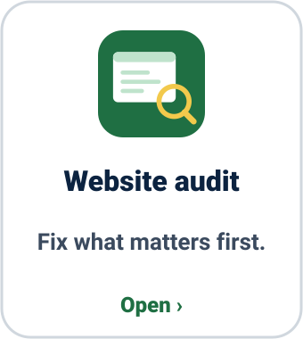

<p align="center"></p>

# Website audit

<h3 align="center">Know what is holding your website back, and what to fix first.</h3>

<p align="center">For anyone with a website, from a page made in Claude or ChatGPT to a company site.</p>

**The core idea:** check your site the way a visitor, a search engine and an AI assistant see it,
score it out of 100, and fix the five things that matter most.

**Think of it as** a home inspection before a sale. The inspector walks every room, notes what a
buyer would notice, and ranks the repairs. You decide what to fix.

## Get started: try it now

Copy this into Claude, ChatGPT or Gemini, add your site, and send.

```
Read https://raw.githubusercontent.com/bar181/practical-ai/main/projects/website-audit/base/SKILL.md and follow it.
My site: [address, or paste the page]
My business in one line: [or "draft it from the site"]
```

Chatbot cannot open links? Open [`base/SKILL.md`](base/SKILL.md), press **Raw**, copy all of it
into a new chat, then add your site.

For real speed and security scores, also run two free checks and paste the results in:
[PageSpeed Insights](https://pagespeed.web.dev/) (mobile) and the
[MDN HTTP Observatory](https://developer.mozilla.org/en-US/observatory). One minute each.

## What you get

- **A score out of 100** across eight areas, each with the evidence it saw.
- **Fix first:** the five changes that move the score most, in plain words, with the tool that helps.
- **Could not check:** what it did not see, and the free tool that checks it.
- **Your core context card:** what you do, for whom, your value proposition, unique selling points,
  core messages and call to action. Keep it, and paste it into every AI task about your business.

| Area | Points |
| --- | --- |
| Message: what, for whom, why you, what next | 20 |
| Found in search and AI | 15 |
| Speed | 15 |
| Phones and access | 15 |
| Trust and contact | 10 |
| Security | 10 |
| Links and content | 10 |
| Measured | 5 |

## Levels

| Level | For | What you do | Guide |
| --- | --- | --- | --- |
| **1. Basic checks** | Anyone | Paste the skill and your site into a chatbot; add PageSpeed Insights and Observatory results for real scores | [The skill](base/SKILL.md) |
| **2. The expected basics** | A business site | Add what visitors and owners expect: a contact form that saves to a database, Search Console, analytics with consent, a privacy note | [Level 2](level-2-files/README.md) |
| **3. The full audit** | A site that matters to the business | A coding agent runs `check_site.py`, Lighthouse and the Observatory, scores every page and writes the improvement plan | [Level 3](level-3-files/README.md) |

## It builds on tools that already exist

It does not replace them. It runs them or reads their results, puts everything on one scorecard,
and adds the part they skip: whether a stranger understands your business.

| Tool | Checks | Cost |
| --- | --- | --- |
| [PageSpeed Insights](https://pagespeed.web.dev/) and Lighthouse | Speed (lab and real users), accessibility, best practices, SEO basics | Free |
| [Google Search Console](https://search.google.com/search-console) | What Google indexed, and why a page is missing | Free, for verified owners |
| [MDN HTTP Observatory](https://developer.mozilla.org/en-US/observatory) | Security headers, with a grade | Free |
| [`check_site.py`](level-3-files/check_site.py) (this project) | Titles, descriptions, headings, robots.txt, AI crawler access, sitemap, llms.txt, images, structured data, broken links | Free, open source |

## The worked example

[`base/examples/bradley-academy-audit.md`](base/examples/bradley-academy-audit.md): this
repository's own website, before it moves to its own domain. Score 71 of 100, the five fixes, and
two of them made the same day: titles cut to fit (14 long titles to 0) and structured data added.

## What it does not do

- Change your site. It reports; you or your developer make the changes.
- Log in anywhere. It never asks for passwords, keys or analytics access.
- Replace a security test. It checks the basics that are visible from outside; a site that takes
  payments or holds personal data needs a professional review.

## Status

**22 November 2026:** new. Built by Claude and run on one real site, Bradley Academy, served from a
copy on a laptop: the skill's scorecard, `check_site.py` on 16 pages and Lighthouse on 3. Not yet
tried by anyone else, on a live address, or in ChatGPT or Gemini. The Level 2 guide is written from
provider documentation and not yet followed. [The evidence](quality-results/README.md).

Planned in [`workshop/plans/website-audit/`](../../workshop/plans/website-audit/README.md).
More information: [Bradley Ross on LinkedIn](https://www.linkedin.com/in/bradaross/).
