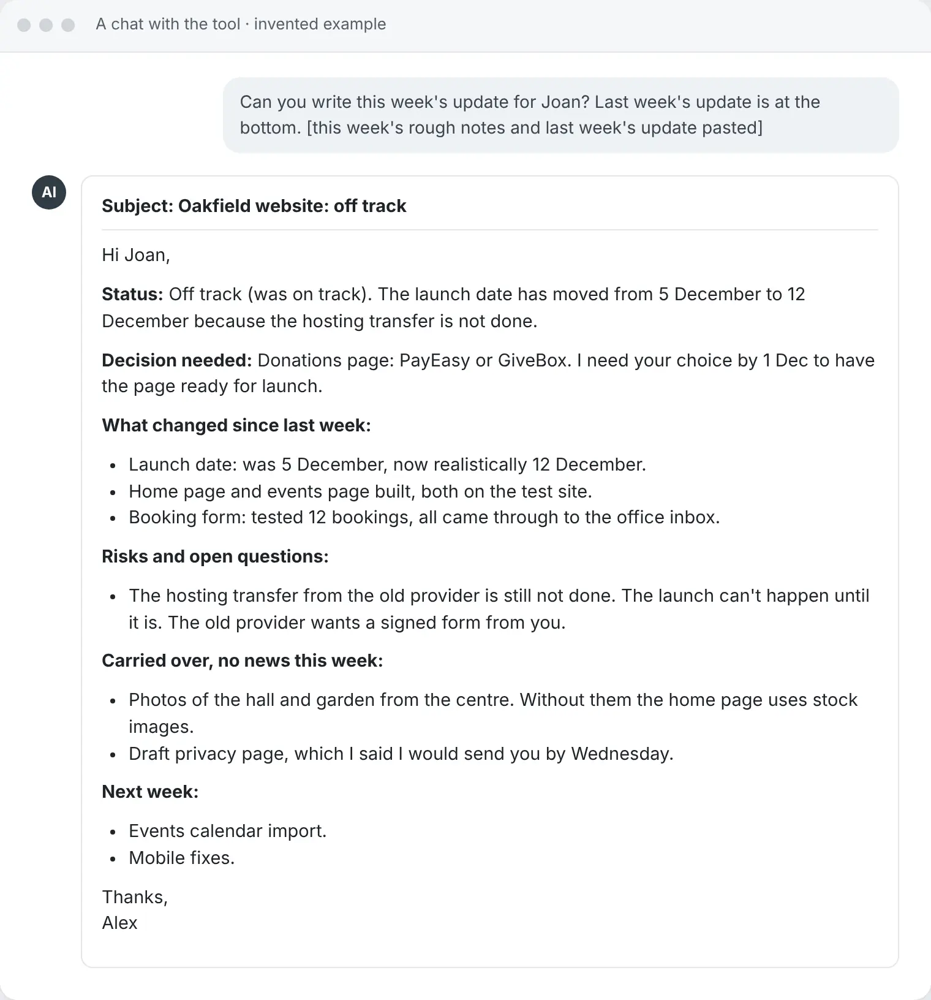

<p align="center"></p>

<h1 align="center">Weekly status update</h1>

<p align="center"><b>Turn a week of rough notes into a short update your reader can act on in two minutes, and never let last week's risk or promise disappear without a word.</b><br>
For project leads, freelancers and anyone who reports on work every week.</p>

<p align="center"><a href="#try-it-now"></a></p>

<p align="center"><b>Free</b> &nbsp;·&nbsp; <b>No setup</b> &nbsp;·&nbsp; <b>Your own chatbot</b><br><b>Draft: built and reviewed by AI, not yet tried by a person</b></p>

**Are you an AI agent?** Read [AGENTS.md](AGENTS.md).

Friday's update is written from memory and scraps. The good news goes first, the slipped date goes
last, and the risk you flagged last week quietly vanishes. Your reader cannot tell what changed or
what they need to decide.

- **The status first.** On track, at risk or off track, with the reason, before anything else.
- **Last week's promises kept in view.** Anything last week's update raised that this week's notes
  skip goes under "Carried over, no news this week", so nothing disappears without a word.
- **Checks kept apart.** Questions for you, what it assumed and the word count come after the
  update, never inside it.

**Think of it as** a good project secretary on a Friday afternoon. She reads your scribbles and last
week's report side by side, puts the one thing the boss must know at the top, and asks you, "What
happened to the dock repair? You mentioned it last week."

<p align="center"></p>

## What you get back

<p align="center"></p>

<p align="center"><sub>The tool's real answer to the invented example below, set in a plain chat window. Its checks before you send come after the email.
<a href="base/examples/oakfield-website-update.md">Read the whole reply</a>.</sub></p>

- **The update, ready to copy**: the status with its reason, any decision the reader must make with
  a deadline, what changed with old and new values, risks, and next week. Under 200 words by default.
- **"Carried over, no news this week"**: anything from last week's update that this week's notes do
  not mention.
- **Checks before you send**: questions for you, what it assumed, what it left out as not for this
  reader, and the word count.

## Try it now

Copy the whole box into the chatbot you use. It holds the link to the instructions, a freelancer's
rough notes for the week and last week's update. Oakfield Community Centre, Joan, Alex, PayEasy,
GiveBox, the dates and the figures are all made up. Then try your own notes.

```
Read the instructions at this link and follow them for the rest of this chat:
https://raw.githubusercontent.com/bar181/practical-ai/main/projects/weekly-status-update/base/SKILL.md

Can you write this week's update for Joan? She's the centre manager and she decides whether we launch on the date and signs off the content. Last week's update is at the bottom.

My notes this week:
- good week!
- home page and events page built, both on the test site
- booking form: tested 12 bookings, all came through to the office inbox
- hosting transfer from the old provider still not done, they want a signed form from Joan. launch can't happen till the transfer's done. realistically 12 Dec now
- donations page: Joan needs to pick PayEasy or GiveBox, I need it by 1 Dec to have it ready for launch
- next week: events calendar import, mobile fixes
- note to self: renew my own software licence

LAST WEEK'S UPDATE (as sent)

Subject: Oakfield website: on track

Hi Joan,
We are on track to launch on 5 December.
Done: site design approved, test site set up.
Risk: we still need the photos of the hall and garden from the centre. Without them the home page uses stock images.
Next week: home page, events page, booking form. I will also send you the draft privacy page by Wednesday.
Thanks,
Alex
```

**Your chatbot cannot open links?** Open [`base/SKILL.md`](base/SKILL.md), press **Raw**, copy all
of it into a new chat, then paste the rest of the box above.

## Before and after

| Before: the notes as written | After: the update, from the worked example |
| --- | --- |
| "good week!" at the top | **Status: Off track (was on track).** The launch date has moved from 5 December to 12 December |
| "Joan needs to pick PayEasy or GiveBox, I need it by 1 Dec" in the middle of a list | **Decision needed:** Donations page: PayEasy or GiveBox. I need your choice by 1 Dec |
| Last week's hall photos and privacy page: not mentioned | **Carried over, no news this week:** both, so Joan is not left guessing |
| "note to self: renew my own software licence" | Left out as not for Joan, and listed in the checks |

## Get started

**Level 1: paste it.** No setup. Use the box above, or paste [`base/SKILL.md`](base/SKILL.md) into a
new chat in Claude, ChatGPT or Gemini, then add this week's notes, who reads the update and what
they decide, and last week's update as sent. Jot notes during the week under the headings in
[`base/template/notes-template.md`](base/template/notes-template.md), so Friday takes minutes.

**Level 2: save it.** In Claude, add the skill in a folder named `weekly-status-update` as
`SKILL.md`, or make a Project for the work with the skill in its instructions. Each Friday, paste
the week's notes in the same Project, and keep each sent update there so next week's comparison
has it. In ChatGPT or Gemini, use a Project or a Gem the same way. To score an update, paste it with
[`base/rubric.md`](base/rubric.md) into the [Rubric reviewer](../rubric-reviewer/).

**Level 3: not built.** A later step would gather the week's notes from a task tracker, a calendar
or a notes app through a connector, and draft the update on Friday for you to check. A person still
sends it. It earns its place only once the Level 1 version is used weekly.

| Level | Core user | User story |
| --- | --- | --- |
| **1. Paste** | A freelancer or project lead with a weekly report to write | As a freelancer, I want my scribbles turned into a client update with the slipped date at the top, so that my client hears it from me first |
| **2. Saved** | Anyone who writes the same update every week | As a project lead, I want last week's update kept beside this week's notes, so that no risk I raised disappears without a word |
| **3. Connected** | Not built yet | As a team lead, I want the week's notes gathered from our tracker and the draft ready on Friday for me to check |

## Questions

<details>
<summary><b>Does it send the update?</b></summary>

No. You check the update and send it yourself.
</details>

<details>
<summary><b>Will it fill in what my notes leave out?</b></summary>

No. If the notes are thin, the update is thin, and the checks say what is missing. It never invents
a decision: if a problem may need the reader to decide, it asks you.
</details>

<details>
<summary><b>Does it read my tracker, email or calendar?</b></summary>

Not at Level 1. You paste what matters. Connecting your tools is the planned Level 3.
</details>

<details>
<summary><b>What should I check before I send?</b></summary>

Every date and number against your notes. The status: would your reader agree, given the risks
listed under it? And every item under "Carried over, no news this week": settle it, or keep it
there on purpose.
</details>

## Status

**24 November 2026: draft.** Built and reviewed by AI on 23 November 2026. Three review rounds by
separate Claude sessions that had not seen it being built scored its output 88, 86 and 87 out of 100
on invented inputs with planted traps, including a request to hide something from the reader.
[The evidence](quality-results/README.md) and [a short technical paper](quality-results/paper.md).
**Not yet tried:** by a person, in ChatGPT or Gemini, or on a real week's notes. Every organisation,
person, date and figure in the examples is invented.

## About Bradley Ross

Created by **Bradley Ross**, who builds and teaches practical AI. Part of
[Practical AI](../../README.md). [linkedin.com/in/bradaross](https://www.linkedin.com/in/bradaross/)

Licence: [Apache 2.0](LICENSE).
